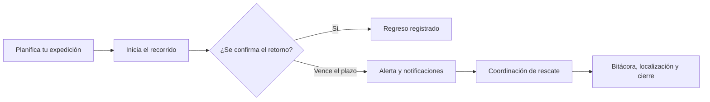
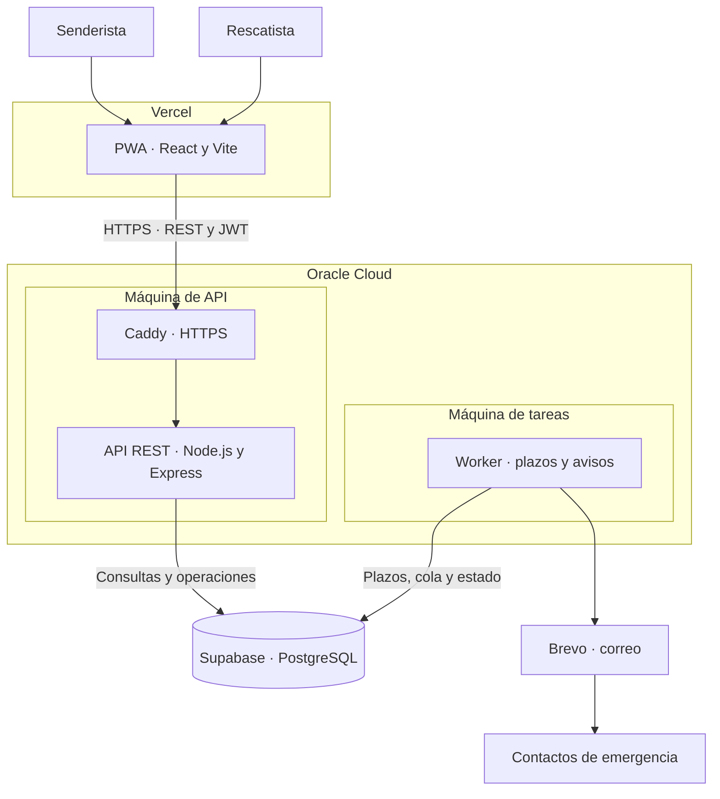

# TrekSafe


**[Explorar la aplicación](https://treksafe-r2.vercel.app)** · **[Ver Release 2](https://github.com/ArianaBlanco06/TrekSafe/releases/tag/v2.0.0)** · **[Documentación](docs/arquitectura/README.md)**

[](https://github.com/ArianaBlanco06/TrekSafe/releases)
[](https://github.com/ArianaBlanco06/TrekSafe/actions/workflows/ci.yml)


TrekSafe conecta la planificación de expediciones, la confirmación de retorno y la coordinación de rescate en una sola plataforma.

El senderista prepara su recorrido y establece cuándo espera regresar. Si vence el plazo sin una confirmación, el sistema genera alertas y pone la información de la expedición a disposición del equipo de rescate para organizar su atención.

> Proyecto académico de la **Universidad de Lima**, desarrollado en continuidad entre Ingeniería de Software 1 e Ingeniería de Software 2.

## Contenido

- [El producto y su valor](#el-producto-y-su-valor)
- [Actores](#actores)
- [Cómo funciona](#cómo-funciona)
- [Capacidades](#capacidades)
- [Stack tecnológico](#stack-tecnológico)
- [Arquitectura de despliegue](#arquitectura-de-despliegue)
- [Estructura del proyecto](#estructura-del-proyecto)
- [Desarrollo local](#desarrollo-local)
- [Despliegue](#despliegue)
- [API e integraciones](#api-e-integraciones)
- [Seguridad y privacidad](#seguridad-y-privacidad)
- [Equipo](#equipo)
- [Documentación y licencia](#documentación-y-licencia)

## El producto y su valor

En una expedición, conocer el destino y la hora prevista de retorno permite identificar cuándo hace falta actuar. Esa información suele quedar dispersa entre conversaciones, contactos personales y registros independientes.

TrekSafe reúne ese recorrido en una experiencia compartida:

- **Antes de salir:** permite organizar la ruta, los acompañantes, el equipo y los contactos de emergencia.
- **Durante la expedición:** supervisa los plazos registrados y permite comunicar avances.
- **Ante una alerta:** ofrece una consola para priorizar casos, asignar responsables y registrar la atención.
- **Al finalizar:** conserva el historial y permite consultar estadísticas y exportar reportes.

La propuesta se centra en el turismo de aventura y las actividades de alta montaña: ayudar al senderista a preparar su salida y al equipo de rescate a trabajar con información organizada y trazable.

## Actores

| Actor | Qué necesita | Qué ofrece TrekSafe |
| --- | --- | --- |
| **Senderista** | Planificar su salida y comunicar su retorno | Gestión de expediciones, rutas, equipo, contactos, avances y confirmación de regreso |
| **Rescatista** | Identificar alertas y coordinar la atención | Consola operativa, mapas, asignación y relevo de responsables, bitácora y cierre de incidentes |
| **Contacto de emergencia** | Recibir información sobre la expedición | Avisos por correo vinculados a las alertas y al retorno; no necesita una cuenta en la aplicación |

El registro de rescatistas utiliza validación contra un padrón institucional. En la demostración académica se emplean registros ficticios; no existe una integración con padrones oficiales.

## Cómo funciona



La confirmación de retorno del senderista y el cierre de un incidente de rescate son acciones distintas: cada una conserva su propio registro.

## Capacidades

### Para senderistas

- Crear, editar, cancelar y reutilizar planes de expedición.
- Definir destinos, horarios, acompañantes y contactos de emergencia.
- Organizar listas de equipo y marcar su preparación.
- Consultar rutas y registrar puntos y avances.
- Ampliar el retorno previsto y confirmar el regreso.
- Gestionar información médica y preferencias de privacidad.
- Preparar borradores con conectividad limitada y revisarlos antes de enviarlos.

### Para rescatistas

- Consultar expediciones y alertas con filtros y prioridades.
- Revisar el recorrido y el último avance disponible.
- Asumir la coordinación y transferirla a otro rescatista.
- Mantener una bitácora cronológica del incidente.
- Registrar la localización y el cierre con su informe.
- Consultar estadísticas y exportar reportes CSV.
- Acceder a información médica cuando se cumplen las condiciones de autorización.

### Para la operación

- Supervisión automática de plazos mediante un worker independiente.
- Procesamiento de avisos con una cola persistente.
- Registro del estado de entrega y reintentos controlados.
- Comprobaciones separadas de salud de la API y disponibilidad operativa.

**Conectividad:** TrekSafe es una PWA instalable. Algunas funciones permiten trabajar con borradores locales, pero el envío de cambios y la coordinación compartida requieren conexión. El monitoreo se basa en los plazos y datos registrados; no realiza seguimiento GPS continuo.

## Stack tecnológico

| Área | Tecnologías |
| --- | --- |
| **Interfaz** | React 18, TypeScript, Vite 6, Tailwind CSS 4 y React Router |
| **Mapas** | Leaflet, React Leaflet y OpenStreetMap |
| **PWA** | Service Worker, Workbox y Vite PWA |
| **API y tareas** | Node.js 22, Express 4 y TypeScript |
| **Persistencia** | PostgreSQL en Supabase, funciones SQL y transacciones |
| **Autenticación y validación** | JWT, bcrypt y Zod |
| **Correo** | Brevo y Nodemailer |
| **Infraestructura** | Vercel, Oracle Cloud, Docker, Caddy y DuckDNS |
| **Calidad** | GitHub Actions, pruebas automatizadas, Playwright y comprobaciones de tipos |

## Arquitectura de despliegue

El frontend se publica en Vercel. La API y el worker se ejecutan en dos máquinas independientes de Oracle Cloud y comparten la base académica de Supabase.



La separación permite atender las solicitudes de la aplicación sin ejecutar las tareas programadas dentro del proceso HTTP. La API y el worker intercambian información mediante la base de datos.

El backend organiza sus responsabilidades en **presentación, aplicación, dominio e infraestructura**, con composición e inyección de dependencias.

## Estructura del proyecto

```text
TrekSafe/
├── frontend/                 # Aplicación web y PWA
│   └── src/
│       ├── pages/            # Pantallas
│       ├── components/       # Componentes de interfaz
│       ├── services/         # Comunicación con la API
│       └── features/         # Funcionalidades de la aplicación
├── backend/
│   ├── src/
│   │   ├── api.ts            # Entrada de la API
│   │   ├── worker.ts         # Entrada de tareas
│   │   ├── presentation/    # Rutas y controladores
│   │   ├── application/     # Casos de uso y servicios
│   │   ├── domain/          # Reglas del negocio
│   │   └── infrastructure/  # Persistencia e integraciones
│   ├── migrations/          # Evolución del esquema
│   └── Dockerfile
├── deployment/oci/          # Configuración de despliegue
├── docs/                    # Guías y documentación técnica
├── .github/workflows/       # Integración continua
└── .env.example             # Referencia de configuración
```

## Desarrollo local

### Requisitos

- Node.js 22 y npm 10 o superior.
- Git.
- Un proyecto Supabase propio para desarrollo, con el esquema preparado según la [guía de instalación de base nueva](backend/migrations/academico/README.md).

### 1. Obtener el proyecto e instalar dependencias

```bash
git clone https://github.com/ArianaBlanco06/TrekSafe.git
cd TrekSafe

npm ci --prefix backend
npm ci --prefix frontend
```

### 2. Configurar el entorno

Copia [`.env.example`](.env.example) a `backend/.env` y completa las credenciales de tu entorno de desarrollo.

Configuración principal:

| Variable del backend | Uso |
| --- | --- |
| `SUPABASE_URL` | Dirección del proyecto de desarrollo |
| `SUPABASE_SERVICE_ROLE_KEY` | Credencial de servidor para persistencia |
| `JWT_SECRET` | Secreto de autenticación propio del entorno |
| `MEDICAL_ENCRYPTION_KEY` | Secreto para cifrar información médica |
| `CORS_ORIGIN` | `http://localhost:5173` |
| `CRON_ENABLED` | `false` para iniciar únicamente la API |

Crea `frontend/.env` con:

```dotenv
VITE_API_URL=http://localhost:3000/api
```

Las claves de servidor permanecen en `backend/.env`. El frontend solo necesita la URL pública de la API.

### 3. Iniciar la aplicación

En una terminal:

```bash
npm run dev:api --prefix backend
```

En otra terminal:

```bash
npm run dev:frontend
```

- **Aplicación:** [localhost:5173](http://localhost:5173)
- **Salud de la API:** [localhost:3000/api/salud](http://localhost:3000/api/salud)

Para probar plazos y avisos, inicia también `npm run dev:worker --prefix backend` en una terminal con `CRON_ENABLED=true` y la configuración de correo correspondiente. Utiliza una base de desarrollo propia y un único worker por entorno.

### Comprobaciones de desarrollo

```bash
npm test --prefix backend
npm run test:equipo --prefix frontend

npm run build:backend
npm run build:frontend
```

## Despliegue

### Entorno académico publicado

| Componente | Plataforma | Acceso |
| --- | --- | --- |
| **Aplicación web / PWA** | Vercel | [Abrir TrekSafe](https://treksafe-r2.vercel.app) |
| **API REST** | Oracle Cloud | [Comprobar salud](https://treksafe-v2.duckdns.org/api/salud) |
| **Worker** | Oracle Cloud | [Comprobar disponibilidad](https://treksafe-v2.duckdns.org/api/disponibilidad) |
| **Base de datos** | Supabase | Acceso desde el backend |
| **Correo** | Brevo | Envío desde el worker |

### Publicar una nueva versión

1. **Validar el código.** GitHub Actions comprueba backend, frontend y persistencia. Los cambios integrados en las ramas principales también pueden publicar la imagen del backend en GHCR.
2. **Publicar el frontend.** Compilar con la URL de la API de destino y desplegar el contenido de `frontend/dist` en el proyecto Vercel correspondiente, conservando la configuración de rutas de `frontend/vercel.json`.
3. **Actualizar API o worker cuando corresponda.** Desplegar la imagen seleccionada en Oracle Cloud si existen cambios en esos componentes.
4. **Comprobar el entorno.** Verificar login, flujos afectados, salud de la API y disponibilidad del worker.

En producción, el frontend utiliza:

```dotenv
VITE_API_URL=https://treksafe-v2.duckdns.org/api
VITE_ACCESO_DEMO=false
```

El despliegue actual de Vercel es **manual**: integrar un PR no actualiza automáticamente la aplicación. El frontend y el backend pueden tener versiones de despliegue distintas, registradas por separado.

El procedimiento de configuración, actualización y recuperación se encuentra en la [guía de despliegue en Oracle Cloud](deployment/oci/README.md).

## API e integraciones

La aplicación utiliza una API REST con prefijo `/api`, cuerpos JSON y autenticación JWT en las operaciones protegidas.

```http
Authorization: Bearer <token>
```

| Área | Ejemplos |
| --- | --- |
| **Estado del sistema** | `GET /api/salud` · `GET /api/disponibilidad` |
| **Autenticación** | `POST /api/auth/registrar-senderista` · `POST /api/auth/registrar-rescatista` · `POST /api/auth/iniciar-sesion` |
| **Perfil y privacidad** | `GET /api/usuario/ficha-medica` · `POST /api/usuario/privacidad/revocar` |
| **Expediciones** | `POST /api/expediciones` · `GET /api/expediciones/activa` · `POST /api/expediciones/:id/confirmar-retorno` |
| **Atención de alertas** | `GET /api/rescate/alertas` · `POST /api/rescate/alertas/:expedicionId/coordinacion` |
| **Reportes** | `GET /api/rescate/estadisticas` · `GET /api/rescate/estadisticas.csv` |

Integraciones principales:

- **Supabase:** persistencia y operaciones transaccionales.
- **Brevo / SMTP:** envío de avisos por correo.
- **OpenStreetMap:** cartografía para los recorridos.

Las rutas y sus controladores se encuentran en [`backend/src/presentation/http`](backend/src/presentation/http).

## Seguridad y privacidad

TrekSafe incorpora controles para proteger las cuentas, las expediciones y la información sensible:

- **Autenticación y autorización:** JWT, roles y comprobaciones de propiedad y responsabilidad.
- **Contraseñas:** almacenamiento mediante hashes bcrypt.
- **Información médica:** cifrado AES-256-GCM y acceso condicionado al responsable vigente, al estado del incidente y al consentimiento.
- **Trazabilidad:** auditoría de acceso médico y registro de las acciones de coordinación.
- **Protección de la API:** validación de entradas, límites en autenticación, cabeceras de seguridad y CORS.
- **Separación de secretos:** credenciales de Supabase, correo y cifrado disponibles únicamente en el servidor.
- **Privacidad de la PWA:** las respuestas privadas de la API no se almacenan para uso offline y los datos locales privados se limpian al cerrar sesión.
- **Gestión de datos:** consentimiento y funciones para solicitar la revocación de datos personales.

El esquema utiliza RLS restrictivo. Como el backend opera con credenciales privilegiadas, la autorización también se aplica en sus casos de uso y operaciones de base de datos.

La demostración académica utiliza cuentas y padrones ficticios. Las credenciales de prueba se comparten por canal privado.

## Equipo

### Release 2 · Ingeniería de Software 2

| Integrante | Rol |
| --- | --- |
| Marko Antonio López Bernuy | Product Owner |
| Ariana Belen Blanco Quintana | Scrum Master |
| Sebastián Ricardo Chapman López | Developer |
| Favio Antonio Chavarry Minaya | Developer |
| Andriy Hitoshi Enciso Rojas | Developer |
| Fernando Jesús Quispe Gámez | Developer |
| Jhon Raúl Romero Berto | Developer |

**Docente:** Hernán Alejandro Quintana Cruz

**Universidad de Lima · Ingeniería de Sistemas**

<details>
<summary>Equipo de Release 1 · Ingeniería de Software 1</summary>

| Integrante | Rol |
| --- | --- |
| Marko Antonio López Bernuy | Product Owner |
| Ariana Belen Blanco Quintana | Scrum Master |
| Manuel Rodrigo Llaury Murga | Developer |
| Pedro Leonardo Ormeño Moquillaza | Developer |
| Yahel Jair Cordova Amez | Developer |

**Docente:** Jorge Luis Irey Nuñez

</details>

## Documentación y licencia

- [Arquitectura y decisiones técnicas](docs/arquitectura/README.md)
- [Despliegue y operación](deployment/oci/README.md)
- [Instalación de una base nueva](backend/migrations/academico/README.md)
- [Migraciones de base de datos](backend/migrations/README.md)
- [Aceptación de Release 2](docs/cierre-r2/acta-aceptacion.md)
- [Historial de versiones](https://github.com/ArianaBlanco06/TrekSafe/releases)

Proyecto académico desarrollado en la Universidad de Lima. El repositorio no incluye actualmente una licencia open source.

<sub>Portada generada con IA, inspirada en la Cordillera Blanca de Huaraz, Perú.</sub>
