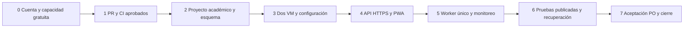

# Roadmap del PO: despliegue académico R2 sin recursos de pago

Estado al preparar el paquete: **no publicado**. El PO todavía no tiene cuenta Oracle Cloud. No existen aquí URLs nuevas, proyectos nuevos ni una aceptación atribuida al PO. El objetivo es separar API y worker en dos VM Always Free y conservar evidencia suficiente para resolver #107–#112. La ejecución cloud es manual del PO; los agentes preparan, prueban y revisan estos archivos.



| Paso | Acción del PO | Condición para avanzar / evidencia |
|---|---|---|
| 0 | Crear cuenta Oracle, seleccionar región principal y comprobar capacidad | Cuenta activa; **dos** AMD `VM.Standard.E2.1.Micro` marcadas Always Free, sin cambio a cuenta de pago ni shapes sustitutos |
| 1 | Revisar PR, solicitar la revisión independiente exigida y esperar CI | Commit integrado exacto, checks verdes, imagen GHCR privada y digest registrados |
| 2 | Crear Supabase Free académico separado y aplicar esquema | Sin datos/usuarios DEV; inventario inicial vacío, orden completo, ledger hasta 032 y permisos comprobados |
| 3 | Crear y configurar las dos VM, sin arrancar worker | 2 × 1 GB RAM, Ubuntu 24.04 LTS x86, 2 × 50 GB boot; configuración por rol y secretos separados |
| 4 | Publicar API HTTPS y PWA | DuckDNS/Caddy, CORS exacto, Vercel deployment/commit registrado; `/salud` responde y `/disponibilidad` aún puede estar degradado |
| 5 | Reconciliar legado, activar exactamente un worker y monitores | Heartbeat de ambos ciclos y pendientes dentro de umbral; API operativa independiente del worker |
| 6 | Ejecutar aceptación y fallos controlados | Matriz por criterio, correo recibido comprobado, persistencia/reinicio, consumo y recuperación registrados |
| 7 | Resolver bloqueantes y firmar acta con evidencia | Solo cerrar tareas satisfechas y luego release; despliegue, aceptación y cierre son eventos distintos |

## 0. Cuenta y capacidad Always Free

El PO realiza el alta en [Oracle Cloud Free Tier](https://www.oracle.com/cloud/free/) con sus propios datos y la verificación que exija Oracle. No comparte contraseña, tarjeta, códigos ni claves con agentes. Una autorización temporal del medio de pago durante el alta no acredita consumo cloud: revisar lo que muestre el proceso y detenerse si propone una contratación no prevista.

En la **región principal**, buscar dos AMD `VM.Standard.E2.1.Micro` Always Free, Ubuntu 24.04 LTS compatible x86, 1 GB RAM cada una. Seleccionar **50 GB por boot volume** (100 GB total de los 200 GB gratuitos compartidos); conservar el resto para recuperación dentro del cupo. Confirmar también IP pública incluida por VM, VCN/subred y reglas. API y worker pueden usar IP pública para salida a Supabase/Brevo; no agregar NAT Gateway de pago. El worker no abre puertos de aplicación.

No elegir flex pagado, A1 como sustituto automático, balanceador, IPv4 de Supabase de pago, snapshots adicionales ni tamaños mayores. Si no existe capacidad gratuita para ambas VM, registrar el bloqueo y parar antes de crear recursos de pago. Verificar etiquetas Always Free y estimador de costo para cada recurso; guardar captura sin datos personales. Los presupuestos y alertas no constituyen un límite duro de facturación. No actualizar a Pay As You Go para resolver falta de capacidad.

Oracle puede reclamar instancias gratuitas inactivas según su ventana de siete días y métricas; no hay SLA académico. No generar carga artificial para evitarlo. Supabase Free puede pausar tras una semana de inactividad y no incluye backups automáticos. La disponibilidad se observa; no se promete continuidad 24/7 con estos planes. [Límites Oracle oficiales](https://docs.oracle.com/en-us/iaas/Content/FreeTier/freetier_topic-Always_Free_Resources.htm), [Supabase Free](https://supabase.com/pricing).

## 1. Código e imagen que se van a publicar

La rama debe pasar backend, frontend y PostgreSQL/PostgREST. El PR también construye la imagen amd64 sin acceder a secretos ni publicarla. Solo un push a `develop` o `main`, después de esas tres validaciones, puede publicar en GHCR. El workflow no crea ni actualiza VM. Hace una comprobación de visibilidad privada antes y después de publicar; si no puede acreditarla, **no usar el resultado como imagen autorizada para despliegue**.

La revisión obligatoria del repositorio requiere otro integrante; no se sustituye por la autorrevisión del PO. Obtener el SHA completo integrado y el artefacto CI `imagen-academica-<SHA>/imagen.txt`. Usar `ghcr.io/<propietario-en-minusculas>/treksafe-r2-academico@sha256:<digest>`, nunca `latest`. La etiqueta OCI `org.opencontainers.image.revision` debe coincidir con ese SHA. GHCR indica almacenamiento y transferencia de contenedores gratuitos actualmente; revisar esa condición antes de publicar. Los minutos/artefactos Actions tienen límites propios, y el artefacto de identidad se conserva siete días: guardar su copia en el expediente. [Facturación GHCR](https://docs.github.com/en/billing/concepts/product-billing/github-packages).

El paquete académico usa el nombre nuevo `treksafe-r2-academico`: el paquete anterior `treksafe-r2` es público y bloqueó la publicación integrada. GitHub no permite volver privado un paquete público. El workflow verifica la visibilidad del paquete nuevo antes y después de publicar; si aún no existe, el primer push lo crea privado por defecto y la comprobación posterior debe confirmarlo antes de guardar el artefacto de identidad. El preflight de las VM rechaza el nombre anterior incluso con un digest válido. [Visibilidad de paquetes](https://docs.github.com/en/packages/learn-github-packages/configuring-a-packages-access-control-and-visibility).

Para descargar un paquete privado en cada VM, usar una cuenta GitHub autorizada y un token clásico limitado a `read:packages`; introducirlo por `docker login ghcr.io --username <usuario>` en el prompt, no en comandos, documentos ni logs. Guardar la configuración Docker root con permisos restringidos y revocar el token al terminar si deja de necesitarse. Las VM no compilan Node ni clonan `.env` de DEV.

## 2. Proyecto Supabase académico y esquema

1. Confirmar cupo de **dos proyectos activos gratuitos** en la cuenta/organización. Crear uno nuevo en Free y región cercana a las VM. No actualizar el plan ni pausar/borrar DEV para hacer espacio sin una decisión expresa del responsable.
2. Registrar referencia, región y plan. Mantener DEV `ibnwggvqgjpeqcretjak` fuera de los archivos académicos; el preflight rechaza ese host. No copiar datos, fichas médicas, usuarios, JWT, clave de cifrado ni credenciales desde DEV.
3. Confirmar que `public` no contiene objetos TrekSafe antes de ejecutar el [bootstrap vacío y su orden de instalación](../../backend/migrations/academico/README.md).
4. Aplicar los **36 archivos separados**, en el orden canónico: bootstrap; 000–007; los dos HU30 fechados; 008–014; 016–019; 021; 015; 022–024; 020; 025–032. No usar orden alfabético, `init_schema.sql`, ni una transacción exterior que agrupe 004 y 005. Parar ante el primer error y conservar cada resultado. La ruta real del bootstrap desde la raíz es `backend/migrations/academico/bootstrap_vacio.sql`.
5. Verificar asientos, RLS, permisos y funciones, incluidos los verificadores de [032](../../docs/cierre-r2/paquete-032/README.md). El esquema académico no se considera listo por rellenar `SCHEMA_VERSION=032`.
6. Registrar cuentas ficticias mediante flujos normales con contraseñas propias. Antes del primer registro, cargar únicamente los dos registros institucionales de prueba indicados abajo; no hay usuarios semilla con contraseñas conocidas en el bootstrap. Autorizar solo destinatarios de correo controlados por el equipo.

**DEV conserva su gestión propia:** 032 sigue pendiente de que Ariana la aplique y verifique allí; este plan no ejecuta DDL contra DEV. El proyecto académico necesita sus propias claves JWT/cifrado y `service_role` solo en API/worker. El backend usa HTTPS Data API/RPC, así que no necesita un addon IPv4 ni conexión SQL permanente. Para backup/restauración, usar el pooler de sesión compatible IPv4 si la conexión directa no está disponible; los datos de conexión no se publican.

### Padrón ficticio previo al registro de los dos rescatistas

El PO comprueba el nombre/ref del **proyecto académico nuevo en la consola y URL Supabase** y guarda fuera de Git una copia del siguiente bloque con esa ref y un identificador de sesión elegido por él. Ejecutar solo cuando no hay usuarios ni padrón cargados, antes de registrar las 12 cuentas. La ref declarada en SQL es una confirmación manual, no una verificación automática de host (`current_database()` suele ser `postgres` en ambos proyectos). Las guardas de vaciedad y 032 complementan esa comprobación y abortan sobre el DEV actualmente poblado. No modificar las guardas para reejecutarlo sobre una base ya usada.

```sql
DO $$
DECLARE
  proyecto_confirmado text := 'REEMPLAZAR_REF_ACADEMICA_VERIFICADA';
  sesion_ficticia text := 'REEMPLAZAR_ID_SESION';
BEGIN
  IF proyecto_confirmado LIKE 'REEMPLAZAR%' OR proyecto_confirmado = '' OR
     proyecto_confirmado = 'ibnwggvqgjpeqcretjak' OR
     sesion_ficticia LIKE 'REEMPLAZAR%' OR
     sesion_ficticia !~ '^[A-Za-z0-9_-]{1,25}$' THEN
    RAISE EXCEPTION 'CONFIRMAR_PROYECTO_ACADEMICO_Y_SESION_FICTICIA';
  END IF;
  IF EXISTS (SELECT 1 FROM public.usuarios) OR
     EXISTS (SELECT 1 FROM public.registros_institucionales_rescatista) OR
     NOT EXISTS (SELECT 1 FROM public.treksafe_migraciones WHERE version='032') THEN
    RAISE EXCEPTION 'REQUIERE_BASE_ACADEMICA_VACIA_CON_032';
  END IF;
  INSERT INTO public.registros_institucionales_rescatista
    (institucion, numero_credencial, nombre_completo, fecha_nacimiento, esta_activo)
  VALUES
    ('AGMP', 'ACADEMICO-R2-' || sesion_ficticia || '-1',
     'Persona Ficticia TrekSafe Uno', DATE '1990-01-01', true),
    ('MINCETUR', 'ACADEMICO-R2-' || sesion_ficticia || '-2',
     'Persona Ficticia TrekSafe Dos', DATE '1991-02-02', true);
END $$;
```

Estos registros son inequívocamente **FICTICIOS**, no acreditaciones reales de AGMP/MINCETUR. Guardar las dos credenciales elegidas en el registro privado de fixtures; el PO registra luego ambos rescatistas mediante el flujo normal usando exactamente esos datos y contraseñas individuales seguras. Este bloque no crea usuarios ni contraseñas, no es una migración y no se ha ejecutado remotamente. Tras las pruebas, conservar únicamente el tiempo necesario los fixtures académicos y limpiar con el procedimiento autorizado del entorno, sin borrar DEV.

## 3. VM y archivos por rol

En OCI permitir ingreso TCP 22 **solo desde la IP pública actual del PO** en ambas VM. API permite además TCP 80/443 al público; no abrir 3000. Worker mantiene únicamente SSH y ninguna regla HTTP. Comprobar NSG/security lists y firewall Ubuntu: una regla en uno no corrige el otro. Mantener una sesión SSH abierta mientras se revisan cambios para evitar bloquearse. No exponer el socket Docker ni dar acceso al grupo Docker a cuentas no administradoras.

Instalar Docker Engine y Compose **>=2.30.0** desde la [guía Ubuntu oficial](https://docs.docker.com/engine/install/ubuntu/), Python3 y CA certificates. No pegar scripts de instalación no revisados ni fijar versiones desde un blog. Copiar este directorio desde el **commit aprobado** a `/opt/treksafe/deployment/oci` en cada VM; no copiar `node_modules`, `outputs`, `.env` históricos ni el repositorio con datos locales. Los scripts Python se ejecutan por intérprete, y el script shell mediante `/bin/bash`.

Preparar `/etc/treksafe` con propietario root, modo 700. Copiar `deployment.env.example` como `deployment.env`; en cada VM copiar solo su `api.env.example` o `worker.env.example` al nombre sin `.example`. Los tres archivos van root:root, modo **600**. Editar localmente en la VM; nunca versionarlos ni publicar su contenido. Generar secretos aleatorios independientes con un gestor de contraseñas o `openssl rand -hex 32`; conservar la clave médica para poder recuperar las fichas creadas con ella.

| Campo | Valor que completa el PO |
|---|---|
| `TREKSAFE_IMAGE` | Digest privado verificado del CI; igual en ambas VM |
| `DEPLOYMENT_COMMIT` | SHA completo que coincide con la etiqueta de imagen |
| `CADDY_IMAGE` | `caddy@sha256:…` de imagen oficial descargada y registrada; solo API |
| `API_HOST` / `ACME_EMAIL` | Subdominio DuckDNS elegido y correo operativo ACME |
| `OCI_ALWAYS_FREE_CONFIRMED` | `true` solo después de comprobar los recursos reales y cuotas |
| `SUPABASE_URL` / `SUPABASE_SERVICE_ROLE_KEY` | Proyecto académico nuevo, solo servidor |
| `JWT_SECRET` / `MEDICAL_ENCRYPTION_KEY` | Nuevas claves académicas compartidas entre API y worker |
| `PUBLIC_APP_URL` / `CORS_ORIGIN` | Mismo origen HTTPS Vercel definitivo, sin ruta/query/credenciales |
| `CRON_ENABLED` | API `false`; worker `true` |
| `MAIL_DEV_FALLBACK` | `false` en ambos |
| `BREVO_API_KEY` / `SMTP_FROM` | Solo worker: API key académica y remitente verificado en Brevo |

Mantener intervalos del perfil: plazos 60 s, outbox 15 s, lote 1, heartbeat máximo 180 s, atraso pendiente 600 s. Las VM de 1 GB limitan cada proceso a 512 MB, heap Node 320 MB, logs 3 × 5 MB. Caddy usa 128 MB; estos son **límites configurados**, no consumo observado. Medir RAM, CPU, disco y latencia después de publicar; si no alcanza, reducir carga de demostración o registrar bloqueo, sin contratar otro shape automáticamente.

Antes de iniciar systemd descargar ambas imágenes por digest con `sudo docker pull <digest>`. Para obtener y fijar Caddy oficial: `sudo docker pull caddy:2`, consultar `sudo docker image inspect caddy:2 --format '{{index .RepoDigests 0}}'` y copiar el digest; registrar fecha/versión, revisar actualizaciones antes de usarlas. El pull no construye código ni activa servicios. Ejecutar `sudo bash /opt/treksafe/deployment/oci/preflight.sh api` en API o `worker` en su VM; el preflight no imprime secretos y contrasta revisión de imagen local. No comprueba por sí solo facturación, aplicación SQL, remitente verificado ni credenciales remotas.

## 4. DuckDNS, HTTPS y frontend

Crear cuenta/subdominio gratuito en [DuckDNS](https://www.duckdns.org/) y guardar el token solo en `/etc/treksafe/duckdns.env` (root:root 600). El subnombre debe coincidir con `API_HOST`. Instalar las unidades `treksafe-duckdns.service` y `.timer` en `/etc/systemd/system`, ejecutar `sudo systemctl daemon-reload`, iniciar una actualización y habilitar el timer. Consultar estado/journal sin imprimir el token; el actualizador tiene timeout de 15 s y emite mensajes genéricos.

Instalar **solo** `treksafe-api.service` en la VM API. Con las imágenes y archivos preparados:

```bash
sudo systemctl daemon-reload
sudo systemctl enable --now treksafe-api.service
sudo systemctl status treksafe-api.service
curl --fail --max-time 10 https://<API_HOST>/api/salud
```

Caddy obtiene/renueva certificados automáticamente al estar correctos DNS, puertos y almacenamiento persistente `caddy_data`/`caddy_config`. Mantener esos volúmenes en actualizaciones; no usar `docker compose down -v`. `/api/disponibilidad` devuelve 503 hasta que el worker y sus dos ciclos acrediten salud; un `/salud` 200 solo prueba la API. [HTTPS automático Caddy](https://caddyserver.com/docs/automatic-https).

En Vercel seleccionar **Hobby** para este uso académico y repositorio autorizado. Root Directory `frontend`, build `npm run build`, output `dist`. Fijar `VITE_API_URL=https://<API_HOST>/api` en el entorno publicado **antes del build**; no poner `service_role`, Brevo, JWT_SECRET o claves médicas en variables `VITE_*`. Desplegar el commit aprobado y registrar deployment ID y Git SHA que muestre Vercel. Confirmar el dominio definitivo y actualizar ambos orígenes backend si cambió; reiniciar API y luego worker de forma controlada. [Hobby](https://vercel.com/docs/plans/hobby), [variables Vercel](https://vercel.com/docs/environment-variables).

## 5. Correo, worker único y monitoreo

En [Brevo Free](https://help.brevo.com/hc/en-us/articles/208580669-FAQs-What-are-the-limits-of-the-Free-plan), verificar remitente propio y cuota disponible; Free indica 300 correos/día, con otros envíos que también consumen cuota. Autorizar la IP saliente si la cuenta exige allowlist. No simular entrega ni sustituir automáticamente por `dev-log`. Aceptación por proveedor y recepción en buzón son pruebas distintas. Usar destinatarios controlados y el máximo de 20 correos de la aceptación académica.

Antes de habilitar el worker confirmar que no existe otro cron/worker activo sobre el mismo proyecto. API debe tener `CRON_ENABLED=false`; `main.ts` no es una entrada de producción. Revisar el inventario de expediciones en alerta sin outbox y pendientes legados según el dossier operativo, sin reenviar manualmente ni borrar evidencia para obtener verde. La sonda se degrada ante alertas sin outbox, fallidos/inciertos o pendientes fuera de plazo. Documentar/reconciliar cada caso antes del go/no-go.

Instalar **solo** `treksafe-worker.service` en su VM; después:

```bash
sudo systemctl daemon-reload
sudo systemctl enable --now treksafe-worker.service
sudo systemctl status treksafe-worker.service
curl --fail --max-time 10 https://<API_HOST>/api/disponibilidad
```

La primera señal requiere terminar ambos ciclos. Consultar logs por contenedor y el verificador privado de estado; la sonda pública solo revela operativo/degradado. Dar hasta 180 s por heartbeat antes de investigar, no ocultar 503. Worker espera trabajo en curso al detenerse, con margen de 150 s en Compose y 180 s en systemd; evitar apagar la VM forzosamente durante un envío.

Crear monitores **UptimeRobot Free** cada **5 minutos** sobre `/api/salud`, `/api/disponibilidad` y PWA. No introducir datos médicos ni tokens en monitores. Destino de notificación: cuenta del PO; no enviar avisos a otros miembros sin instrucción. Un monitor de cinco minutos no garantiza detección inmediata. Guardar las alertas reales y resolución; no confundir el heartbeat de 180 s con frecuencia externa. [Límites del monitor Free](https://help.uptimerobot.com/en/articles/11604710-who-should-use-uptimerobot-s-free-plan).

## 6. Validación publicada y recuperación

Completar `publicado.manifest.example.json` fuera de Git con las URLs **reales**, commit de 40 caracteres y esquema verificado; el runner rechaza valores vacíos, localhost o HTTP. Conservar también `registro-publicacion.example.json`: contrastar deployment Vercel/SHA, imagen descargada/digest/etiqueta y ledger Supabase. Un manifiesto rellenado por el PO **no demuestra por sí solo** qué código o esquema ejecuta una URL.

Seguir [protocolo integral](../../docs/cierre-r2/protocolo-aceptacion.md), [PWA y runner](../../docs/cierre-r2/pwa-validacion.md) y matriz. Las rutas desde la raíz son `docs/cierre-r2/…`; la aceptación debe cubrir los 75 criterios, las seis tareas TECH y regresiones R1 pertinentes, no solo los dos smokes de lectura. Usar 10 senderistas y 2 rescatistas ficticios durante 15 min, observación 30 min y máximo 20 correos controlados, ajustando los datos necesarios a cada caso. No ejecutar carga contra DEV compartido.

En el clon del **commit aprobado**, las credenciales ficticias van solo en variables del proceso como indica el dossier PWA. Fijar `TREKSAFE_PUBLICADO_MANIFIESTO` a la ruta absoluta del JSON completado y ejecutar primero `npm run test:publicado:lectura --prefix frontend`. Después, configurar los dos opt-ins y las tres cuentas ficticias del dossier y ejecutar `npm run test:publicado --prefix frontend`. Guardar resultados sanitizados, URLs, fecha, SHA y evidencia de recepción sin cabeceras privadas/tokens. El manifest no se pasa como argumento posicional a Playwright.

Ensayos controlados que el PO registra antes de aceptar:

1. **Worker detenido:** detener servicio en su VM. API `/salud` sigue 200 y disponibilidad pasa 503 al caducar heartbeat. Producir un pendiente con datos ficticios mientras el worker está detenido; comprobar que persiste. Reiniciar y comprobar resultado/estado sin duplicación lógica. No cerrar la API para simular este caso.
2. **API reiniciada:** conservar worker y DB; reiniciar API y comprobar sesión/consulta tras recuperación, sin pérdida de outbox.
3. **Proveedor indisponible/resultado incierto:** ejecutar fixture seguro del protocolo o simulación local previamente acreditada. No revocar credenciales compartidas, enviar a direcciones ajenas ni forzar reenvíos ciegos. Registrar límites de duplicados; los inciertos requieren conciliación autorizada antes del reintento HU46.
4. **PWA:** dos roles/cuentas, logout, offline/reconexión, versión obsoleta, deep link privado desde correo, mapa en dominio real y acceso médico rechazado sin autorización. La evidencia local con SW no acredita automáticamente el dominio publicado.
5. **Recuperación:** antes de la demo hacer backup manual cifrado del proyecto académico (datos y esquema propios), registrar herramienta/versiones y ensayar restauración **solo en base desechable**, verificando conteos, ledger y un pendiente controlado. Mantener por separado la clave de cifrado de fichas. No subir backups ni secretos a Git/Drive público. Supabase Free no aporta backup automático del que se pueda depender.

Para retroceder aplicación: guardar digest/manifest anterior; detener worker, comprobar que la versión anterior soporta el esquema aditivo y estados actuales, cambiar **solo** digest y SHA coherentes en ambas VM, descargar imagen, ejecutar preflight y `docker compose ... up -d --no-build --pull never` (o parar/iniciar la unidad systemd), comprobar API, luego activar un worker. El esquema 032 es aditivo pero eso no acredita cualquier versión histórica: no volver a un cron que envíe directo y compita con la outbox. No borrar tablas/asientos ni ejecutar un down SQL destructivo. Si no puede acreditarse compatibilidad, mantener el bloqueo y corregir hacia delante.

Diagnóstico: `/salud` caído → DNS/TLS/Caddy/API/puertos; salud 200 y disponibilidad 503 → 032/proyecto, ciclos, heartbeat, pendientes, fallidos/inciertos o alertas sin outbox; envío aceptado sin buzón → proveedor/remitente/allowlist/spam/recepción, sin afirmar entrega. Consultar métricas `docker stats --no-stream`, disco `df -h`, CPU/RAM OCI y latencias del protocolo. Registrar valores observados y presupuesto restante; no usar los límites configurados como medición.

## 7. Cierre de asignaciones PO y release

Resolver defectos bloqueantes, acreditar cada criterio con entorno y fuente y firmar el acta fechada. #107 puede quedar técnicamente revisada con CI integrado; #108 mantiene el gate real de esquema por entorno (incluida Ariana en DEV). #109 necesita correo real controlado; #110 consumo/URLs/recuperación; #111 dominio real/PWA/privacidad; #112 aceptación integral y recepción. Cerrar únicamente las tareas cuyos criterios estén satisfechos y después registrar el cierre de Sprint 2/Release 2. No sustituir un pendiente publicado con una casilla marcada en GitHub.

El índice [cierre R2](../../docs/cierre-r2/README.md) reúne las evidencias.
