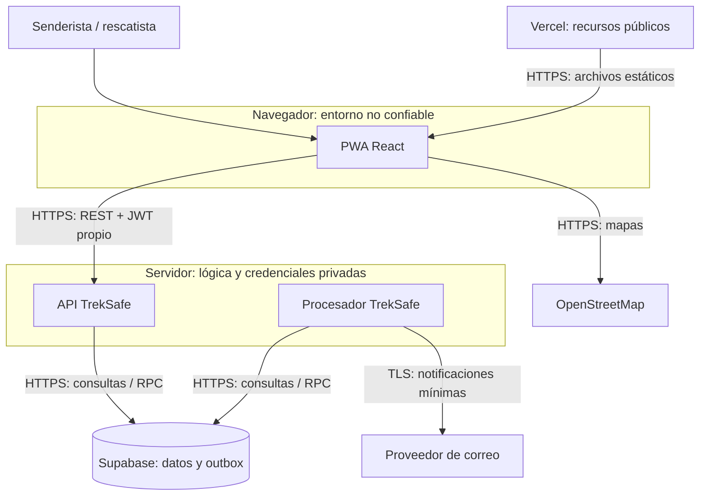
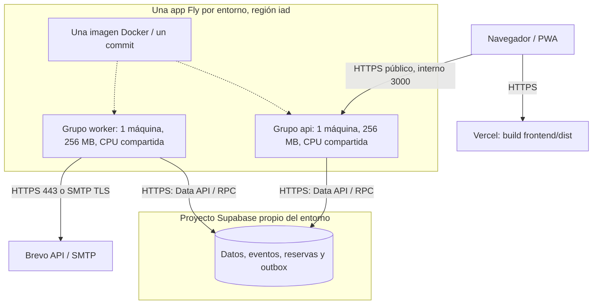
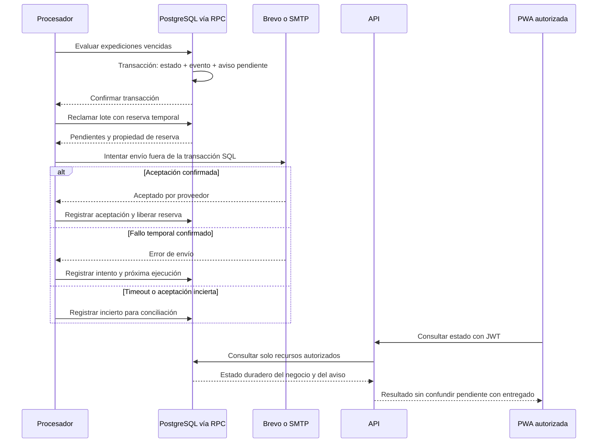

# Arquitectura objetivo

**Estado: diseño aprobado para implementación en DEP-02 a DEP-06.** Base y comprobaciones: [estado actual](estado-actual.md). Decisiones: [registro](decisiones.md).

## Contexto y límites de confianza

[Vista SVG](diagramas/arquitectura-objetivo-1.svg). La base valida actor, propiedad y transacciones a través de los contratos del backend/RPC; el navegador nunca recibe `service_role`. API y procesador son programas distintos del mismo sistema, con privilegios de servidor: separarlos no crea aislamiento de credenciales dentro de una misma app Fly.

## Despliegue por entorno

[Vista SVG](diagramas/arquitectura-objetivo-2.svg). Las conexiones representan acceso a través de la Data API de Supabase, no SQL directo por HTTPS. El `worker` no tendrá servicio HTTP público ni dependerá de peticiones de usuarios para continuar. Ambos grupos permanecerán activos. Se dimensiona inicialmente una máquina por grupo; los despliegues pueden necesitar capacidad temporal adicional.

## Componentes, entradas y resultados

| Componente | Responsabilidad y entrada | Resultado y persistencia | Límite / responsable |
|---|---|---|---|
| PWA | Formularios, mapas, sesión y sincronización permitida | Peticiones REST, interfaz y borradores autorizados por sesión | Sin claves de servidor; #111 |
| Vercel | Distribuir build estático por HTTPS | HTML, JS, CSS y Service Worker públicos | `VITE_API_URL` se incorpora al compilar; #110 |
| API | Autenticar JWT, autorizar y ejecutar casos de uso | JSON y cambios transaccionales con eventos/pendientes | Sin temporizadores ni envíos directos de flujos migrados; #107/#109 |
| Procesador | Evaluar plazos/recordatorios y reclamar pendientes | Cambios de estado, avisos y resultados de despacho | Reservas persistentes, reintento y recuperación; #109 |
| PostgreSQL / Data API | Guardar datos, aplicar restricciones, transacciones y exclusión concurrente | Estado duradero entre procesos y reinicios | Tablas/RPC privadas; #108 |
| Brevo/SMTP | Intentar transmisión de mensajes mínimos | Aceptación, fallo o resultado incierto | Aceptado no equivale a recibido; #109/#112 |
| OpenStreetMap | Proveer teselas usadas por Leaflet | Imágenes de mapa | La consulta no necesita enviar fichas ni contactos; dependencia externa de interfaz; #111 |
| GitHub Actions | Verificar cambios antes de publicar | Resultados y artefactos de validación | El CI actual no acredita CD; publicación en #110 |

Los datos médicos permanecen cifrados en la base y se descifran en el servidor después de autorizar y verificar consentimiento/responsable. La outbox y los logs tampoco deben contener fichas médicas; el correo objetivo proporciona un enlace a la aplicación con autorización vigente, sin tokens de acceso incrustados. Estos son requisitos pendientes, no garantías del código base.

## Secuencia objetivo de una alerta

[Vista SVG](diagramas/arquitectura-objetivo-3.svg). El mismo principio se aplica a retorno seguro y avisos que requieran persistencia. Los recordatorios in-app se guardan como avisos; no todo aviso exige correo. Se conservan las reglas de cada HU.

Una interrupción antes del commit revierte estado y pendiente; después del commit deja el pendiente recuperable. Un envío aceptado seguido de caída antes de registrar el resultado puede quedar ambiguo. La reserva y la clave de evento reducen concurrencia/duplicación interna, pero no garantizan una sola entrega externa. Ver [contratos](contratos-y-operacion.md).
