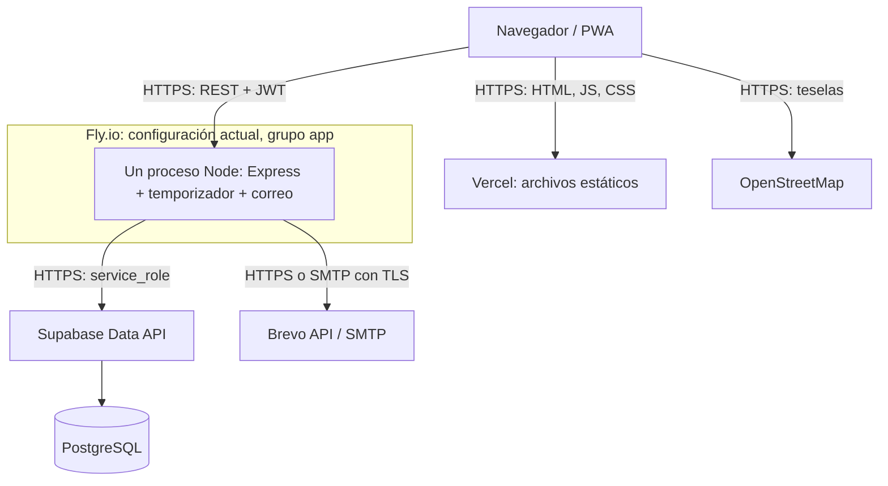

# Estado actual y línea base

Consulta: **2026-11-10, aproximadamente 15:09–15:20 Lima / 20:09–20:20 UTC**. Alcance: repositorio, metadatos GitHub, consultas de solo lectura a Supabase DEV y dos URLs históricas. No se consultaron filas de usuarios, fichas médicas ni credenciales.

## Revisiones y propuestas

| Referencia | Revisión / estado observado | Alcance acreditado |
|---|---|---|
| `main` | `f89d6afa8454ffe89090c868233ab678a0ffc19c` | Referencia histórica de código; no identifica automáticamente un despliegue |
| `develop` | `8508bb449fe731342834a528327fa40b15a83b94` | Base de esta documentación |
| [PR #103](https://github.com/ArianaBlanco06/TrekSafe/pull/103) | Integrado, 2026-11-10 20:05 UTC | Conciliación documental de asientos 002, 003 y HU-30 en DEV |
| [PR #104](https://github.com/ArianaBlanco06/TrekSafe/pull/104) | Integrado como `982bf1b`, 2026-11-10 20:03 UTC | Cancelación cuando la salida pasa mientras se espera un bloqueo |
| [PR #90](https://github.com/ArianaBlanco06/TrekSafe/pull/90) | Abierto; `c7614b191a24440dfd01d7624b3229f7c30d902f` | Propuesta HU-45, outbox y procesador |
| [PR #93](https://github.com/ArianaBlanco06/TrekSafe/pull/93) | Abierto; `e701a1eace3b36678a30fdc7d516dae6e79fe394` | Propuesta HU-44, avisos de retorno vía outbox |
| [PR #94](https://github.com/ArianaBlanco06/TrekSafe/pull/94) | Abierto; `7804f9be3c9d21ed5c0b4e1147011314b7075978` | Propuesta HU-46, seguimiento y reintento manual |
| [PR #105](https://github.com/ArianaBlanco06/TrekSafe/pull/105) | Abierto; `5c436c80e5404a06938d0e372a6a2cb08f024dbb` | Propuesta HU-39, coordinación de incidentes |

Los estados son una fotografía, no una lista permanente. Revalidarlos al integrar las siguientes issues.

## Topología definida en la base

[Vista SVG](diagramas/estado-actual-1.svg). El diagrama representa el código/configuración del commit base, **no un inventario de máquinas efectivamente publicadas**.

| Componente | Fuente del repositorio | Hecho comprobado en código/configuración |
|---|---|---|
| PWA | [package.json](../../frontend/package.json), [vite.config.ts](../../frontend/vite.config.ts), [vercel.json](../../frontend/vercel.json) | React 18, Vite 6, TS 5, Tailwind 4, Router 7; build estático `dist`; navegación SPA; Workbox |
| API y arranque | [main.ts](../../backend/src/main.ts), [app.ts](../../backend/src/presentation/http/app.ts) | API y cron arrancan en el mismo proceso; comprueba DB al iniciar; puerto 3000 y prefijo `/api` |
| Runtime | [Dockerfile](../../backend/Dockerfile), [fly.toml](../../backend/fly.toml) | Imagen Node 22 Debian Bookworm Slim, dos etapas, usuario `node`; grupo `app`, `iad`, 256 MB y 1 CPU compartida; suspensión automática desactivada; mínimo 1 máquina configurada |
| Datos | [supabase.ts](../../backend/src/infrastructure/database/supabase.ts), [pool.ts](../../backend/src/infrastructure/database/pool.ts) | SDK Supabase por HTTPS con `service_role`; pool `pg` opcional sin llamadas a `getPool()` encontradas fuera de su definición |
| Tareas | [cronFechaLimiteExpedicion.ts](../../backend/src/infrastructure/jobs/cronFechaLimiteExpedicion.ts) | Tick inmediato y `setInterval`, predeterminado 60 s; `CRON_ENABLED` predetermina `true`; sin exclusión explícita de ciclos superpuestos |
| Correo | [ServicioCorreo.ts](../../backend/src/infrastructure/email/ServicioCorreo.ts) | Prioridad Brevo API → SMTP → `dev-log` sin credenciales; comprobar configuración Brevo no prueba envío ni recepción |
| Sesión y offline | [sesion.ts](../../frontend/src/lib/sesion.ts), [offlineStorage.ts](../../frontend/src/lib/offlineStorage.ts) | JWT propio en `sessionStorage`; recursos públicos y borradores/plantillas permitidos por ámbito de sesión; API privada por red |
| CI | [ci.yml](../../.github/workflows/ci.yml) | Tipos, pruebas y compilación; no contiene publicación a Fly/Vercel |
| Secretos | [.env.example](../../.env.example), [set-fly-secrets.ps1](../../backend/scripts/set-fly-secrets.ps1) | Plantilla sin valores reales; script histórico importa configuración a la app fija `treksafe-api`; no transmite `CRON_ENABLED` |

La separación por carpetas existe, pero parte de `application` importa infraestructura directamente. El objetivo de inversión de dependencias sigue en [#107](https://github.com/ArianaBlanco06/TrekSafe/issues/107).

## Verificación de servicios y esquema

| Destino / método | Observación | Límite de la evidencia |
|---|---|---|
| `https://treksafe-app.vercel.app`, GET directo con acceso de red | HTTP 404 | La URL histórica no sirvió la aplicación en esta consulta; no identifica otro dominio ni el estado de la cuenta Vercel |
| `https://treksafe-api.fly.dev/api/salud`, GET directo | Error de resolución de host | Disponibilidad y revisión de API no verificadas; no demuestra una caída global de Fly |
| Fly/Vercel autenticados | CLI no encontrada y sin conector pertinente disponible | No se pudieron comprobar inventario, secretos, facturación ni revisión publicada |
| GitHub Deployments, hasta 5 registros recientes | Respuesta sin registros | No acredita ausencia de despliegues externos o manuales |
| Supabase, `list_projects` autenticado | Solo se devolvió `treksafe-dev-r2`, región `us-east-2`, `ACTIVE_HEALTHY`, PostgreSQL 17 (`17.11.0.011`) | Solo describe proyectos visibles para esta conexión; producción académica no identificada |
| Supabase, `list_migrations` | Dos registros iniciales: `20261102031915`, `20261102032432` | El registro propio de TrekSafe se consulta por separado |
| Supabase DEV, SELECT a `treksafe_migraciones` | 18 asientos: `000`–`014`, `016`, `hu30_listas`, `hu30_operaciones` | Acredita asientos administrativos; no es una nueva prueba funcional ni validación integral del esquema |

Las fechas de los asientos 002, 003 y HU-30 corresponden a **conciliación** del 2026-11-10 14:12 UTC, no a la instalación original. Ver [registro de aplicación](../../backend/migrations/REGISTRO_APLICACION.md) y [esquema inicial DEV](../../backend/migrations/dev-r2/README.md). No se reejecutó DDL.

## Brechas que condicionan la transición

1. **Fallo entre estado y aviso:** el cron actual cambia a alerta y luego envía. Un reinicio intermedio puede dejar la expedición en alerta sin aviso recuperable; no hay outbox integrada en esta base.
2. **Outbox propuesta:** en el PR #90, `main.ts` todavía arranca API, cron y procesador juntos. El encolado se hace después del cambio de estado mediante llamadas separadas; falta garantizar una transacción común. Sus contadores devuelven encolados como `enviados`/`registrados`, por lo que no son prueba de entrega.
3. **Numeración:** ese PR aún contiene `012_hu45_outbox.sql`; `012` ya pertenece a HU-36. El README de migraciones reserva `015` para HU-45. #108/#109 deben reconciliar nombre, registro y dependencias antes de aplicar SQL; renombrar no acredita instalación.
4. **Privacidad médica:** el servicio actual de aviso a rescate consulta e incluye ficha médica en el contenido. La restricción de responsable y el aviso sin datos médicos se verifican con HU-50 / #52, #109 y #111.
5. **Arranque/configuración:** una API separada no debe iniciar temporizadores ni depender de credenciales SMTP para servir HTTP; `CRON_ENABLED=false` debe fijarse explícitamente para API y DEV. No reutilizar ciegamente el script histórico entre entornos.

Estas brechas se documentan como trabajo pendiente. #106 no las corrige ni vuelve a cerrar las HU históricas.
