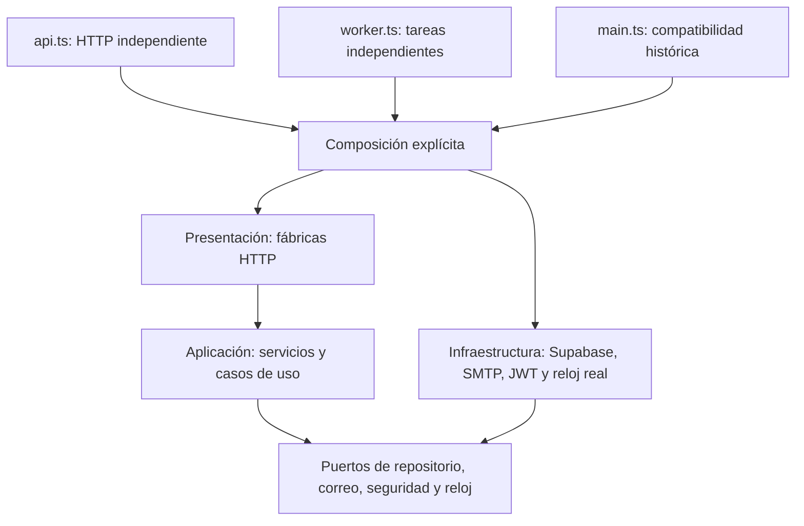

# DEP-03 / #107 — API y tareas con composición independiente

Responsable: Marko Antonio Lopez Bernuy (PO). Base de entrega: `develop` en `3b61042beb2265a4b38d2e2bc9427e410a65ae1e`, con HU-39, el diseño de [issue #106](https://github.com/ArianaBlanco06/TrekSafe/issues/106) integrado mediante [PR #113](https://github.com/ArianaBlanco06/TrekSafe/pull/113), y el registro DEV de 017/018. La implementación y las pruebas comenzaron sobre `68f2440`; la actualización de base incorporó únicamente documentación y registro.

Esta entrega separa ensamblaje y ejecución. No cambia rutas, JWT, códigos HTTP, reglas de expediciones ni coordinación de incidentes. No cambia SQL ni publica máquinas. La persistencia transaccional se integra desde #108; outbox y recuperación de despachos corresponden a #109.

## Arquitectura de dependencias implementada



- `infrastructure/composicion` es la única convención de ensamblaje; se retiró `infrastructure/composition/puntosRuta.ts` y se actualizaron sus consumidores.
- Los servicios históricos de autenticación, usuario, expediciones, rescate, alertas, bandeja y recordatorios reciben puertos. Aplicación y dominio no importan Supabase, Express, correo o implementaciones de infraestructura.
- Los puertos de aplicación conservan las formas históricas necesarias para la compatibilidad, incluidas filas de lectura de expediciones y rescate. Las operaciones nuevas no deben usar los adaptadores concretos como contratos.
- Los controladores son fábricas y las rutas permiten inyectar servicios. `createApp(dependencias)` acepta configuración, routers y lector de salud, sin ensamblar Supabase o correo cuando se proporcionan dependencias.
- Los formateadores de mensajes son funciones puras de aplicación; sus rutas de importación históricas se conservan mediante reexportaciones.

## Entradas y configuración

| Comando después del build | Comportamiento |
|---|---|
| `npm run start:api --prefix backend` | `dist/api.js`: verifica DB, inicia HTTP y registra señales. No verifica SMTP ni inicia temporizadores |
| `npm run start:worker --prefix backend` | `dist/worker.js`: si `CRON_ENABLED=true`, verifica DB/correo e inicia tareas; no abre un servidor HTTP |
| `npm start --prefix backend` | `dist/main.js`: entrada histórica con API y cron juntos, conservada hasta cambiar el despliegue en #110 |
| `npm run dev:api --prefix backend` | API mediante `tsx watch` |
| `npm run dev:worker --prefix backend` | Tareas mediante `tsx watch`; revisar destino antes de habilitar el cron |

Las entradas inicializan el entorno explícitamente. Importar un módulo ya no carga `backend/.env`; `loadEnv()` valida las variables ya presentes y `inicializarEntorno()` realiza la carga del archivo. Se conserva la prioridad histórica del archivo `.env` cuando se llama a esa inicialización. Los scripts operativos de base/correo/alertas la invocan explícitamente; no se ejecutaron contra servicios reales para verificar este cambio.

`CRON_ENABLED` mantiene su valor histórico por omisión (`true`). En desarrollo compartido fijar `false`; la API independiente no llama al cron incluso cuando la variable es `true`. El worker con `false` no comprueba DB/correo ni crea temporizadores y termina sin trabajo activo. La configuración por grupo Fly y el cambio de su comando de arranque pertenecen a #110.

El worker aún ejecuta los flujos históricos de plazos, recordatorios y envío directo. No consume automáticamente la outbox propuesta en PR #90. La restricción de acceso médico y la retirada de la ficha del correo se integran en las issues funcionales relacionadas y #109/#111; esta refactorización conserva los contenidos existentes.

## Ciclo de vida y fallos

- API y worker exponen una parada asíncrona idempotente. Las señales se registran solo al ejecutar la entrada como programa principal.
- La API cierra su servidor y recursos. Un error de DB, construcción HTTP o puerto ocupado libera recursos sin cerrar servidores ajenos.
- El scheduler inicia un ciclo inmediato y conserva el intervalo existente. Si un ciclo sigue pendiente, no inicia otro. La parada cancela futuros ciclos y espera el trabajo en curso antes de cerrar recursos.
- Los errores del ciclo actualizan la señal de salud y permiten recuperarse en el siguiente ciclo. Esa señal sigue siendo memoria de proceso: no certifica la salud de otro worker o recepción de correo.
- La entrada compatible detiene ambos programas y cierra los recursos compartidos incluso si una parada falla. Un fallo de SMTP sigue afectando al arranque compatible según la configuración histórica; la entrada API independiente no depende de esa verificación.

## Verificación y aceptación

Ejecutar desde la raíz, con Node.js 22 y dependencias fijadas instaladas:

```powershell
npm run typecheck --prefix backend
npm test --prefix backend
npm run build --prefix backend
```

| Criterio #107 | Evidencia |
|---|---|
| Casos de uso dependen de contratos | Prueba estática de límites y ausencia de imports de infraestructura en aplicación/dominio |
| API y tareas se construyen independientemente | `api.ts`, `worker.ts`, scripts explícitos, mismo build TypeScript |
| Dependencias sustituibles sin servicios compartidos | Pruebas de reloj fijo, repositorios, correo simulado y aplicación HTTP inyectada |
| Compatibilidad y regresión | Suite backend existente, roles/JWT y coordinación HU-39; compilación y verificaciones pertinentes |
| Módulos, deuda y comandos documentados | Este documento, archivos de composición y pruebas reproducibles |

Pruebas específicas: `infrastructure/ejecucion/arranque.test.ts`, `importaciones.test.ts`, `jobs/cronFechaLimiteExpedicion.test.ts`, `application/services/desacoplamiento.test.ts` y `presentation/http/composicionInyectada.test.ts`.

Los tests de importación se ejecutan en un proceso sin credenciales e instrumentan lectura de `.env`, conexiones HTTP, temporizadores y señales. Las pruebas de arranque cubren apagado desactivado, fallos previos a la escucha, puerto ocupado, parada repetida y trabajo pendiente. Los tests HTTP usan datos ficticios y loopback. Los tests de transporte no envían correos.

Resultado local del 2026-11-11 con **Node 22.23.4**: verificación de tipos aprobada, **556 pruebas aprobadas**, build aprobado y diagrama Mermaid renderizado. Las suites PostgreSQL condicionadas a variables de integración no se activan por este comando; la validación SQL y conjunta con #108 se registra por separado. La ejecución usó acceso a servidores locales de prueba, sin cron contra DEV ni correo real.

## Límites y trabajo siguiente

Los recursos de Fly y sus comandos ejecutables siguen con la configuración anterior hasta #110. #108 cambia la creación del adaptador a RPC sobre esta misma firma. #109 integrará reclamación, reservas, reintentos y resultado incierto de outbox. #110 añadirá señales persistentes entre procesos; #112 acreditará la versión publicada. Esta entrega no declara esas tareas terminadas ni aplica migraciones a DEV.
