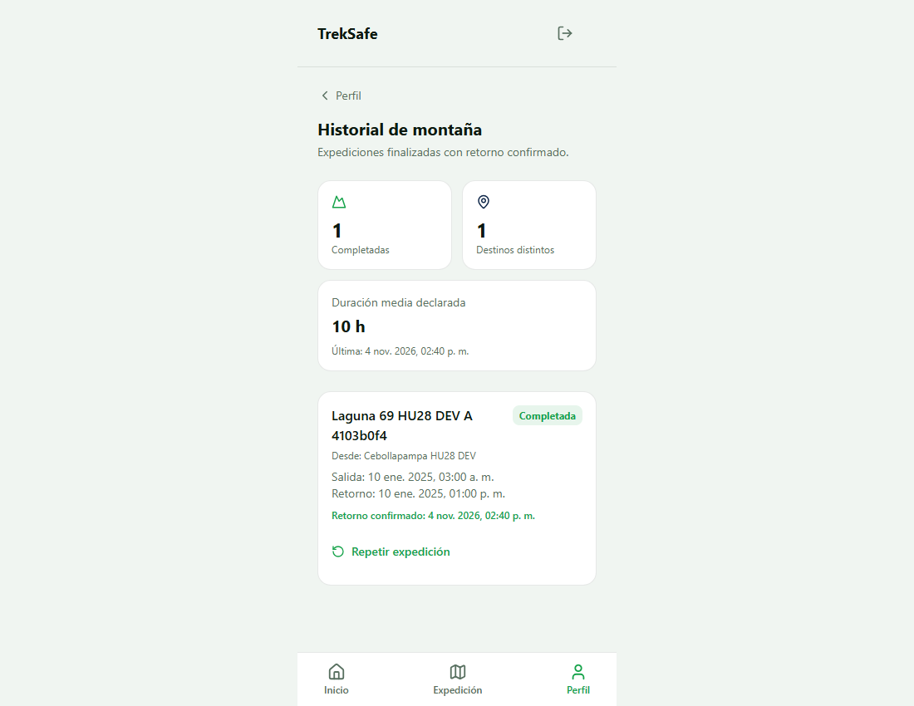
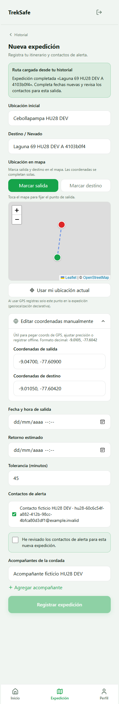
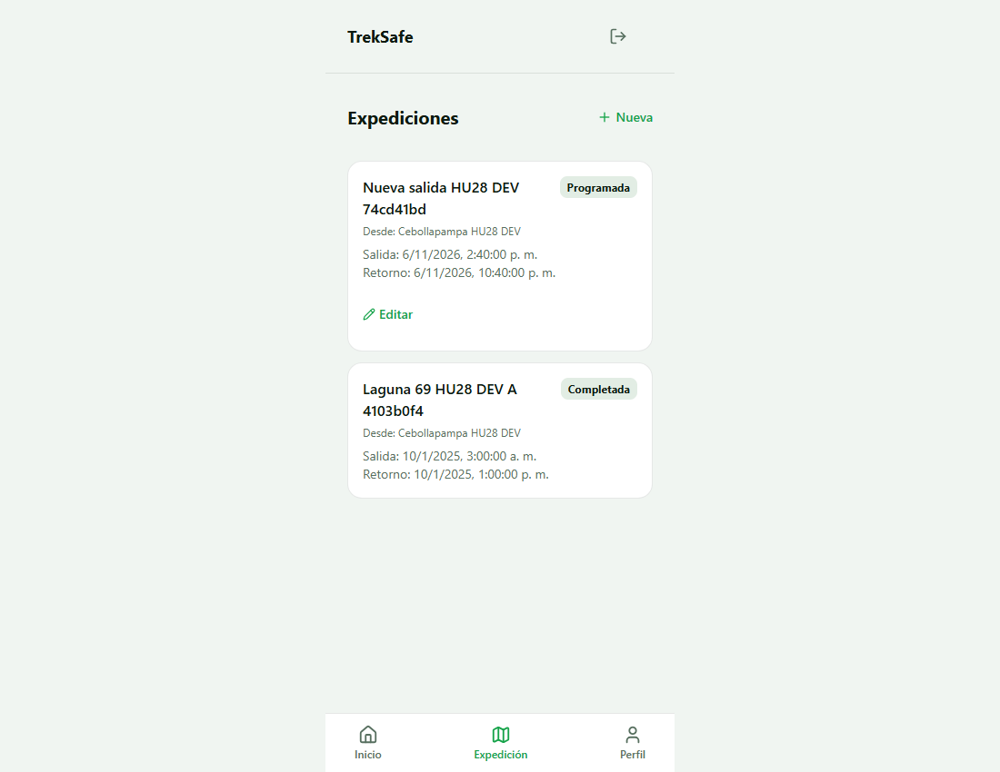
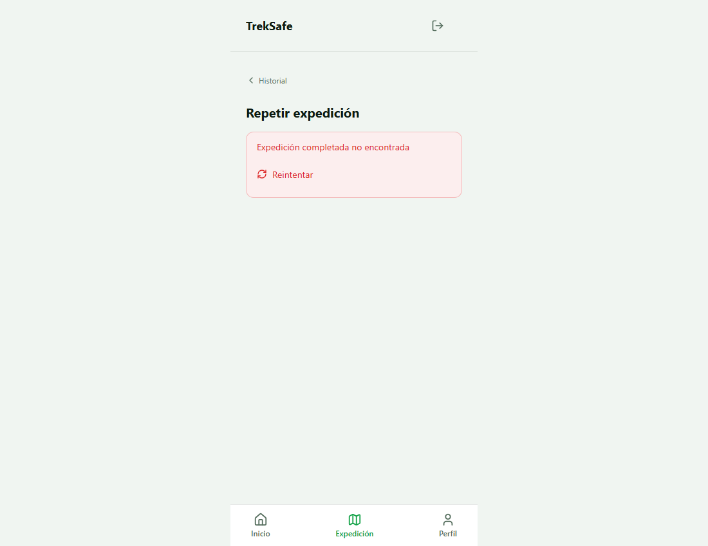

# Evidencia HU-28 en Supabase DEV

- Fecha UTC: 2026-11-04T19:40:50.868Z
- Resultado: aprobado para el alcance sin puntos intermedios
- Ejecución: 4103b0f4-aa1a-4ee8-b326-3aa6bfa0bc6a
- Limpieza: verificada: cuentas ficticias y sus expediciones eliminadas por id y propietario

- [x] Esquema DEV disponible y dos cuentas ficticias aisladas preparadas.
- [x] Login real de TrekSafe con A y B; cron sin iniciar y correo simulado.
- [x] PostgREST real devuelve el borrador propio con fechas vacías y sin campos privados del viaje anterior.
- [x] Aislamiento real: B solo ve su historial; origen ajeno e inexistente devuelven el mismo 404.
- [x] Guardar rechaza fechas antiguas, contactos borrados y contactos de B, sin crear expediciones parciales.
- [x] PWA real crea otra expedición en DEV: id nuevo, fechas futuras, contactos vigentes y origen intacto.
- [x] La nueva expedición permanece programada, no hereda bitácoras ni despachos y todavía no puede repetirse como completada.

- Id del origen ficticio: 74cd41bd-d7e9-4bd4-addc-3c9e179899d3
- Id nuevo: 0f3c152b-6915-4138-a814-a143ce5dd0b9

Pendiente: puntos intermedios y aceptación del equipo. Este informe no cierra la HU.
