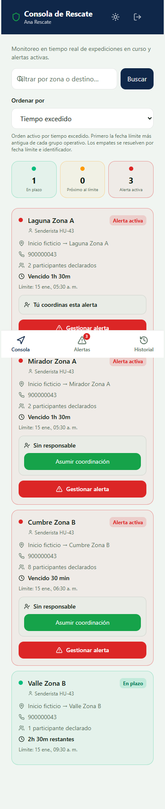
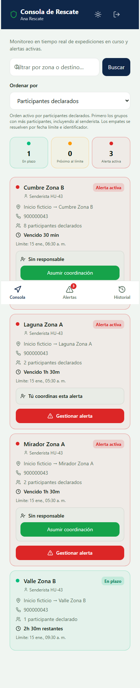
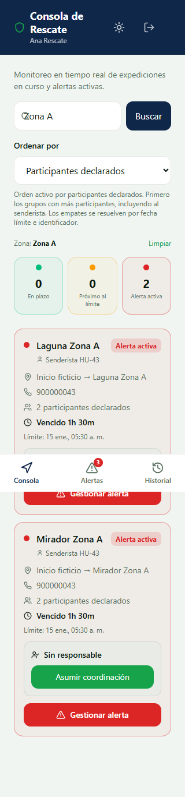

# HU-43 · Evidencia de integración

Verificado el 11 de noviembre de 2026. Responsable de la historia, John.
Rama `feat/hu-43-priorizar-alertas`. Issue #44.

## Resultado

Siete casos de integración local aprobados sobre PostgreSQL 18.1 desechable, con
consola React, API Express, JWT, estrategias y adaptadores de rescate reales.
El conjunto contiene seis expediciones ficticias, tres en alerta, una en progreso,
una programada y una completada. El monitor conserva las cuatro expediciones
activas y la lista de alertas conserva las tres alertas abiertas.

La conexión con Supabase DEV se comprobó mediante lecturas reales de la API local.
DEV devolvió conjuntos vacíos para alertas y expediciones en curso. Por elección
de John, los escenarios con datos se ejecutaron en PostgreSQL local desechable.

| Criterio | Comprobación | Resultado |
| --- | --- | --- |
| CA-01 | Selección de tiempo excedido y participantes declarados desde la consola y la API | Aprobado localmente |
| CA-02 | Mismo conjunto en ambos criterios, empate de fecha y grupo resuelto por id, exclusión de programada y completada | Aprobado localmente |
| CA-03 | Explicación del criterio activo, coordinación visible e instantánea de persistencia idéntica antes y después | Aprobado localmente |
| Integración DEV | Ambos criterios en las rutas de alertas y expediciones, con JWT y perfil validado | Cuatro respuestas 200, conjuntos vacíos |
| Permisos | Falta de token, rol senderista y criterio inválido | 401, 403 y 400, respectivamente |
| Vista móvil | Cambio de criterio y filtro por zona a 390 y 320 píxeles | Aprobado localmente |

## Datos y orden observado

| Expedición ficticia | Estado | Participantes | Tiempo excedido |
| --- | --- | --- | --- |
| Laguna Zona A | Alerta | 2 | 90 minutos |
| Mirador Zona A | Alerta | 2 | 90 minutos |
| Cumbre Zona B | Alerta | 8 | 30 minutos |
| Valle Zona B | En progreso | 1 | Tiene 150 minutos restantes |

Por tiempo, Laguna y Mirador aparecen antes de Cumbre. Sus fechas límite coinciden
y el id de Laguna es menor que el de Mirador. Por participantes, Cumbre aparece
primero, seguida de Laguna y Mirador. Valle conserva su grupo operativo En plazo.
El total incluye al senderista y sus acompañantes declarados.

### Tiempo excedido



### Participantes declarados



### Zona y criterio combinados



## Alcance técnico de la prueba local

El SDK de Supabase construye sus peticiones y el puente
`clienteSupabaseRescatePostgresPruebas` las traduce a SQL real sobre la base
`treksafe_hu43_desechable`, como `service_role` y en transacciones de lectura.
Esta ejecución comprueba el conteo SQL, el mapeo de los adaptadores, las estrategias,
el JSON de la API y la consola. La compatibilidad de las consultas REST desplegadas
se comprobó por separado en DEV con su conjunto vacío.

El script prepara el esquema inicial y las migraciones 000, 002 y 017 dentro del
clúster temporal. Crea la coordinación de Laguna mediante la RPC de HU-39. Compara
las tablas de expediciones, acompañantes, incidentes y bitácoras antes y después
del flujo. El clúster temporal se detuvo y eliminó al terminar correctamente.

La comunicación de la consola con la API local utiliza HTTP real mediante el proxy
de Vite. Las capturas contienen datos ficticios. El navegador usa una sesión técnica
temporal con JWT válido para el perfil ficticio sembrado en la base local.

Los siete casos y la versión de PostgreSQL están registrados en
[resultado-local.json](resultado-local.json).

La suite completa de backend se volvió a ejecutar al cerrar esta fase y aprobó
647 pruebas. Las suites PostgreSQL optativas de otras historias quedaron omitidas.
El chequeo de tipos de backend también fue aprobado. La fase de frontend registró
161 pruebas aprobadas, dos integraciones omitidas y la compilación de la PWA aprobada.

## Comprobación de Supabase DEV

Proyecto `ibnwggvqgjpeqcretjak`. Consultas ejecutadas el 11 de noviembre de 2026,
a las 20:00:43 UTC. El registro devolvió las versiones 015, 022, 023 y 024.

| Ruta | Criterio | HTTP | Elementos |
| --- | --- | --- | --- |
| `/api/rescate/alertas` | `tiempo_excedido` | 200 | 0 |
| `/api/rescate/alertas` | `tamano_grupo` | 200 | 0 |
| `/api/rescate/expediciones` | `tiempo_excedido` | 200 | 0 |
| `/api/rescate/expediciones` | `tamano_grupo` | 200 | 0 |

Las cuatro respuestas incorporaron `Cache-Control: no-store`. Se utilizó un JWT
técnico temporal emitido localmente para un perfil de rescatista validado existente
en DEV. La prueba cubre las consultas autenticadas de HU-43. La validación mediante
inicio de sesión por formulario queda para la revisión funcional con el equipo.

Las lecturas de DEV se registran en [resultado-dev.json](resultado-dev.json).
La ordenación de alertas con datos dentro de DEV queda pendiente de un conjunto
ficticio coordinado con el equipo, si lo requiere la revisión.

## Reproducir la integración local

Requiere Node.js 22, las dependencias instaladas de backend y frontend, PostgreSQL
instalado y Microsoft Edge en Windows. En otros sistemas utiliza el Chromium
disponible para Playwright.

Desde la raíz del proyecto, en PowerShell.

```powershell
cd backend
node --import tsx scripts/test-hu43-integracion.mjs --pg-bin "C:\Program Files\PostgreSQL\18\bin"
```

El script crea su clúster en TEMP, aplica el esquema en su base local desechable,
ejecuta las consultas y el navegador, guarda estas evidencias y elimina el clúster.
Las consultas usan datos y configuración ficticios definidos en el script.

## Texto para el PR

HU-43 permite elegir entre tiempo excedido y participantes declarados en la consola
de rescate. La API utiliza Strategy, desempata por fecha límite e id y conserva la
coordinación vigente de HU-39. La consola explica el criterio aplicado y mantiene
la última lista válida mientras consulta el nuevo orden.

Se verificaron siete casos de integración con PostgreSQL local desechable y el
flujo en navegador. Las cuatro consultas reales contra DEV respondieron 200 con
conjuntos vacíos. Se adjuntan capturas y resultados de ambas comprobaciones.

Pendiente la revisión del PR y la validación funcional de Marko. La ordenación con
datos en DEV puede verificarse cuando el equipo prepare alertas ficticias.

Closes #44
