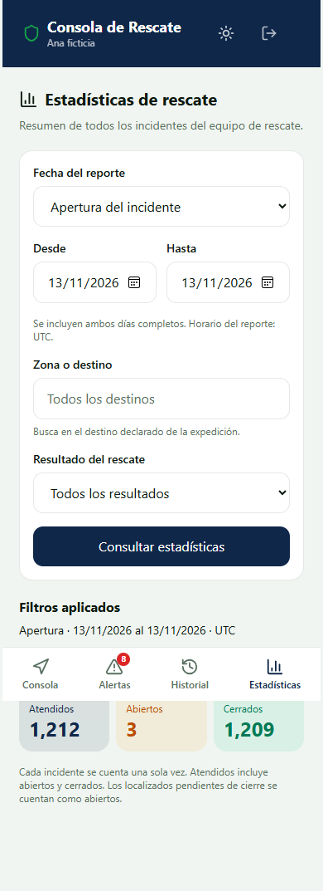
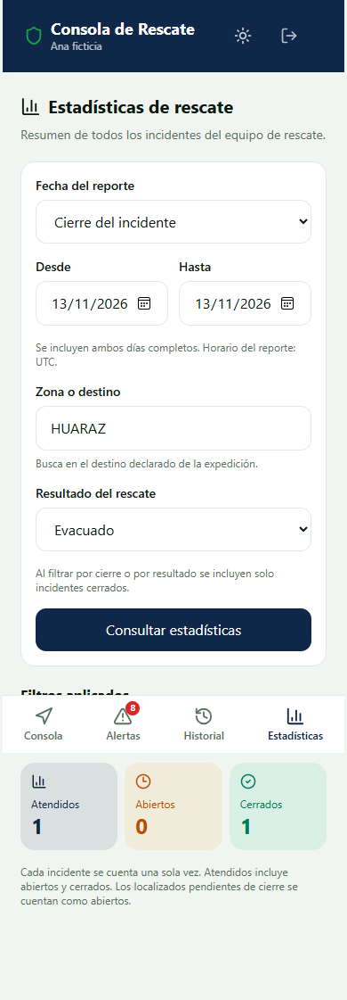
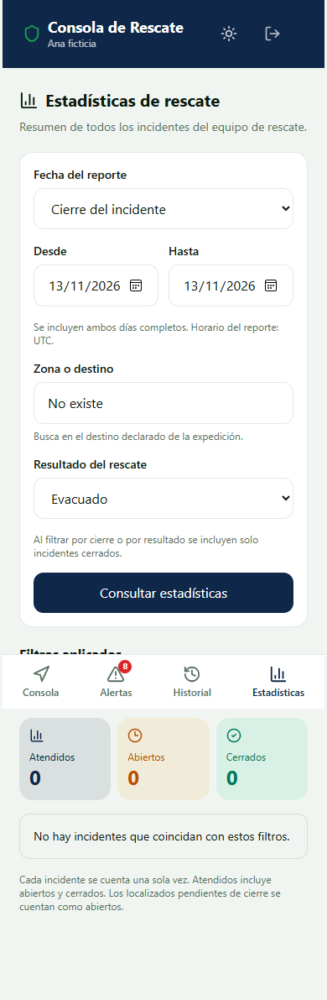
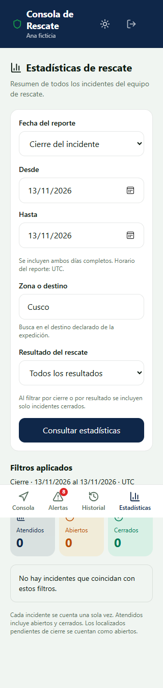

# HU-47 · Evidencia local de estadísticas operativas

Responsable: John. Issue [#49](https://github.com/ArianaBlanco06/TrekSafe/issues/49).

## Alcance comprobado

Se probó el recorrido completo del build PWA en Edge, pasando por la API Express,
el DAO de producción, el SDK Supabase, PostgREST 16.5 y PostgreSQL 18. Los datos
son ficticios. La instancia PostgreSQL y todos los servicios del runner son
temporales, escuchan en loopback y se detienen al terminar.

El SDK utiliza un proxy HTTP que retira el prefijo `/rest/v1` antes de llegar a
PostgREST nativo. Ese proxy no interpreta consultas ni sustituye resultados.
La sesión del navegador usa un JWT técnico emitido localmente para la fixture;
esta prueba no valida el formulario de inicio de sesión ni credenciales de DEV.

Fecha y resultado de la ejecución final: [resultado-integracion.json](resultado-integracion.json).

## Resultados

| Comprobación | Resultado |
| --- | --- |
| Suite completa del backend | 1.031 pruebas aprobadas, cero fallos; suites PostgreSQL condicionadas no activadas |
| Suite completa del frontend | 260 aprobadas, 2 omitidas por requerir sus entornos específicos, cero fallos |
| TypeScript de frontend y backend | Aprobado |
| Tipos de pruebas y Playwright del frontend | Aprobado |
| Compilaciones de backend y PWA | Aprobadas |
| SQL real sobre esquema y migraciones reales | 13 comprobaciones aprobadas |
| Recorrido completo por navegador y PostgREST real | 10 escenarios aprobados |
| Suite completa de privacidad PWA, con el flujo actualizado del aviso de instalación | 30 pruebas aprobadas en 55,9 segundos |

El runner aplica 000, 002, 017, 019, 021, 025 y 029 solamente en
`treksafe_hu47_desechable`. Los datos incluyen incidentes abiertos, localizados,
cerrados con informe, históricos sin informe, dos incidentes que comparten
expedición y un grupo de 1.205 incidentes para comprobar el conteo completo.

## Criterios de aceptación

| Criterio | Prueba y resultado |
| --- | --- |
| CA-01 · Filtros y alcance | Apertura/cierre, ambos extremos del rango, zona y resultado; dos rescatistas validados reciben el mismo agregado global. Sin token 401, senderista 403, rescatista sin perfil 403, filtros inválidos 400 |
| CA-02 · Conteo único | Tres notas y un relevo mediante RPC reales de HU-41/HU-40 mantienen el total; dos incidentes de una expedición se cuentan como dos. Se cuentan los 1.205 registros de volumen |
| CA-03 · Resumen y fecha visible | La pantalla muestra atendidos, abiertos y cerrados, rango aplicado, criterio de apertura/cierre y UTC. Abiertos incluye localizado. Cierre/resultado excluyen abiertos. No se devuelven datos médicos |

## Capturas

### 1. Reporte con todos los incidentes del día

Datos ficticios: 1.212 atendidos, 3 abiertos y 1.209 cerrados. El número incluye el
grupo de volumen. La API devuelve los mismos filtros que aparecen en la pantalla.



### 2. Cierre, destino y resultado

Fecha base cierre, destino Huaraz, resultado evacuado. Se obtiene un incidente
cerrado y cero abiertos.



### 3. Conjunto sin coincidencias

Los filtros se conservan junto al mensaje de conjunto vacío y los tres ceros.



### 4. Pantalla estrecha

Se comprobó ausencia de desbordamiento horizontal a 320 y 1.280 píxeles. A 320 px
los campos de fecha se apilan para permitir leer el día completo.



## Fallos y privacidad

- Se retiró temporalmente EXECUTE de la RPC solo en la base desechable. La API
  devolvió 500 y la pantalla mantuvo la última consulta correcta con sus filtros.
  Tras restituir el permiso, el botón de reintento ejecutó la consulta pendiente.
- Se activó el Service Worker real del build y se comprobó que Cache Storage no
  contuviera respuestas de `/api/rescate/estadisticas`.
- Al pasar el navegador a offline, la consulta falló sin recuperar una respuesta
  de caché ni presentar datos anteriores como una consulta nueva exitosa.
- Las consultas HTTP devolvieron `Cache-Control: no-store`. El agregado solo
  contiene los tres conteos y los filtros aplicados.
- Las instantáneas de persistencia se conservaron tras las consultas. La prueba
  SQL también ejecutó el reporte dentro de una transacción `READ ONLY`.
- No se observaron errores de JavaScript durante el recorrido.

## Reproducción

La suite de privacidad contempla el aviso de instalación del login. Sus recorridos
cierran el diálogo mediante «Entendido» antes de iniciar sesión. Dos pruebas
adicionales comprueban cierre/reapertura al entrar desde navegador y ocultación
con `navigator.standalone` simulado. La ejecución local completa terminó con
30 aprobadas; los tipos de pruebas y Playwright también aprobaron.
Este resultado local debe confirmarse en GitHub después de publicar la corrección
de las pruebas en el PR #134.

Con el build PWA generado, esta suite se reproduce con:

```powershell
npm run test:pwa:privacidad --prefix frontend
```

Con dependencias instaladas, Node 22, PostgreSQL nativo y PostgREST nativo:

```powershell
npm run build --prefix backend
$env:VITE_API_URL = '/api'
npm run build --prefix frontend
node backend/scripts/test-hu47-postgres.mjs --pg-bin "C:\Program Files\PostgreSQL\18\bin" --postgrest "C:\ruta\postgrest.exe" --with-browser
```

En Windows se utiliza Edge instalado. En otros sistemas se usa Chromium de
Playwright. El runner no descarga dependencias ni PostgREST automáticamente.
La ejecución conserva los logs temporales y regenera las capturas y el JSON.
Para ejecutar solo las 13 comprobaciones SQL, omitir `--postgrest` y `--with-browser`.

El binario Windows de esta ejecución procede del
[release oficial de PostgREST 16.5](https://github.com/PostgREST/postgrest/releases/tag/v16.5).
Se verificó el SHA256 del ZIP contra el digest del release:
`17f595b0d8dd37473d0231417dea07c5ac9f791282ff5b017fae51ff29e5de2f`.

## DEV y cierre de la historia

Se consultó únicamente el registro de migraciones del proyecto del equipo
`ibnwggvqgjpeqcretjak`. Respondió HTTP 200 y contenía 017, 019, 021 y 025.
029 no estaba registrada al comprobarlo. No se aplicaron archivos ni se
modificaron datos de Supabase DEV.
Registro de esta comprobación: [resultado-dev.json](resultado-dev.json).

La validación local no sustituye la validación compartida en DEV ni la aceptación
funcional de Marko. John confirmó que 029 está libre para HU-47. Para cerrar la
historia falta coordinar con Sebastian/Ariana su aplicación una vez, probar con rescatista
validado y adjuntar el resultado al PR. Si DEV sigue sin incidentes, distinguir
el conjunto vacío real de las pruebas con datos ficticios locales.

No se han realizado commits, push ni publicaciones en GitHub desde este trabajo.
