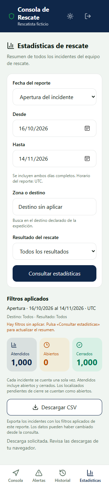

# HU-48 · Evidencia de la fase de frontend

Responsable: John. Fecha y datos del archivo descargado:
[resultado.json](resultado.json).

## Alcance

Build PWA real en Edge headless con Service Worker activo y pantalla móvil. La
API de esta prueba es ficticia y local, proporcionada por
`frontend/tests/pwa/servidor.mjs`. No utiliza Supabase ni valida la autorización
real del backend. La integración CSV por Express, SDK, PostgREST y PostgreSQL
se comprobará en la fase siguiente.

## Resultado

- Frontend: 277 pruebas aprobadas y 2 omitidas por depender de sus propios
  entornos de integración, sin fallos.
- TypeScript de aplicación y configuraciones de pruebas/Playwright aprobado.
- Build PWA aprobado.
- Suite completa de privacidad PWA: 32 pruebas aprobadas, incluidas dos nuevas
  de descarga CSV en navegador, sin fallos.
- Descarga de 1.000 filas, con BOM UTF-8, encabezados, acentos y comillas.
- La edición del formulario sin aplicar conservó los filtros del reporte al
  descargar. El nombre del archivo corresponde a ese rango y criterio.
- Un cuerpo HTTP interrumpido después de enviar las cabeceras no generó archivo.
  El botón de reintento permitió descargar la respuesta completa del mismo filtro.
- No se encontraron respuestas CSV en Cache Storage. Offline deshabilitó el
  botón y reconectar no inició descargas automáticamente.
- Vista de 320 px sin desbordamiento horizontal.

Las pruebas de componente/servicio cubren además el cuerpo pendiente, errores
403, respuestas HTML/JSON inesperadas, cambios de sesión, reporte actualizado,
desmontaje, cancelación y bloqueo de clics repetidos. El objeto URL del archivo
solo se crea después de completar el cuerpo y se libera tras solicitar el guardado.

## Captura

La pantalla muestra filtros editados sin aplicar y explica que el CSV utiliza
los filtros aplicados del reporte. Los datos e identidad son ficticios.



## Reproducción

Con Node 22 y dependencias instaladas:

```powershell
npm run test:equipo --prefix frontend
$env:VITE_API_URL = '/api'
npm run build --prefix frontend
npm run test:pwa:privacidad --prefix frontend
```

En Windows se aprovecha Edge instalado. En otros sistemas se requiere el Chromium
de Playwright, como en CI. Los CSV descargados y capturas de cada ejecución se
generan en `frontend/test-results/privacidad`, excluido de Git; aquí se conserva
una copia de la captura y metadatos del archivo, sin incluir credenciales.

El aviso «Descarga solicitada» confirma la entrega al navegador. La decisión
final de guardar/cancelar corresponde al navegador y al usuario.
