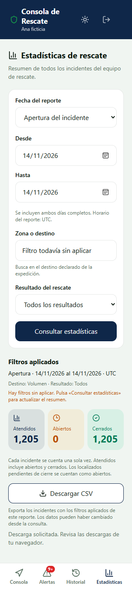
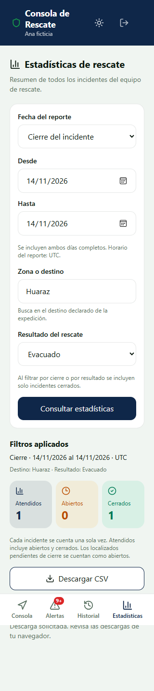
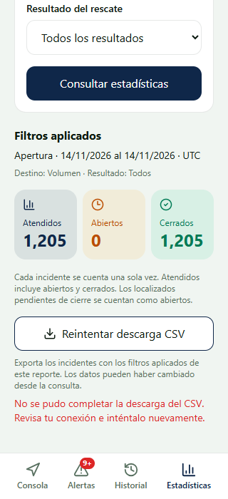

# HU-48 · Integración completa local

Responsable: John. Issue [#50](https://github.com/ArianaBlanco06/TrekSafe/issues/50).
La ejecución final, casos y hashes de archivos están en
[resultado-integracion.json](resultado-integracion.json).

## Entorno y alcance

El recorrido utilizó el build PWA real, Edge headless con Service Worker activo,
Express, el caso de uso y DAO de producción, SDK Supabase, PostgREST 16.5 nativo
y PostgreSQL 18 desechable. Un proxy HTTP adapta únicamente el prefijo `/rest/v1`
que utiliza el SDK a las rutas de PostgREST nativo. No interpreta consultas ni
genera respuestas de datos.

Todos los servicios escucharon en loopback. La base fue
`treksafe_hu48_desechable`, creada por el runner. Se aplicaron el esquema real y
000, 002, 017, 019, 021, 025, 029 y 031 exclusivamente allí.
Los datos, identidades y credenciales son ficticios. La sesión del navegador
utilizó un JWT técnico emitido localmente; esta prueba no valida el formulario
de inicio de sesión ni credenciales de DEV.

La instancia y sus servicios quedaron detenidos al finalizar. No se aplicaron
migraciones ni se modificaron datos en Supabase DEV.

## Resultados

| Comprobación | Resultado |
| --- | --- |
| Backend completo, fase 2 | 1.068 pruebas aprobadas, cero fallos; suites PostgreSQL condicionadas no activadas |
| Frontend completo, fase 3 | 277 aprobadas, 2 omitidas por sus entornos específicos, cero fallos |
| TypeScript y compilaciones backend/PWA | Aprobados |
| Privacidad PWA, fase 3 | 32 pruebas aprobadas |
| PostgreSQL real, fase 4 | 21 comprobaciones aprobadas: 13 de HU-47 y 8 de HU-48 |
| Flujo completo por API, SDK, PostgREST y navegador | 11 escenarios aprobados |

El workflow incorpora la suite SQL de HU-48 al job de backend. Su resultado en
GitHub queda pendiente de publicar la rama y ejecutar CI.

## Criterios de aceptación

| Criterio | Evidencia |
| --- | --- |
| CA-01 · Mismo filtro y campos mínimos | CSV y resumen HU-47 coinciden por apertura/cierre, destino literal y catálogo completo de resultados. Dos rescatistas validados obtienen los mismos ids. Se rechazan token ausente, rol senderista, perfil inválido e identidad inyectada. El archivo contiene únicamente seis columnas |
| CA-02 · Recorrido paginado estable | Se exportaron 1.205 incidentes en siete RPC de páginas de 200. La traza verificó cada cursor y actor. Los ids del CSV coinciden en orden con una consulta SQL independiente, sin duplicados. Las fixtures incluyen varias notas y un relevo real de HU-40 |
| CA-03 · Archivo fiel y protegido | BOM UTF-8, encabezados, comas, comillas, acentos y saltos internos. Las celdas de fórmula reciben tabulación protectora dentro de comillas. El archivo descargado por el navegador fue idéntico byte a byte al obtenido de la API |

## Archivos generados por la API real

- [exportacion-1205.csv](exportacion-1205.csv): 1.205 filas de datos, más encabezados.
- [exportacion-caracteres.csv](exportacion-caracteres.csv): siete incidentes de
  prueba con caracteres especiales y prefijos de fórmula. Incluye un salto de
  línea dentro de una celda, por lo que contar líneas de texto no equivale a
  contar registros CSV.

Los hashes SHA256 están en el JSON de resultado. Estos CSV contienen únicamente
datos ficticios. Las pruebas leyeron el contenido con un parser independiente;
no se abrió Excel ni se ejecutaron fórmulas. La comprobación funcional en la
hoja de cálculo que utilice el equipo sigue pendiente de Marko.

## Capturas

### Descarga y filtros aplicados

El formulario tiene un destino editado sin aplicar. El CSV conserva el destino
«Volumen» y los filtros del reporte, con 1.205 incidentes.



### Cierre y resultado

El reporte de Huaraz por fecha de cierre y resultado evacuado produjo un solo
incidente cerrado, conforme al resumen.



### Fallo de una página posterior

Se inyectó una excepción SQL en la RPC, únicamente en la base desechable, a
partir del segundo cursor. La API interrumpió el cuerpo; el navegador no ofreció
un archivo parcial y mostró el error. Tras restaurar la definición original, el
reintento descargó el mismo CSV completo de 1.205 filas.



## Otras comprobaciones

- Un error SQL de la primera página devolvió JSON 500 sin cabecera de descarga.
- Un conjunto vacío autorizado produjo un CSV con BOM y encabezados.
- Una consulta real demorada permitió verificar que actualizar el reporte
  cancela la descarga pendiente y descarta el archivo anterior.
- Cache Storage no contenía respuestas de `/api/rescate/estadisticas.csv`.
- Sin conexión el botón se bloqueó; reconectar no inició una descarga automática.
- La pantalla se comprobó a 320 px sin desbordamiento horizontal.
- Las instantáneas de incidentes, expediciones, cierres y bitácora no cambiaron
  por las consultas. No se registraron errores JavaScript.

## Reproducción

Con dependencias instaladas, Node 22, PostgreSQL y PostgREST nativos:

```powershell
npm run build --prefix backend
$env:VITE_API_URL = '/api'
npm run build --prefix frontend
node backend/scripts/test-hu48-postgres.mjs --pg-bin "C:\Program Files\PostgreSQL\18\bin" --postgrest "C:\ruta\postgrest.exe" --with-browser
```

El runner no descarga PostgREST automáticamente. En Windows utiliza Edge
instalado; en otros sistemas requiere Chromium de Playwright. Sin las opciones
`--postgrest` y `--with-browser` ejecuta únicamente las 21 comprobaciones SQL.
Los logs permanecen en la carpeta temporal que imprime al terminar.

## Estado de DEV

Consulta de solo lectura al registro del proyecto del equipo:
[resultado-dev.json](resultado-dev.json).
DEV respondió HTTP 200 y tenía 029 y 030 registradas; 031 no estaba registrada
al comprobarlo. Esta evidencia local no acredita aplicación ni prueba funcional
de HU-48 en DEV. Queda coordinar la migración y adjuntar esa prueba al PR.
