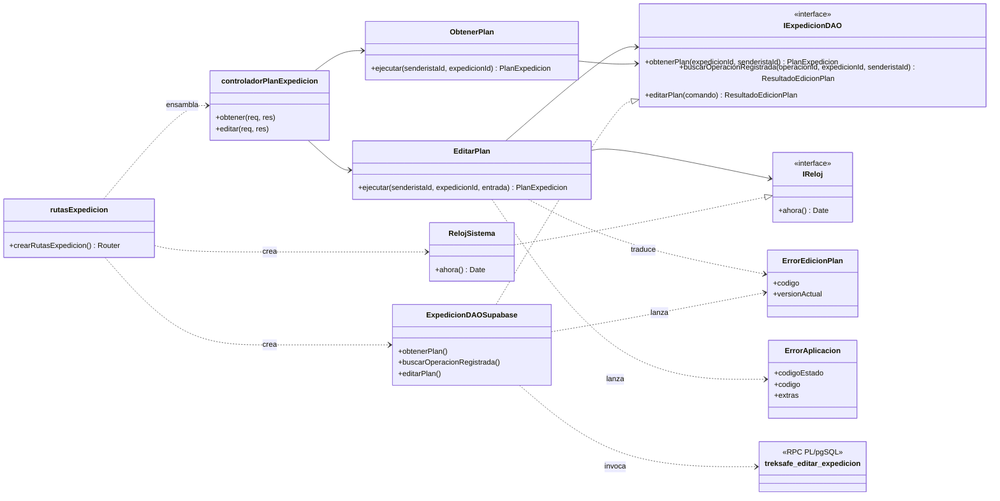

# HU-26: Editar una expedición programada

Como senderista, quiero modificar los datos de una expedición que aún no empieza para corregir mi plan antes de salir.

## Tarjeta CRC

| Clase: `EditarPlan` (`backend/src/application/use-cases/EditarPlan.ts`) | |
|---|---|
| **Responsabilidades** | **Colaboradores** |
| Validar la entrada con `editarExpedicionSchema` | `IExpedicionDAO` |
| Devolver el resultado registrado si la operación se repite | `IReloj` |
| Validar propietario, estado, salida futura y versión | `ErrorEdicionPlan` |
| Rechazar una nueva salida ya pasada, según el reloj | `ErrorAplicacion` |
| Normalizar coordenadas, horas y contactos | |
| Traducir los rechazos de negocio a errores HTTP | |

## Diagrama de clases



## Principios y patrones

- **SRP:** `EditarPlan` decide las reglas, `ExpedicionDAOSupabase` persiste y traduce los códigos de la RPC, y el controlador solo adapta HTTP. `ObtenerPlan` está separado porque leer y editar cambian por motivos distintos.
- **DIP:** `EditarPlan` depende de `IExpedicionDAO` e `IReloj`, definidos en el dominio, y no importa Supabase ni usa `Date.now()`. Las clases concretas se ensamblan solo en `crearRutasExpedicion()`.
- **DAO:** `IExpedicionDAO` oculta PostgREST, la RPC y las tablas. Por eso las pruebas usan un DAO en memoria y un reloj fijo, sin base de datos.

## Doble validación

El caso de uso valida antes de escribir, con el reloj inyectado. La RPC vuelve a validar todo dentro de la transacción y con la fila bloqueada. Sin esa segunda validación, el cron u otra sesión podrían cambiar el plan entre la lectura y la escritura. Por eso el caso de uso también traduce los rechazos que llegan del DAO.

## Atomicidad

`treksafe_editar_expedicion` guarda el plan, reemplaza contactos y acompañantes, e inserta el evento en una sola transacción. Si cualquier paso falla, no queda ningún cambio.

## API

### `GET /api/expediciones/:id`

Devuelve `200 { expedicion }`: el plan completo, con `version`, `idsContactos` y `nombresAcompanantes`.

### `PUT /api/expediciones/:id`

Reemplaza el plan completo: omitir una coordenada la elimina. Devuelve `200 { mensaje, expedicion }`.

```json
{
  "lugarInicio": "Pashpa",
  "lugarFin": "Nevado Ishinca",
  "coordenadasInicio": "-9.5105, -77.5275",
  "coordenadasFin": "-9.0105, -77.6042",
  "horaInicio": "2030-03-01T08:00:00.000Z",
  "horaRetornoEstimada": "2030-03-02T17:00:00.000Z",
  "minutosTolerancia": 45,
  "idsContactos": ["<uuid>"],
  "nombresAcompanantes": ["Ana Ríos"],
  "versionEsperada": 1,
  "operacionId": "<uuid generado por el cliente>"
}
```

| Estado | Código | Cuándo |
|---|---|---|
| 400 | Sin código (`ErrorValidacion`, con `detalles`) | Datos o `:id` no pasan el schema |
| 400 | `RETORNO_INVALIDO`, `TOLERANCIA_INVALIDA`, `CONTACTOS_INVALIDOS`, `DATOS_INVALIDOS` | Rechazo de negocio de los datos |
| 404 | `EXPEDICION_NO_ENCONTRADA` | No existe o es de otro senderista |
| 409 | `PLAN_NO_EDITABLE` | El estado no es `programada` |
| 409 | `VERSION_OBSOLETA` | `versionEsperada` no coincide. El cuerpo incluye `versionActual` |
| 422 | `SALIDA_YA_INICIADA` | La salida actual del plan ya pasó |
| 422 | `SALIDA_EN_PASADO` | La nueva hora de salida ya pasó |

Las respuestas de negocio nunca usan 401, porque el frontend lo interpreta como sesión vencida.

## Contrato de `eventos_plan`

Para HU-36 y HU-37 (lectura), y HU-27 y HU-35 (escritura). Se crea en `backend/migrations/002_hu26_version_y_eventos_plan.sql`.

| Columna | Tipo | Regla |
|---|---|---|
| `id` | `uuid` | PK, `gen_random_uuid()` |
| `expedicion_id` | `uuid` | `NOT NULL`, FK a `expediciones`, `ON DELETE CASCADE` |
| `senderista_id` | `uuid` | `NOT NULL`, propietario del plan |
| `tipo` | `text` | `NOT NULL`: `EDITADA`, `CANCELADA` o `RETORNO_AMPLIADO` |
| `actor_id` | `uuid` | `NOT NULL`, quién hizo el cambio |
| `ocurrido_en` | `timestamptz` | `NOT NULL`, `now()` |
| `version_resultante` | `integer` | `NOT NULL`, versión del plan tras el cambio |
| `cambios` | `jsonb` | `NOT NULL`, `'{}'` |
| `motivo` | `text` | Opcional |
| `operacion_id` | `uuid` | `NOT NULL`, `UNIQUE`; generado por el cliente |

**Orden de lectura:** usa `ORDER BY ocurrido_en, id` junto con el filtro por `expedicion_id`; el índice `idx_eventos_plan_expedicion_orden` lo cubre. `id` no refleja el orden de inserción: solo desempata de forma estable.

**Formato de `cambios`:** contiene únicamente los campos que cambiaron. Si la edición no cambió nada, el evento se registra con `{}` y la versión también aumenta.

```json
{
  "lugarFin": { "antes": "Laguna 69", "despues": "Nevado Ishinca" },
  "minutosTolerancia": { "antes": 30, "despues": 45 }
}
```

**Campos de una edición:** `lugarInicio`, `lugarFin`, `coordenadasInicio`, `coordenadasFin`, `horaInicio`, `horaRetornoEstimada`, `minutosTolerancia`, `idsContactos` y `nombresAcompanantes`. Las horas son cadenas ISO 8601; las dos últimas claves son listas ordenadas.

**Reglas para quien escriba o lea:**

- Nunca guardes contraseñas ni datos médicos.
- Inserta el evento dentro de la misma función que modifica el plan.
- Solo `service_role` puede leer e insertar. RLS deniega a `anon` y `authenticated`.
- Antes de mostrar eventos, filtra por propietario. `cambios` puede contener lugares, coordenadas y nombres de acompañantes, y ids de contactos.
- Los eventos se eliminan en cascada con su expedición. La anonimización de `RepositorioUsuario.anonimizarHistorialRutas` todavía **no** los limpia.
