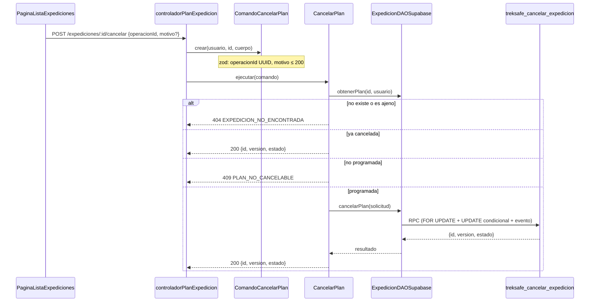

# HU-27: Cancelar una expedición programada

Como senderista, quiero cancelar una expedición que todavía no inicia para evitar que se active un monitoreo que ya no necesito.

**Criterios de aceptación**

1. Solo el propietario cancela un plan programado y futuro.
2. El plan queda cancelado y el cron no lo activa ni genera alertas por su vencimiento.
3. Una segunda cancelación devuelve el mismo resultado sin repetir efectos.

## Regla "todavía no inicia" (pendiente de confirmar por el PO)

"Todavía no inicia" significa que el plan sigue en `programada`. Se puede cancelar aunque la hora de salida ya haya pasado, mientras el cron no lo haya promovido a `en_progreso`. Así un plan que el senderista ya no usará no termina en una alerta falsa.

La regla vive en `backend/src/domain/value-objects/cancelacionPlan.ts` (`esCancelable` y `CANCELAR_EXIGE_SALIDA_FUTURA = false`). Si el PO decide exigir salida futura, se cambia esa constante y se agrega la misma comprobación en `treksafe_cancelar_expedicion` (005).

## Tarjeta CRC

| Clase: `CancelarPlan` (`backend/src/application/use-cases/CancelarPlan.ts`) | |
|---|---|
| **Responsabilidades** | **Colaboradores** |
| Ejecutar un `ComandoCancelarPlan` y devolver `ResultadoCancelarPlan` | `ComandoCancelarPlan` |
| Responder 404 si el plan no existe o es de otro senderista | `IExpedicionDAO` |
| Devolver el mismo resultado si el plan ya está cancelado, sin escribir | `IReloj` |
| Aplicar la regla `esCancelable` con el reloj inyectado | `esCancelable` |
| Delegar la cancelación atómica a la persistencia | `ErrorCancelacionPlan` |
| Traducir los rechazos de negocio a errores HTTP (nunca 401) | `ErrorAplicacion` |

| Clase: `ComandoCancelarPlan` (`backend/src/application/commands/ComandoCancelarPlan.ts`) | |
|---|---|
| **Responsabilidades** | **Colaboradores** |
| Llevar la identidad de la operación (`operacionId`) | `cancelarExpedicionSchema` |
| Llevar los parámetros: plan, propietario y motivo opcional | `Comando<ResultadoCancelarPlan>` |
| Validar la entrada al construirse y quedar inmutable | |

## Patrón Command

`ComandoCancelarPlan` es el comando: un objeto inmutable con identidad (`operacionId`), parámetros (`expedicionId`, `senderistaId`, `motivo`) y un tipo de resultado (`ResultadoCancelarPlan`). `CancelarPlan` es su ejecutor (`IEjecutorComando`). El controlador solo construye el comando a partir de la petición y lo entrega al ejecutor. No sabe cómo se cancela.

La identidad del comando hace posible la idempotencia: el cliente genera el `operacionId` una vez por intento, y el servidor lo usa para no aplicar dos veces la misma operación.




## Principios SOLID

- **SRP:** cada clase cambia por un solo motivo. `ComandoCancelarPlan` define y valida qué se pide. `CancelarPlan` decide las reglas. `ExpedicionDAOSupabase` persiste y traduce los códigos de la RPC. El controlador solo adapta HTTP. `esCancelable` concentra la regla pendiente del PO.
- **OCP:** HU-27 se agregó como un comando y un ejecutor nuevos. `EditarPlan` y `ObtenerPlan` no cambiaron.
- **DIP:** `CancelarPlan` depende de `IExpedicionDAO` e `IReloj`, definidos en el dominio. No importa Supabase ni usa `Date.now()`. Las clases concretas se ensamblan solo en `crearRutasExpedicion()`. Por eso las pruebas usan un DAO en memoria y un reloj fijo.
- **DAO:** `IExpedicionDAO.cancelarPlan` oculta PostgREST, la RPC y las tablas.

## Idempotencia

Hay dos niveles, y ninguno exige `versionEsperada`:

| Caso | Resultado |
|---|---|
| Misma `operacionId` repetida | El mismo `{id, version, estado}`. No hay otro evento ni otra versión |
| Otra `operacionId` sobre un plan ya cancelado | El mismo `{id, version, estado}`. No escribe nada y esa operación no queda registrada |
| `operacionId` de otro plan u otro senderista | 404 `EXPEDICION_NO_ENCONTRADA`, sin revelar nada ajeno |
| `operacionId` ya usada por otra operación del plan (por ejemplo, una edición) | 400 `DATOS_INVALIDOS` |

El caso de uso devuelve el resultado de un plan ya cancelado sin llamar a la RPC. La RPC vuelve a aplicar las mismas reglas con la fila bloqueada, por si dos peticiones llegan a la vez.

## Concurrencia con el cron

`treksafe_cancelar_expedicion` bloquea la fila con `SELECT ... FOR UPDATE` y actualiza con `WHERE estado = 'programada'`. El `UPDATE` de promoción del cron (`RepositorioExpedicion.promoverProgramadasListas`) también exige `estado = 'programada'`. Solo una de las dos operaciones gana:

- Si gana la cancelación, el cron no actualiza ninguna fila. La función de alerta solo toca `en_progreso`, y el contexto de correo, solo `alerta`.
- Si gana el cron, la cancelación responde 409 `PLAN_NO_CANCELABLE`.

El código del cron no cambió. `cronFechaLimiteExpedicion.canceladas.test.ts` demuestra este comportamiento con un cliente Supabase en memoria.

## Atomicidad

El cambio de estado, el aumento de `version`, `actualizado_en` y el evento `CANCELADA` se escriben en una sola transacción, dentro de la RPC. No se envían correos: HU-37 leerá el evento.

## API

### `POST /api/expediciones/:id/cancelar`

```json
{
  "operacionId": "<uuid generado por el cliente, uno por intento>",
  "motivo": "Pronóstico de tormenta"
}
```

`motivo` es opcional, de 200 caracteres como máximo. Vacío o en blanco equivale a no enviarlo.

Respuesta `200`:

```json
{
  "mensaje": "Expedición cancelada",
  "expedicion": { "id": "<uuid>", "version": 2, "estado": "cancelada" }
}
```

| Estado | Código | Cuándo |
|---|---|---|
| 400 | Sin código (`ErrorValidacion`, con `detalles`) | `:id`, `operacionId` o `motivo` no pasan el schema |
| 400 | `DATOS_INVALIDOS` | La RPC rechaza el motivo o la operación |
| 404 | `EXPEDICION_NO_ENCONTRADA` | No existe o es de otro senderista |
| 409 | `PLAN_NO_CANCELABLE` | Está `en_progreso`, `alerta` o `completada` |

Las respuestas de negocio nunca usan 401, porque el frontend lo interpreta como sesión vencida.

## Evento en `eventos_plan`

Sigue el contrato de `docs/hu-26/diseno.md`.

| Columna | Valor |
|---|---|
| `tipo` | `CANCELADA` |
| `cambios` | `{"estado": {"antes": "programada", "despues": "cancelada"}}` |
| `motivo` | Texto recortado, o `NULL` |
| `version_resultante` | `version` anterior + 1 |
| `actor_id` | El propietario |
| `operacion_id` | El del comando |

## Migraciones

| Archivo | Contenido |
|---|---|
| `004_hu27_estado_cancelada.sql` | `ALTER TYPE ... ADD VALUE 'cancelada'`. Va sola y confirmada antes de 005, porque el valor no puede usarse en la transacción que lo agrega |
| `005_hu27_rpc_cancelar_expedicion.sql` | Función `treksafe_cancelar_expedicion` |
| `006_hu27_permiso_anonimizar_eventos.sql` | `GRANT UPDATE (cambios, motivo) ON eventos_plan TO service_role` |

## Privacidad (ARCO)

- `eliminarDatosPersonales` también elimina y cuenta las expediciones canceladas.
- `anonimizarHistorialRutas` anonimiza las completadas y las canceladas. En los eventos de esas expediciones deja `cambios = '{}'` y `motivo = NULL`, y conserva tipo, fecha y versión para auditoría.

## Frontend

- `cancelarExpedicion(id, motivo, operacionId)` está en `frontend/src/services/expedicion.ts`.
- `DialogoCancelarExpedicion` genera el `operacionId` una vez al abrirse y lo reutiliza en los reintentos. El motivo es opcional, se puede vaciar y tiene un contador de 200 caracteres. El botón queda deshabilitado mientras se envía.
- `PaginaListaExpediciones` muestra la etiqueta "Cancelada" y ofrece "Editar" y "Cancelar" solo en las programadas.
