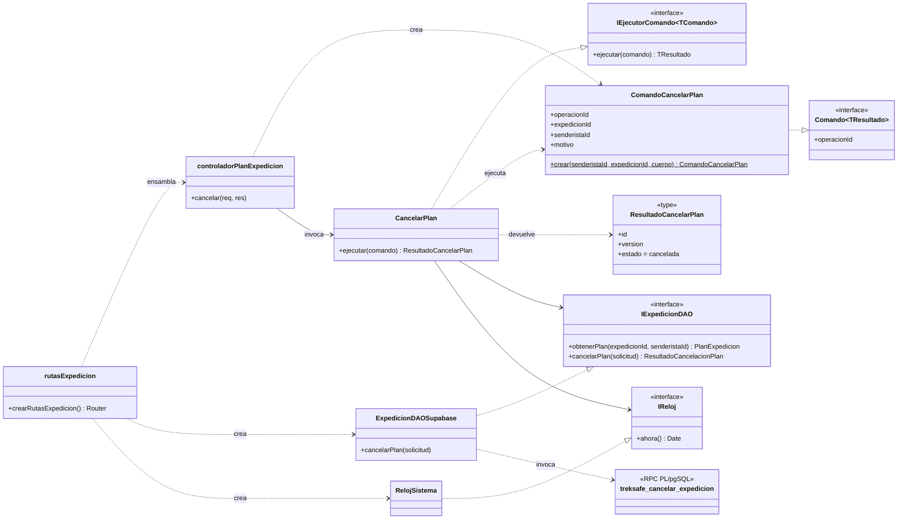
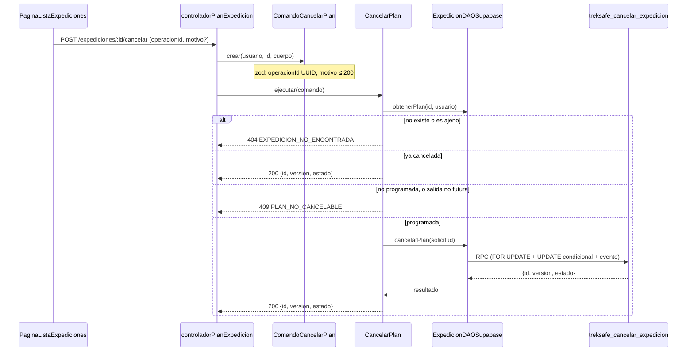

# HU-27: Cancelar una expedición programada

Como senderista, quiero cancelar una expedición que todavía no inicia para evitar que se active un monitoreo que ya no necesito.

**Criterios de aceptación**

1. Solo el propietario cancela un plan programado y futuro.
2. El plan queda cancelado y el cron no lo activa ni genera alertas por su vencimiento.
3. Una segunda cancelación devuelve el mismo resultado sin repetir efectos.

## Regla: solo se cancela un plan programado con salida futura

**La regla se invierte respecto de la versión inicial de HU-27.** La primera implementación entendía "todavía no inicia" como "sigue en `programada`" y permitía cancelar aunque la hora de salida ya hubiera pasado, mientras el cron no lo hubiera promovido. Lo dejó explícito como decisión pendiente del PO (`CANCELAR_EXIGE_SALIDA_FUTURA = false` y un comentario en la migración 005).

La regla está confirmada por el PO (Marko), ver issue #27, y coincide con el CA-01 del issue: **solo se cancela un plan programado y futuro**. Se reprodujo el defecto: una expedición con salida pasada se cancelaba con 200 y quedaba `cancelada`.

| Condición | Resultado |
|---|---|
| `estado = programada` y `hora_inicio > ahora` | Se cancela |
| `estado = programada` y `hora_inicio <= ahora` (incluida la salida **igual** a ahora) | 409 `PLAN_NO_CANCELABLE` |
| `estado` distinto de `programada` | 409 `PLAN_NO_CANCELABLE` |
| Ya `cancelada` | 200 con el mismo resultado, **aunque la salida ya haya pasado** |

- **Comparación estricta.** Salida igual a "ahora" no es futura. Es la misma regla que HU-26 aplica al editar (`hora_inicio <= now()` ya inició) y coincide con el cron, que promueve con `hora_inicio <= ahora`.
- **Un solo instante, sin zona horaria.** La salida es `expediciones.hora_inicio`, de tipo `TIMESTAMPTZ`: un instante absoluto. La API recibe un ISO con desfase, así que la comparación no depende de la zona horaria.
- **Sin código de error nuevo.** Se reutiliza `PLAN_NO_CANCELABLE` (409), y no `SALIDA_YA_INICIADA` de HU-26. Así no cambian el tipo `ErrorCancelacionPlan`, el mapa del caso de uso, el DAO ni el contrato con el frontend, y un backend anterior sigue entendiendo la RPC nueva. El mensaje es: "Solo se pueden cancelar expediciones programadas con hora de salida futura".
- **Dónde vive.** `esCancelable` (`backend/src/domain/value-objects/cancelacionPlan.ts`) la aplica en el caso de uso con el reloj inyectado, y la RPC la repite con el reloj de la base (migración 018). Se eliminó el flag `CANCELAR_EXIGE_SALIDA_FUTURA`: la decisión ya está tomada.

## Tarjeta CRC

| Clase: `CancelarPlan` (`backend/src/application/use-cases/CancelarPlan.ts`) | |
|---|---|
| **Responsabilidades** | **Colaboradores** |
| Ejecutar un `ComandoCancelarPlan` y devolver `ResultadoCancelarPlan` | `ComandoCancelarPlan` |
| Responder 404 si el plan no existe o es de otro senderista | `IExpedicionDAO` |
| Devolver el mismo resultado si el plan ya está cancelado, sin escribir | `IReloj` |
| Aplicar `esCancelable` (programada y salida futura, comparación estricta) con el reloj inyectado | `esCancelable` |
| Delegar la cancelación atómica a la persistencia | `ErrorCancelacionPlan` |
| Traducir los rechazos de negocio a errores HTTP (nunca 401) | `ErrorAplicacion` |

| Clase: `ComandoCancelarPlan` (`backend/src/application/commands/ComandoCancelarPlan.ts`) | |
|---|---|
| **Responsabilidades** | **Colaboradores** |
| Llevar la identidad de la operación (`operacionId`) | `cancelarExpedicionSchema` |
| Llevar los parámetros: plan, propietario y motivo opcional | `Comando<ResultadoCancelarPlan>` |
| Validar la entrada al construirse y quedar inmutable | |

## Patrón Command

`ComandoCancelarPlan` es el comando: un objeto inmutable con identidad (`operacionId`), parámetros (`expedicionId`, `senderistaId`, `motivo`) y un tipo de resultado (`ResultadoCancelarPlan`). `CancelarPlan` es su ejecutor (`IEjecutorComando`). El controlador solo construye el comando a partir de la petición y lo entrega al ejecutor. No sabe cómo se cancela.

La identidad del comando hace posible la idempotencia: el cliente genera el `operacionId` una vez por intento, y el servidor lo usa para no aplicar dos veces la misma operación.





## Principios SOLID

- **SRP:** cada clase cambia por un solo motivo. `ComandoCancelarPlan` define y valida qué se pide. `CancelarPlan` decide las reglas. `ExpedicionDAOSupabase` persiste y traduce los códigos de la RPC. El controlador solo adapta HTTP. `esCancelable` concentra la regla de la salida futura.
- **OCP:** HU-27 se agregó como un comando y un ejecutor nuevos. `EditarPlan` y `ObtenerPlan` no cambiaron.
- **DIP:** `CancelarPlan` depende de `IExpedicionDAO` e `IReloj`, definidos en el dominio. No importa Supabase ni usa `Date.now()`. Las clases concretas se ensamblan solo en `crearRutasExpedicion()`. Por eso las pruebas usan un DAO en memoria y un reloj fijo.
- **DAO:** `IExpedicionDAO.cancelarPlan` oculta PostgREST, la RPC y las tablas.

## Orden de reglas en la RPC

`treksafe_cancelar_expedicion` evalúa las reglas en este orden, y el caso de uso lo respeta:

1. **Idempotencia por `operacionId`:** una operación ya registrada devuelve su resultado, sin mirar la fecha. De otro plan u otro senderista: 404. De otro tipo de operación: 400.
2. **Propietario** (con la fila bloqueada con `FOR UPDATE`) y validez del motivo.
3. **Ya cancelada:** mismo resultado, sin escribir.
4. **Estado** distinto de `programada`: 409 `PLAN_NO_CANCELABLE`.
5. **Salida** no futura (`hora_inicio <= v_ahora`, con `v_ahora := clock_timestamp()` tomado tras el bloqueo): 409 `PLAN_NO_CANCELABLE`.
6. **`UPDATE`** condicionado a `estado = 'programada'` **y** `hora_inicio > v_ahora`, como defensa si cambiara el bloqueo.

Por eso repetir una cancelación ya hecha sigue devolviendo lo mismo aunque la salida ya haya pasado, y un ajeno recibe 404 sin enterarse de la fecha. Una divergencia menor y ya existente: en el caso de uso la salida se evalúa antes de llegar a la RPC, así que un `operacionId` ya usado por una edición sobre un plan con salida pasada responde 409 y no 400. Ambos rechazan.

## Idempotencia

Hay dos niveles, y ninguno exige `versionEsperada`:

| Caso | Resultado |
|---|---|
| Misma `operacionId` repetida | El mismo `{id, version, estado}`. No hay otro evento ni otra versión |
| Otra `operacionId` sobre un plan ya cancelado | El mismo `{id, version, estado}`. No escribe nada y esa operación no queda registrada |
| `operacionId` de otro plan u otro senderista | 404 `EXPEDICION_NO_ENCONTRADA`, sin revelar nada ajeno |
| `operacionId` ya usada por otra operación del plan (por ejemplo, una edición) | 400 `DATOS_INVALIDOS` |

El caso de uso devuelve el resultado de un plan ya cancelado sin llamar a la RPC. La RPC vuelve a aplicar las mismas reglas con la fila bloqueada, por si dos peticiones llegan a la vez.

## Concurrencia con el cron

`treksafe_cancelar_expedicion` bloquea la fila con `SELECT ... FOR UPDATE` y actualiza con `WHERE estado = 'programada'`. El `UPDATE` de promoción del cron (`RepositorioExpedicion.promoverProgramadasListas`) también exige `estado = 'programada'`. Solo una de las dos operaciones gana:

- Si gana la cancelación, el cron no actualiza ninguna fila. La función de alerta solo toca `en_progreso`, y el contexto de correo, solo `alerta`.
- Si gana el cron, la cancelación responde 409 `PLAN_NO_CANCELABLE`.
- Desde la migración 018 la salida también se compara con el reloj de la base, con la fila bloqueada: el reloj de la base decide, no el del servidor de la API.

### Por qué `clock_timestamp()` después del bloqueo y no `now()`

`now()` devuelve el instante de **inicio de la transacción** y no avanza mientras la RPC espera el `SELECT ... FOR UPDATE`. Si otra transacción retiene la fila y la salida pasa durante esa espera, `now()` seguiría siendo anterior a la salida: la comprobación y el `UPDATE` defensivo darían por futura una salida que ya ocurrió y el plan se cancelaría. Se reprodujo con dos conexiones reales (salida en ~2 s; A retiene la fila; B pide cancelar y espera; A suelta a los ~2,6 s): sin la corrección B cancelaba.

Corrección: tras obtener el bloqueo, la RPC toma **una sola vez** `v_ahora := clock_timestamp()` y lo usa en la comprobación de salida (paso 5), en el `WHERE` del `UPDATE` (`estado = 'programada' AND hora_inicio > v_ahora`) y en `actualizado_en`. No queda ningún `now()` en la decisión. El orden de las reglas no cambia: la idempotencia (pasos 1 y 3) sigue evaluándose antes que la salida, así que repetir la cancelación de un plan ya cancelado devuelve lo mismo aunque la salida haya pasado.

Pruebas de regresión:

- **Una sesión** (`backend/migrations/tests/hu27_cancelar_salida_futura.test.sql`, caso 11): la salida pasa durante la transacción (`pg_sleep`) y la RPC debe responder `PLAN_NO_CANCELABLE` sin escribir nada. Se corre con `node backend/scripts/test-hu27-postgres.mjs`.
- **Dos conexiones reales** (`backend/src/infrastructure/migraciones/cancelarSalidaFutura.concurrencia.test.ts`): reproduce el escenario anterior y comprueba `PLAN_NO_CANCELABLE`, estado `programada`, versión 1 y ningún evento. Solo corre contra un PostgreSQL local desechable (crea y elimina su propia base):

  ```bash
  TREKSAFE_PG_TEST_URL=postgres://postgres:<clave>@127.0.0.1:55432/treksafe_desechable     node --import tsx --test backend/src/infrastructure/migraciones/cancelarSalidaFutura.concurrencia.test.ts
  ```

  Sin `TREKSAFE_PG_TEST_URL` se omite y `npm test` sigue funcionando.
- Las salidas "futuras cercanas" de la suite SQL se siembran con margen (30 s), porque con el reloj real un margen de 1 ms ya no es determinista.

El código del cron no cambió. `cronFechaLimiteExpedicion.canceladas.test.ts` demuestra este comportamiento con un cliente Supabase en memoria.

## Atomicidad

El cambio de estado, el aumento de `version`, `actualizado_en` y el evento `CANCELADA` se escriben en una sola transacción, dentro de la RPC. No se envían correos: HU-37 leerá el evento.

## API

### `POST /api/expediciones/:id/cancelar`

```json
{
  "operacionId": "<uuid generado por el cliente, uno por intento>",
  "motivo": "Pronóstico de tormenta"
}
```

`motivo` es opcional, de 200 caracteres como máximo. Vacío o en blanco equivale a no enviarlo.

Respuesta `200`:

```json
{
  "mensaje": "Expedición cancelada",
  "expedicion": { "id": "<uuid>", "version": 2, "estado": "cancelada" }
}
```

| Estado | Código | Cuándo |
|---|---|---|
| 400 | Sin código (`ErrorValidacion`, con `detalles`) | `:id`, `operacionId` o `motivo` no pasan el schema |
| 400 | `DATOS_INVALIDOS` | La RPC rechaza el motivo o la operación |
| 404 | `EXPEDICION_NO_ENCONTRADA` | No existe o es de otro senderista |
| 409 | `PLAN_NO_CANCELABLE` | Está `en_progreso`, `alerta` o `completada`, o su hora de salida ya pasó o es igual a ahora |

Las respuestas de negocio nunca usan 401, porque el frontend lo interpreta como sesión vencida.

## Evento en `eventos_plan`

Sigue el contrato de `docs/hu-26/diseno.md`.

| Columna | Valor |
|---|---|
| `tipo` | `CANCELADA` |
| `cambios` | `{"estado": {"antes": "programada", "despues": "cancelada"}}` |
| `motivo` | Texto recortado, o `NULL` |
| `version_resultante` | `version` anterior + 1 |
| `actor_id` | El propietario |
| `operacion_id` | El del comando |

## Migraciones

| Archivo | Contenido |
|---|---|
| `004_hu27_estado_cancelada.sql` | `ALTER TYPE ... ADD VALUE 'cancelada'`. Va sola y confirmada antes de 005, porque el valor no puede usarse en la transacción que lo agrega |
| `005_hu27_rpc_cancelar_expedicion.sql` | Función `treksafe_cancelar_expedicion` |
| `006_hu27_permiso_anonimizar_eventos.sql` | `GRANT UPDATE (cambios, motivo) ON eventos_plan TO service_role` |
| `018_hu27_cancelar_salida_futura.sql` | Sustituye `treksafe_cancelar_expedicion` de la 005 para exigir salida futura. Requiere la 005. Re-ejecutable |

### Nota de despliegue

- **La 018 sustituye la función de la 005** con `CREATE OR REPLACE` (misma firma y mismos permisos). La 005 no se editó.
- **Re-ejecutar la 005 después de la 018 revertiría la corrección**, porque la 005 también es re-ejecutable y restauraría la función anterior. No volver a ejecutarla. La 005 ya está aplicada en DEV; solo hay que aplicar la 018.
- **Sin orden obligatorio con el backend.** La 018 no introduce códigos nuevos: un backend anterior sigue entendiendo sus respuestas, y un backend nuevo con la 005 aún vigente rechaza igualmente la salida pasada en el caso de uso. Lo ideal es aplicar la 018 antes de desplegar, como el resto de migraciones, para que la defensa de la base esté activa.
- El número 018 es provisional: la 015 está reservada para HU-45 y la 017 la usa HU-39. Si al hacer merge está ocupado, se renumera.

### Consecuencias de la regla

- **Planes atascados.** El cron no promueve una expedición `programada` si el senderista ya tiene otra `en_progreso` o `alerta` (`tieneExpedicionBloqueante`). Esa expedición queda `programada` con la salida pasada, y con esta regla no se puede cancelar ni editar (HU-26 ya lo impide) hasta que termine la otra. Antes sí se cancelaba. Conviene que el PO lo conozca.
- **Ventana del cron.** Quien se arrepienta después de la hora de salida y antes de que el cron la promueva (60 s por defecto) ya no puede cancelar. Tendría que completarla una vez `en_progreso`.
- **Interfaz.** `PaginaListaExpediciones` sigue ofreciendo "Cancelar" a toda expedición `programada`. Con la salida pasada, el servidor responde 409 con el mensaje de arriba y el diálogo lo muestra. Ocultar el botón según `horaInicio` queda como mejora opcional (no se tocó el frontend).

## Privacidad (ARCO)

- `eliminarDatosPersonales` también elimina y cuenta las expediciones canceladas.
- `anonimizarHistorialRutas` anonimiza las completadas y las canceladas. En los eventos de esas expediciones deja `cambios = '{}'` y `motivo = NULL`, y conserva tipo, fecha y versión para auditoría.

## Frontend

- `cancelarExpedicion(id, motivo, operacionId)` está en `frontend/src/services/expedicion.ts`.
- `DialogoCancelarExpedicion` genera el `operacionId` una vez al abrirse y lo reutiliza en los reintentos. El motivo es opcional, se puede vaciar y tiene un contador de 200 caracteres. El botón queda deshabilitado mientras se envía.
- `PaginaListaExpediciones` muestra la etiqueta "Cancelada" y ofrece "Editar" y "Cancelar" solo en las programadas.
