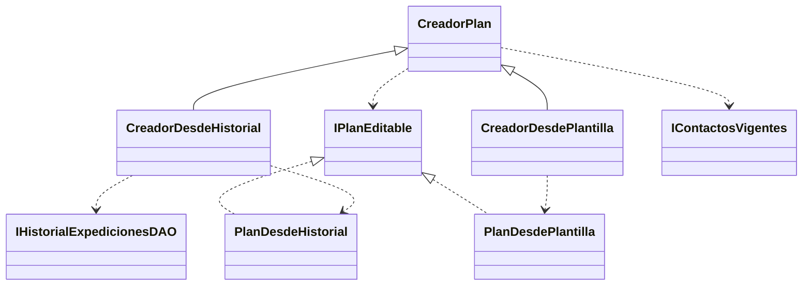

# HU-28: repetir una expedición del historial

## Primera entrega: contrato y reglas

La primera entrega de `feat/hu-28-repetir` incorporó el núcleo del Factory Method.
La segunda añade las consultas de Supabase y la API que se describen más abajo.
El borrador no es una expedición guardada: la creación posterior asignará un id
nuevo y validará las fechas y los contactos al confirmar. La interfaz sigue pendiente.

Se reutilizan sin cambios `CreadorPlan`, `IPlanEditable`, `IContactosVigentes` y
`verificarContratoCreadorPlan` de la referencia local de HU-29
`origin/feat/hu-29-plantillas`, commit `c1c68c1`. Al integrar ambas historias deben
conservarse estos archivos comunes, junto con las pruebas de los dos creadores.

`CreadorDesdeHistorial` consulta mediante `IHistorialExpedicionesDAO` y acepta
únicamente expediciones completadas del propietario. Los orígenes ajenos,
inexistentes o de otros estados devuelven el mismo error 404. Su producto
`PlanDesdeHistorial` implementa `IPlanEditable`, conserva ruta, coordenadas,
tolerancia y sugerencias de contactos y acompañantes, y no retiene referencias
mutables a los datos originales.

La operación común `prepararBorrador` deja las fechas vacías, revalida los contactos
vigentes, elimina sugerencias duplicadas y devuelve únicamente los campos
permitidos. Se conservan como sugerencias para revisión, no como una autorización
de guardado. Las alertas, los datos médicos, la confirmación, el estado y el id de
la expedición original no se trasladan al nuevo plan. `origenId` identifica solo
la procedencia del borrador.

## Responsabilidades y SOLID

| Componente | Responsabilidad |
| --- | --- |
| `IHistorialExpedicionesDAO` | Leer los datos reutilizables de un origen propio. |
| `CreadorDesdeHistorial` | Comprobar propietario y estado y construir el producto. |
| `PlanDesdeHistorial` | Representar una copia inmutable de los datos reutilizables. |
| `CreadorPlan` | Aplicar las reglas comunes de preparación del borrador. |
| `IContactosVigentes` | Comprobar cuáles de los contactos sugeridos siguen disponibles. |

Se separan las consultas de las escrituras (ISP); los colaboradores se reciben
mediante interfaces (DIP). La variante de historial amplía el creador compartido
sin cambiar la variante de plantilla (OCP). La misma suite de contrato comprueba
las invariantes del creador (LSP), y cada componente tiene una responsabilidad
acotada (SRP).



Los componentes de plantilla del diagrama pertenecen a HU-29 y no se incorporan
a esta rama en esta entrega.

## Verificación de la primera entrega

El 4 de noviembre de 2026, con Node 22.23.4, pasaron las 15 pruebas nuevas de
historial, el typecheck, el build y las 141 pruebas de la suite ordinaria del
backend. La suite PostgreSQL de HU-30 permanece condicionada a su entorno local
desechable y no se ejecutó en esta comprobación.

También se reunieron en una carpeta temporal los archivos comunes de esta rama y
el creador, producto, consultas en memoria y pruebas originales de HU-29 en
`c1c68c1`. Pasaron las 23 pruebas de ambos creadores: 15 de historial y 8 de
plantilla. Esta comprobación acredita la compatibilidad unitaria de esas versiones
del Factory Method, no la integración de las pantallas ni las API de ambas HU.

Desde la raíz, para reproducir la comprobación ordinaria:

```powershell
npm.cmd run typecheck --prefix backend
npm.cmd test --prefix backend
npm.cmd run build --prefix backend
```

## Segunda entrega: consultas y API

La API autenticada expone `GET /api/expediciones/:id/borrador`, usando el prefijo
configurado para el backend. Requiere el JWT propio de TrekSafe y rol `senderista`.
El propietario se obtiene del token; ningún parámetro de query sustituye esa
identidad. Devuelve `200` con `{ borrador }`, siguiendo el mismo formato de HU-29.

| Resultado | Código HTTP |
| --- | --- |
| Borrador de una expedición propia completada | `200` |
| UUID mal formado | `400` |
| Sesión ausente, inválida o expirada | `401` |
| Rol distinto de senderista | `403` |
| Origen ajeno, inexistente o no completado | `404` |
| Fallo de consulta de historial o contactos | `500`, sin entregar un borrador parcial |

`HistorialExpedicionesDAOSupabase` recibe el cliente y aplica filtros de id,
propietario y estado en la consulta. Selecciona solo los datos reutilizables y los
identificadores de contactos y nombres de acompañantes. No consulta fechas
antiguas, datos médicos, alertas ni confirmaciones.

Para los contactos se reutiliza sin cambios `DAOContactosVigentesSupabase` de la
misma referencia `c1c68c1` de HU-29, además de los cuatro archivos comunes de la
primera entrega. Solo recupera identificadores que siguen perteneciendo al
senderista y mantiene el orden de las sugerencias. La escritura definitiva deberá
volver a validar los contactos, porque pueden cambiar después de preparar el borrador.

El controlador valida el UUID y coordina la respuesta; el router aplica sesión y
rol únicamente a `/:id/borrador`. Las otras rutas de expediciones mantienen su
comportamiento. `app.ts` conecta las implementaciones concretas con el creador y
monta el router. La política global `Cache-Control: no-store` y las reglas
NetworkOnly de la PWA cubren esta ruta privada.

Esta fase usa tablas existentes y no requiere migraciones. Solicitar un borrador
es una lectura: no crea ni modifica expediciones, ni inicia el cron o el correo
durante las pruebas.

Las pruebas del adaptador usan el SDK real de Supabase con transporte HTTP
sustituido; comprueban la selección, filtros, mapeo y errores. Las pruebas de API
usan Express y JWT reales con consultas sustitutas, y verifican permisos,
aislamiento, UUID, fechas vacías, revalidación de contactos y ausencia de
escrituras. La prueba global de privacidad incluye también el rechazo sin sesión
de la ruta nueva. Estas comprobaciones no acreditan PostgREST ni Supabase DEV.

El 4 de noviembre de 2026, con Node 22.23.4, pasaron las 19 pruebas nuevas de API
y consultas, la nueva comprobación de privacidad y las 161 pruebas de la suite
ordinaria del backend, junto con el typecheck y el build. La suite PostgreSQL
condicionada de HU-30 no se ejecutó en esta fase. El frontend no cambia todavía.

## Pendientes para completar HU-28

1. Añadir «Repetir expedición» al historial y cargar el formulario de creación.
2. Exigir fechas nuevas y revisión de contactos; guardar con otro id y conservar
   la expedición original.
3. Ejecutar las comprobaciones de persistencia real, interfaz y el recorrido de DEV.
4. Coordinar los puntos intermedios con su responsable. El contrato actual de
   HU-29 no tiene ese campo: esta entrega conserva el contrato existente. La copia
   de puntos disponibles sigue pendiente y debe validarse antes de aceptar el
   alcance completo. No se reemplazarán puntos existentes por una colección vacía.

Las pruebas de estas entregas usan destinos sustitutos y datos ficticios. No
acreditan una integración completa de HU-29 ni una validación contra Supabase DEV.
