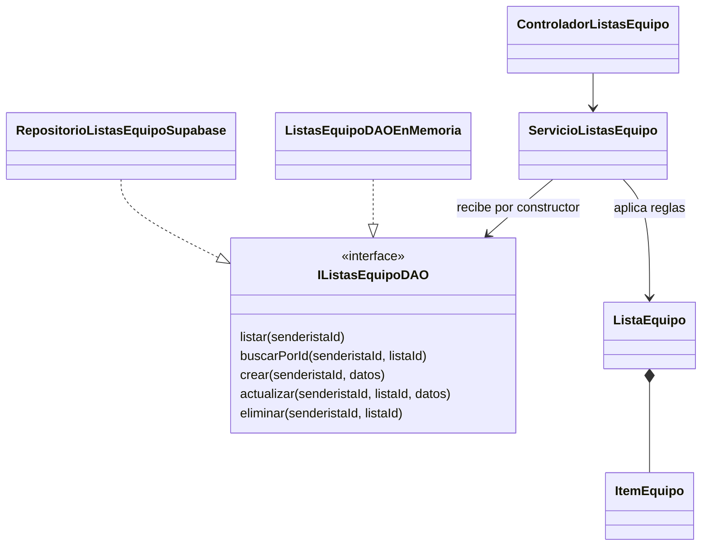

# HU-30 Listas personales de equipo

Esta historia permite al senderista crear, consultar, editar y eliminar sus listas
de equipo. Cada lista tiene nombre e ítems obligatorios u opcionales. Se permiten
listas inicialmente vacías y también quitar todos los ítems de una lista existente.

## Estado de las fases

| Fase | Resultado |
| --- | --- |
| 1 Alcance | Reglas delimitadas y listas vacías confirmadas por Jhon. |
| 2 Diseño | Entidades, contrato DAO y responsabilidades definidos. |
| 3 Esquema | Migración y pruebas locales PostgreSQL; aplicada y verificada en Supabase DEV. |
| 4 Reglas | Entidades, servicio y DAO de pruebas implementados; comprobación de tipos y pruebas aprobadas. |
| 5 Persistencia y API | Adaptador, RPC y rutas comprobados localmente; aplicación y validación en Supabase DEV pendientes. |
| 6 Interfaz | Pantalla y acceso desde el perfil implementados; pruebas de React aprobadas, revisión visual pendiente. |
| 7 Validación | 80 pruebas locales aprobadas con Node 22; revisión visual y Supabase DEV pendientes. |
| 8 Entrega | Integrada en develop con el PR #62; aceptación del PO a registrar en la Review. |

## Reglas y contrato

- Los nombres de lista e ítem se recortan en los extremos y no pueden quedar vacíos.
- Cada ítem indica explícitamente si es obligatorio mediante un booleano.
- El actor se recibe de la identidad autenticada. Los datos de edición no permiten
  sustituir el propietario ni el identificador de la lista.
- El cliente no asigna ids al crear. Al editar, envía el id de los ítems que conserva;
  los nuevos no tienen id y los omitidos se eliminan. Se rechazan ids repetidos y de
  otra lista, incluso cuando ambas listas tienen el mismo propietario.
- Una lista ajena produce la misma ausencia que una inexistente. Consultar, editar
  o eliminar desde el servicio produce `LISTA_EQUIPO_NO_ENCONTRADA`.
- El DAO guarda cada colección completa de forma atómica y vuelve a comprobar la
  propiedad y la pertenencia de ids durante la escritura. Un error conserva el
  estado anterior. La implementación PostgreSQL bloquea la lista durante la edición
  y comprueba de nuevo los ids, aunque la aplicación ya haya validado una lectura anterior.

`ListaEquipo` e `ItemEquipo` son instantáneas inmutables de datos guardados. Los
ids y fechas los proporciona el DAO. La normalización de las entradas está en el
dominio y se reutiliza al reconstruir las entidades. Los errores de validación del
dominio no dependen de Express, códigos HTTP ni Supabase. La representación HTTP
de esos errores se realiza en el manejador de errores de la API.

## Dependencias



El servicio utiliza los errores de ausencia y autenticación compartidos de la
aplicación. No importa implementaciones de infraestructura ni tiene un DAO por
defecto. El adaptador Supabase se conecta en `presentation/http/app.ts`, el punto
de ensamblaje HTTP existente. El controlador recibe el servicio por constructor.

## Tarjetas CRC

| Clase | Responsabilidad | Colaboradores |
| --- | --- | --- |
| `ItemEquipo` | Validar y representar nombre, identidad e indicador obligatorio de un ítem guardado. | `ErrorValidacionEquipo` |
| `ListaEquipo` | Validar el contenido y conservar una colección inmutable sin ids duplicados. | `ItemEquipo`, `ErrorValidacionEquipo` |
| `ServicioListasEquipo` | Coordinar operaciones del propietario y comunicar ausencia o errores. | `IListasEquipoDAO`, entidades, errores de aplicación |
| `ListasEquipoDAOEnMemoria` | Cumplir el contrato de persistencia en pruebas sin acceso a servicios externos. | `ListaEquipo`, almacenamiento local en memoria |
| `RepositorioListasEquipoSupabase` | Traducir el contrato DAO a RPC y convertir resultados y errores. | Cliente Supabase, entidades, funciones PostgreSQL |
| `ControladorListasEquipo` | Validar tipos y UUID de las solicitudes y devolver respuestas HTTP. | Servicio, esquemas Zod |

## Evidencia de SOLID

| Principio | Aplicación y comprobación |
| --- | --- |
| SRP | El dominio mantiene invariantes, el servicio coordina y el DAO persiste. Las pruebas ejercitan estas responsabilidades por separado. |
| OCP | El servicio recibe el contrato DAO; una implementación diferente se conecta sin modificar sus casos de uso. |
| LSP | La suite `verificarContratoListasEquipoDAO` se ejecuta sobre memoria y sobre el adaptador con SDK y PostgreSQL local real. Comprueba resultados, errores, aislamiento y conservación de datos. |
| ISP | `IListasEquipoDAO` contiene solo cinco operaciones cohesivas de listas base; no mezcla usuarios, expediciones o reportes. |
| DIP | Aplicación importa el contrato de dominio y recibe la implementación por constructor. Dominio no importa infraestructura. |

No se imponen nombres únicos ni una cantidad máxima nueva de listas o ítems.
La copia de equipo y las marcas de preparación por expedición pertenecen a HU-31.

## Comprobaciones de la fase 4

Desde la raíz del repositorio en PowerShell:

```powershell
npm.cmd run typecheck --prefix backend
npm.cmd test --prefix backend
npm.cmd run build --prefix backend
```

Las pruebas nuevas cubren entidades, casos de uso y contrato DAO. Incluyen nombres
vacíos, tipos inválidos, permisos, ids de ítems ajenos o duplicados, edición y
eliminación, conservación de datos ante errores y una eliminación entre lectura y
escritura. No requieren `.env`, Supabase ni correo.

El 1 de noviembre de 2026 se verificaron tipos, compilación y 41 pruebas en Windows
con Node 24.15.0, sin fallos: 35 pruebas nuevas y las 6 existentes. La validación
posterior con Node 22 se recoge en la fase 7. Estas pruebas no acreditan persistencia
remota ni aislamiento HTTP, que requieren la fase 5.

## API de la fase 5

Todas las rutas requieren `Authorization: Bearer <JWT>` y rol senderista. El
propietario se toma del token, nunca del cuerpo. Los cuerpos admiten únicamente
los campos documentados; se rechazan tipos incorrectos y campos adicionales.

| Método y ruta | Respuesta |
| --- | --- |
| `GET /api/usuario/listas-equipo` | 200 con `{ listas }` |
| `GET /api/usuario/listas-equipo/:listaId` | 200 con `{ lista }` |
| `POST /api/usuario/listas-equipo` | 201 con `{ mensaje, lista }` |
| `PUT /api/usuario/listas-equipo/:listaId` | 200 con `{ mensaje, lista }` |
| `DELETE /api/usuario/listas-equipo/:listaId` | 204 sin cuerpo |

Creación de una lista vacía:

```json
{ "nombre": "Equipo de montaña", "items": [] }
```

Al crear, los ítems llevan `nombre` y `obligatorio`. Al editar, se envía la
colección completa: conservar el `id` retiene el ítem, omitir un ítem lo elimina y
enviar uno sin `id` crea otro. El orden enviado se guarda en una posición interna.
La posición no forma parte del cuerpo HTTP ni de la entidad de dominio.

Los errores de validación producen 400, la ausencia de sesión 401, un rol distinto
403 y una lista ajena o inexistente 404. Un fallo de persistencia devuelve 500 con
un mensaje genérico. La actualización preserva el id, propietario y fecha de
creación. Se serializan las escrituras por lista; no se añade control de versión
optimista: una edición válida posterior puede sustituir otra edición válida.

## Pruebas de la fase 5

Además de las pruebas ordinarias, el script siguiente crea una instancia
PostgreSQL local independiente, reproduce los roles, aplica las dos migraciones,
ejecuta las pruebas SQL y del backend y apaga la instancia en `finally`:

```powershell
powershell.exe -NoProfile -ExecutionPolicy Bypass -File backend/scripts/test-hu30-postgres.ps1
```

Requiere PostgreSQL con `initdb`, `pg_ctl` y `psql` en PATH, y las dependencias del
backend instaladas. La opción `ExecutionPolicy` afecta únicamente a ese proceso
de PowerShell. No se usa `DATABASE_URL`; los datos y logs quedan en una carpeta
temporal local. La variable `HU30_TEST_DATABASE_URL` solo se establece para la
ejecución y se restaura al finalizar. Sin ella, la suite PostgreSQL se omite al
ejecutar `npm.cmd test --prefix backend`.

Las pruebas SQL llaman las RPC directamente. La suite de contrato usa el SDK
Supabase con un puente `fetch` que ejecuta las funciones sobre PostgreSQL real
como `service_role`. Este puente sustituye PostgREST; no acredita el despliegue
de Supabase. Las pruebas HTTP levantan Express en un puerto local temporal con
JWT firmado y DAO en memoria, sin iniciar `main.ts` ni su cron.

El 1 de noviembre de 2026, la comprobación integrada de esta fase aprobó 60 pruebas, incluidas dos
carreras con bloqueo real de PostgreSQL: edición contra edición e intento de
editar una lista eliminada. La comprobación final conservó solo las dos cuentas
semilla, cero listas y cero ítems. También pasaron typecheck y compilación del
backend, con Node 24.15.0; PostgreSQL local fue 18.1. Quedan pendientes la aplicación coordinada y
la comprobación contra Supabase DEV. La validación con Node 22 se completó en la fase 7.

## Interfaz de la fase 6

El senderista accede desde **Perfil → Listas de equipo**, en
`/senderista/perfil/equipo`. Puede crear listas vacías, añadir o quitar ítems,
cambiar su condición de obligatorio, editar listas y eliminarlas tras confirmar.
Editar consulta primero la versión guardada; cancelar descarta solo el formulario.

| Componente o módulo | Responsabilidad |
| --- | --- |
| `listasEquipoApi` | Adaptar las cinco operaciones HTTP y enviar el JWT. |
| `useListasEquipo` | Coordinar carga, escrituras, errores y resultados; recibe `ListasEquipoApi`. |
| `FormularioListaEquipo` | Mantener lo escrito, mostrar validaciones y emitir los datos del formulario. |
| `listasEquipoFormulario` | Preparar una copia editable y serializar solo los campos autorizados. |
| `PaginaListasEquipo` | Conectar sesión, API y presentación; reiniciar el estado privado al cambiar de usuario. |

Los ids guardados se conservan al editar y las claves locales de React no salen
en la solicitud. Los fallos de guardado conservan nombre e ítems; las escrituras
simultáneas están bloqueadas. Una lectura anterior no puede sobrescribir el
resultado de una escritura que terminó después. Hay estados separados de carga,
colección vacía, error, reintento y confirmación de una operación exitosa.

La pantalla permite continuar escribiendo en un formulario abierto sin conexión,
pero guardar y eliminar requieren red. No persiste borradores ni añade una cola
offline. Las lecturas usan `cache: no-store` y Workbox aplica `NetworkOnly` a estos
endpoints para no guardar respuestas privadas en la caché compartida de la PWA.

## Comprobaciones de la fase 6

```powershell
npm.cmd run test:equipo --prefix frontend
npm.cmd run typecheck --prefix frontend
npm.cmd run build --prefix frontend
```

Se añadieron herramientas de prueba de desarrollo compatibles con React 18 y el
ejecutor Node: `react-test-renderer`, sus tipos, `tsx` y los tipos de Node 22.
No se cargan en el código de la aplicación entregado al navegador.

El 1 de noviembre de 2026 pasaron 19 pruebas del frontend con Node 24.15.0.
Cubren listas vacías, ítems obligatorios y opcionales, ids retenidos, cancelación,
errores de guardado, confirmación de eliminación simulada, reconexión, reintento,
doble envío, lecturas antiguas y solicitudes HTTP autenticadas sin caché.

Estas pruebas montan React con un contrato HTTP sustituido y eventos simulados;
no son pruebas de navegador. La revisión visual en móvil y escritorio, incluyendo
el tema oscuro y la navegación por teclado, queda pendiente: no había navegador
habilitado en la sesión. Tampoco se comprobó aún el recorrido completo de la PWA
contra Supabase DEV. Ambos puntos forman parte de la verificación de integración.

## Verificación de la fase 7

Se completó el recorrido local React → cliente HTTP → Express → DAO → PostgreSQL
con dos usuarios ficticios y sesiones distintas del mismo usuario. Se aprobaron
80 pruebas con Node 22.23.4 en Windows: 60 del backend y 20 del frontend, además
de las pruebas SQL, ambos typecheck y ambos builds. Los scripts actuales también
descubrieron correctamente las suites nuevas en ese entorno.

El script PostgreSQL ahora ejecuta las pruebas de ambas carpetas antes de apagar
su instancia temporal. Sin `HU30_TEST_DATABASE_URL`, las pruebas ordinarias omiten
la suite de PostgreSQL y el nuevo recorrido integrado del frontend.

La matriz de aceptación, comandos, entorno y limitaciones están en
[Validación local de HU-30](hu-30-validacion.md). Supabase DEV y sus migraciones
siguen pendientes por decisión de Jhon; la comprobación visual requiere un navegador
habilitado. Esta evidencia local no marca la HU como aceptada o Done.
