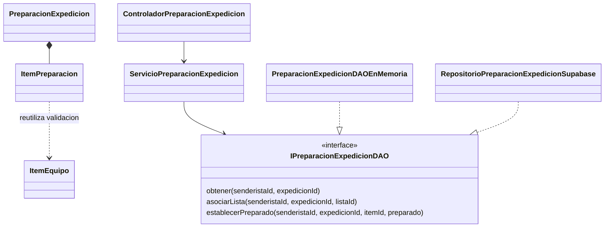

# HU-31: revisar el equipo de una expedición

## Estado y alcance

Fases 1, 2 y 3 completadas el 5 de noviembre de 2026: alcance, dominio, servicio,
DAO en memoria, migraciones, adaptador Supabase y API con pruebas locales de
PostgreSQL. La pantalla, la aplicación de migraciones en DEV y la validación
funcional en ese entorno siguen pendientes.

Fuente funcional: `TrekSafe_Product_Backlog_ISW2.xlsx`, hoja de backlog, fila 42.
Historia asignada a Jhon, Sprint 1, 3 SP. Depende de HU-07 y HU-30; no requiere
HU-28 ni los puntos intermedios de HU-32. HU-33 consumirá posteriormente el
resumen de preparación junto con los puntos de la ruta.

La rama `feat/hu-31-equipo-expedicion` parte de la referencia local de develop
`0ab5057`, que ya contiene las listas de HU-30 y el arreglo de privacidad/PWA.
La creación y edición de listas base permanece en HU-30. HU-31 añade una copia
por expedición y sus marcas de preparación.

## Criterios y decisiones

| Origen | Regla |
| --- | --- |
| Backlog, criterio 1 | Asociar una lista crea una copia de todos sus ítems para esa expedición. |
| Backlog, criterio 2 | Las marcas persisten y se muestra el número de obligatorios pendientes. |
| Backlog, criterio 3 | Los cambios de la lista base no alteran la copia; el aviso no bloquea confirmar el retorno seguro. |
| Confirmado por Jhon el 05/11/2026 | Una expedición conserva su primera copia. Se rechaza una segunda asociación, sin reemplazar la copia ni reiniciar marcas. |
| Confirmado por Jhon el 05/11/2026 | Se permite asociar y cambiar marcas en `programada` y `en_progreso`. Los demás estados son de consulta. |

La escritura depende del estado vigente al guardar, no solo del mostrado en la
pantalla. No se añade una condición de fecha futura distinta a los estados
confirmados. Un estado nuevo no habilita escrituras automáticamente.

Cada expedición admite como máximo una preparación. Una lista base puede usarse
en varias expediciones del mismo propietario, con copias y marcas independientes.
El usuario debe ser propietario tanto de la expedición como de la lista origen.
Los identificadores y la identidad del propietario no se aceptan como contenido
editable enviado por el cliente: el actor se obtiene del JWT de TrekSafe.

## Comportamiento previsto

1. El propietario abre el equipo de una expedición.
2. Si no tiene preparación y el estado permite escribir, selecciona una de sus
   listas de HU-30. Si no tiene listas, puede ir a crearlas en su perfil.
3. El backend copia nombre de lista, nombres de ítems, indicadores obligatorios y
   orden. Asigna identidades nuevas a la preparación y sus ítems; todas las
   marcas empiezan en `preparado: false`.
4. La pantalla presenta los ítems con casillas y el contador de obligatorios
   pendientes. Cambiar una casilla guarda un booleano explícito en el servidor.
5. Recargar recupera las marcas guardadas. Un error conserva el último estado
   confirmado y permite reintentar, sin anunciar un guardado que no ocurrió.

Ejemplo: una lista tiene casco y agua obligatorios y cámara opcional. Al
asociarla hay 2 obligatorios pendientes. Marcar cámara no cambia ese número;
marcar casco lo reduce a 1; desmarcar casco lo devuelve a 2.

Se mantienen las listas vacías permitidas en HU-30. Asociar una lista vacía crea
una preparación con cero ítems y cero pendientes. La interfaz distingue «sin
lista asociada» de «lista asociada sin ítems»; un contador en cero no certifica
la seguridad de la salida.

La copia conserva su contenido si la lista original se renombra, cambia sus
ítems o se elimina. Eliminar la expedición elimina su preparación. Eliminar la
cuenta respeta las cascadas existentes. No se permite editar el contenido de la
copia, sustituirla ni quitarla como parte de esta entrega: solo marcar/desmarcar.

En `completada`, `alerta` u otro estado no habilitado se consulta lo guardado, si
existe. El módulo de equipo no cambia el estado, la versión del plan, sus fechas,
contactos, cron, alertas ni confirmaciones. Una falla de carga o guardado de
equipo no condiciona ni retrasa el flujo de retorno seguro.

## Diseño SOLID

Las entidades, el puerto, el servicio, los dos adaptadores y HTTP de la tabla
siguiente están implementados. El frontend corresponde a la siguiente fase.

| Componente | Responsabilidad y colaboradores |
| --- | --- |
| `ItemPreparacion` | Representar el ítem copiado y su marca booleana. Reutilizar la validación de nombre y obligatoriedad de `ItemEquipo`, sin heredar de la lista base. |
| `PreparacionExpedicion` | Representar una instantánea independiente e inmutable y calcular los obligatorios pendientes desde sus ítems. |
| `IPreparacionExpedicionDAO` | Contrato pequeño de consulta, asociación atómica y establecimiento de una marca, siempre limitado al propietario. |
| `ServicioPreparacionExpedicion` | Coordinar los casos de uso mediante el puerto inyectado y comunicar sus resultados y errores. No importar Supabase ni Express. |
| `PreparacionExpedicionDAOEnMemoria` | Cumplir el mismo contrato para pruebas de reglas, propiedad e independencia. |
| `RepositorioPreparacionExpedicionSupabase` | Traducir el puerto a operaciones SQL/RPC y reconstruir las entidades. |
| Controlador y router de preparación | Validar UUID y tipos, obtener el actor autenticado y convertir resultados a HTTP. |
| Cliente HTTP, hook y pantalla de equipo | Separar transporte, coordinación de solicitudes y presentación; recibir sus colaboradores para probarlos. |

No se amplía `IListasEquipoDAO` ni `IExpedicionDAO` con responsabilidades ajenas.
La copia no agrega `preparado` a `ItemEquipo` ni modifica las listas base.
El ensamblaje se hará en `backend/src/presentation/http/app.ts`.



| Principio | Aplicación prevista |
| --- | --- |
| SRP | Separar preparación, listas reutilizables, persistencia y presentación. |
| OCP | Conectar otro adaptador mediante el mismo puerto sin cambiar el servicio. |
| LSP | Ejecutar una suite de contrato común sobre memoria y persistencia real local. |
| ISP | Mantener tres operaciones cohesivas de preparación, sin añadirlas a los DAO existentes. |
| DIP | Aplicación depende del contrato de dominio; las implementaciones se inyectan en el ensamblaje. |

Se reutilizan validadores y componentes compatibles de HU-30 y los estilos
existentes. Su formulario edita contenido de una lista base, por lo que no se
forzará a representar también marcas de preparación mediante opciones ajenas a
su responsabilidad. HU-31 usa DAO; no necesita otro Factory Method.

## Persistencia y concurrencia previstas

HU-31 sí necesita migraciones nuevas. Los nombres y números definitivos se
acordarán con Sebastian siguiendo `backend/migrations/README.md`. No se modifica
el SQL ya aplicado de HU-30 ni se ejecuta `init_schema.sql` en DEV.

| Tabla propuesta | Contenido y relaciones |
| --- | --- |
| `preparaciones_expedicion` | UUID, expedición única con cascada, referencia opcional a lista origen con `ON DELETE SET NULL`, nombre copiado y fechas. |
| `items_preparacion_expedicion` | UUID propio, preparación con cascada, nombre copiado, obligatoriedad, `preparado` inicialmente falso y posición única no negativa por preparación. |

Los ítems copiados no dependen de los ítems originales mediante una cascada. El
contador se calcula a partir de `obligatorio && !preparado`; no se guarda otro
contador que pueda quedar desactualizado. El propietario se comprueba mediante
la expedición y, al asociar, también mediante la lista base.

La asociación se realiza en una única transacción/RPC que comprueba propietario,
estado y ausencia de preparación, lee una versión consistente de la lista y
crea cabecera e ítems. Se coordina el bloqueo de la lista con las operaciones de
HU-30 para no copiar una mezcla de versiones. Una restricción única por
expedición impide dos copias concurrentes. Un error no deja cabeceras o ítems
parciales, y repetir una solicitud no borra marcas existentes.

Cada cambio de marca vuelve a comprobar propietario, estado y pertenencia del
ítem dentro de la transacción. Se establece `true` o `false`, no se implementa
un «invertir» que una repetición pueda deshacer. Se actualiza solo ese ítem; dos
marcas de ítems distintos no deben sobrescribirse. Los cambios sobre el mismo
ítem se serializan y prevalece la última escritura procesada. La lectura de la
preparación y sus ítems también debe devolver una instantánea consistente.

Las escrituras coordinan el bloqueo de la expedición con los cambios de estado.
Una carrera con el cron o con la confirmación de retorno no permite guardar
basándose en un estado anterior ya invalidado. El módulo de retorno no consulta
ni exige que el equipo esté completo.

Se conserva el modelo actual: RLS y permisos directos denegados para `anon` y
`authenticated`, RPC `SECURITY INVOKER` con `search_path` vacío y ejecución solo
para `service_role`. Como este rol evita RLS, cada operación SQL debe comprobar
explícitamente propietario y pertenencia; una comprobación previa en el servicio
no autoriza por sí sola la escritura.

## API y pantalla propuestas

Rutas nuevas bajo el prefijo configurado de la API:

| Operación | Ruta y cuerpo | Resultado previsto |
| --- | --- | --- |
| Consultar | `GET /api/expediciones/:id/equipo` | `200 { preparacion }`; `preparacion: null` si la expedición propia aún no tiene copia. |
| Asociar | `POST /api/expediciones/:id/equipo` con `{ listaId }` | `201 { preparacion }`. |
| Establecer marca | `PATCH /api/expediciones/:id/equipo/items/:itemId` con `{ preparado }` | `200 { preparacion }` con marcas y contador actualizados. |

Sin sesión: 401. Rol distinto de senderista: 403. UUID o booleano inválido: 400.
Una expedición, lista o ítem ajeno produce el mismo 404 que uno inexistente. Las
reglas de estado y segunda asociación producen 409 cuando el recurso es propio;
se comprueba primero la propiedad. Un fallo interno devuelve un error genérico,
sin datos de otras cuentas ni detalles de SQL.

La interfaz prevista es `/senderista/expedicion/:id/equipo`, accesible desde el
listado de expediciones y la vista activa, con consulta desde el historial cuando
corresponda. Mostrará selección inicial, lista vacía, casillas, contador, estados
de carga/error y reintento. Durante el guardado se evita el doble envío y no se
permite otra asociación. Los avisos siguen el estilo de la PWA.

Las nuevas operaciones requieren conexión. No se añade una cola offline ni
almacenamiento de equipo en Web Storage. Se mantienen `Cache-Control: no-store`,
NetworkOnly y el control de sesión de `clienteApi`. Al salir o cambiar de cuenta
se descartan respuestas tardías y se limpia el estado de pantalla.

## Casos de prueba previstos

| Área | Comprobación necesaria |
| --- | --- |
| Copia | Contenido y orden correctos, identidades nuevas y marcas inicialmente falsas; lista vacía válida. |
| Independencia | Renombrar, editar o eliminar la lista base no cambia la preparación. Dos expediciones no comparten marcas. |
| Pendientes | Solo cuentan obligatorios no preparados; marcar opcionales no cambia el contador; desmarcar restaura el pendiente. |
| Permisos | Rechazar expedición o lista de otro usuario e ítems de otra preparación, incluso del mismo usuario. |
| Estados | Asociar y marcar en programada/en progreso; rechazar escrituras en los demás estados y permitir consulta. |
| Persistencia | Recargar conserva marcas; eliminar expedición elimina su copia; eliminar lista base conserva la copia. |
| Atomicidad | Un fallo al copiar no deja datos parciales; dos asociaciones concurrentes crean como máximo una preparación. |
| Marcas y carreras | Repetir el mismo booleano no invierte la marca; marcas en ítems distintos se conservan; un cambio de estado se revalida al escribir. |
| API y sesión | Validación de entrada, 401/403/404/409, no-store y descarte de respuestas de otra sesión. |
| Interfaz | Selección, casillas, contador, lectura por estado, fallo y reintento sin falso guardado. |
| Regresión | HU-30 conserva su comportamiento y confirmar retorno sigue funcionando con obligatorios pendientes o sin preparación. |

Las pruebas unitarias y el adaptador en memoria no sustituyen la comprobación
SQL local ni el recorrido real de DEV. La evidencia distinguirá qué se ejecutó,
qué se omitió y qué sigue pendiente.

## Ruta de implementación por fases

| Fase | Entrega y criterio de avance |
| --- | --- |
| 1 Alcance y diseño | Este documento y las dos decisiones confirmadas por Jhon. Completada a nivel de planificación. |
| 2 Dominio y casos de uso | Completada: entidades, puerto, servicio y DAO en memoria; 46 pruebas nuevas aprobadas, tipos y compilación correctos. |
| 3 Persistencia y API | Completada localmente: dos migraciones, tres RPC, adaptador y rutas; 229 pruebas backend y 24 frontend de HU-30 aprobadas con PostgreSQL real. DEV pendiente. |
| 4 Interfaz | Selección y revisión de equipo por expedición, marcas y contador, pruebas de componentes y regresión del retorno. |
| 5 DEV y entrega | Coordinar migraciones con Sebastian, probar con dos cuentas ficticias, reunir capturas y resultados, limpiar datos de prueba y preparar el PR para revisión. |

Jhon realiza los cambios de Git, commits, push y publicación del PR. La aplicación
de migraciones en DEV se coordina con Sebastian cuando los archivos estén
implementados y comprobados. La integración, revisión de criterios y aceptación
del equipo son necesarias antes de declarar la historia terminada.

## Implementación y comprobación de la fase 2

Archivos principales:

- `backend/src/domain/entities/ItemPreparacion.ts`: reutiliza las reglas de
  `ItemEquipo` y exige una marca booleana sin convertir cadenas o números.
- `backend/src/domain/entities/PreparacionExpedicion.ts`: mantiene identidades,
  nombre e ítems copiados en una instantánea inmutable. Su propiedad calculada
  `obligatoriosPendientes` cuenta únicamente los obligatorios sin preparar.
- `backend/src/domain/errors/ErrorPreparacionExpedicion.ts`: errores de dominio
  y regla de estados permitidos, sin dependencias de HTTP.
- `backend/src/domain/repositories/IPreparacionExpedicionDAO.ts`: tres operaciones
  y sus garantías de propiedad, estado, independencia y escritura atómica.
- `backend/src/application/services/servicioPreparacionExpedicion.ts`: recibe el
  puerto por constructor, exige actor y traduce los rechazos de negocio a errores
  de aplicación. Rechaza respuestas de otra cuenta o expedición si un adaptador
  defectuoso incumple el contrato; propaga los fallos de persistencia.
- `backend/src/testing/PreparacionExpedicionDAOEnMemoria.ts`: modelo aislado con
  fuentes ficticias de expediciones y listas. Publica una nueva instantánea solo
  después de materializarla completamente. No se ensambla en producción.

`contextoPreparacionEnMemoria.ts` construye datos ficticios usando también el DAO
existente de HU-30 para crear, editar y eliminar las listas base. La suite común
`verificarContratoPreparacionExpedicionDAO` contiene 17 casos reutilizables por el
adaptador real. En esta fase solo se ha ejecutado sobre memoria: todavía no
acredita sustitución frente a PostgreSQL ni bloqueos SQL.

El 5 de noviembre de 2026, con Node 22.23.4, se aprobaron:

| Comprobación | Resultado |
| --- | --- |
| Dominio HU-31 | 14 pruebas aprobadas. |
| Servicio HU-31 | 10 pruebas aprobadas. |
| Contrato DAO sobre memoria | 17 pruebas aprobadas. |
| Fallos y casos adicionales del sustituto | 5 pruebas aprobadas. |
| Suite ordinaria del backend, incluyendo HU-31 | 172 pruebas aprobadas. |
| `typecheck` y `build` del backend | Aprobados. |

La suite condicionada de PostgreSQL desechable de HU-30 no se ejecutó en esta
comprobación. No se aplicaron migraciones ni se ejecutaron pruebas de HU-31 en DEV.
Tampoco se cambiaron rutas, pantallas o dependencias. Los escenarios con solicitudes
simultáneas son un modelo en memoria; las carreras reales con cambios de estado,
los permisos SQL y las cascadas se verificarán en la fase de persistencia.

Para reproducir desde la raíz usando Node 22:

```powershell
npm.cmd run typecheck --prefix backend
npm.cmd test --prefix backend
npm.cmd run build --prefix backend
```

Como criterio para la fase 3 se estableció que el DTO HTTP debía incluir
explícitamente `obligatoriosPendientes` y que las RPC debían comprobar las reglas
dentro de la transacción. Estos requisitos se verificaron en la entrega siguiente.

## Implementación y comprobación de la fase 3

Se añadieron las migraciones `004_hu31_preparacion_expedicion.sql` y
`005_hu31_operaciones_preparacion.sql`, el adaptador
`RepositorioPreparacionExpedicionSupabase`, DTO, controlador y router propios.
El ensamblaje inyecta el adaptador en el servicio sin cambiar los DAO de HU-30 o
de edición del plan. El router protege solo sus tres rutas y no intercepta las
operaciones existentes de expediciones.

La API devuelve exclusivamente los campos de preparación permitidos e incluye
el contador calculado. Exige booleanos reales y UUID y rechaza campos extra de
propietario, identidades o contenido de la copia. Los errores conocidos de SQL se
traducen por código; los mensajes de persistencia y datos corruptos son genéricos.

La misma suite de 17 casos de contrato se ejecutó sobre memoria y sobre el SDK
con PostgreSQL real como `service_role`. El puente de pruebas sustituye el
transporte HTTP de Supabase, no las funciones ni las transacciones de SQL. Los
casos de estado usan expediciones compatibles con la restricción existente de
una sola expedición activa/alerta por senderista.

Las pruebas reales también verificaron espera de bloqueos, copia coherente
tras editar la lista, eliminación concurrente del origen, cambios a completada
o alerta durante una escritura pendiente, rollback ante fallo al copiar un ítem,
cascadas y denegación efectiva de tablas y RPC a los roles del cliente. Se
comprobó la consulta HTTP y persistencia de marcas con dos usuarios ficticios.

Resultados reproducibles, comando local y límites en
[hu-31-validacion.md](hu-31-validacion.md). Las migraciones se aplicaron únicamente
en la base local desechable. Sebastian debe confirmar numeración y orden antes
de DEV. La prueba SQL de completar el estado con pendientes no sustituye todavía
el recorrido de contraseña y retorno seguro desde la PWA, previsto en las fases
de interfaz y validación funcional.
