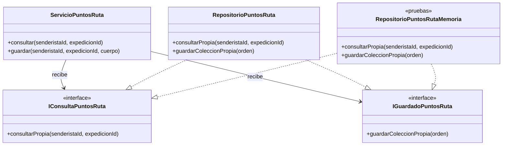

# HU-32 — Diseño SOLID y tarjetas CRC

Material de referencia: Semana 2 ISW2, SOLID v2 proporcionado por Andriy. Las páginas citadas incluyen la portada del PDF. Evidencia de ejecución: [fase 6](fase-6-integracion.md).

## Diagrama de las clases y contratos reales

El ensamblaje de infraestructura construye el repositorio Supabase y lo inyecta al servicio. El controlador es una fábrica de manejadores HTTP; la interfaz React utiliza componentes y hooks funcionales. El diagrama no los presenta como clases que el código no contiene.

## Aplicación verificable de los cinco principios

| Principio | Decisión y motivo | Código y evidencia |
| --- | --- | --- |
| **SRP**, p. 40 | Separar recepción HTTP, validación, coordinación de negocio y persistencia permite cambiar cada responsabilidad de forma acotada. | `controladorPuntosRuta.ts`, `puntosRuta.dto.ts`, `ServicioPuntosRuta` y `RepositorioPuntosRuta`. Pruebas independientes del servicio, adaptador y rutas. |
| **OCP**, p. 46 | El caso de uso consume contratos de datos estables. Se puede conectar otra implementación conservando su lógica. | Puertos de consulta/guardado; el mismo servicio recibe colaboradores sustitutos en `servicioPuntosRuta.test.ts`. La extensión demostrada es la persistencia. |
| **LSP**, p. 52 | Sustituir una implementación exige conservar resultados, rechazos, IDs y reglas de versión; compartir firmas no basta. | Los mismos 12 escenarios de `contratoPuntosRuta.test.ts` pasan en memoria y PostgreSQL. El redondeo decimal del sustituto respeta los empates negativos del servidor. Las pruebas SQL añaden rollback y concurrencia reales. |
| **ISP**, p. 58 | Lectura y escritura tienen contratos pequeños; no obligan a implementar correo, rescate o salud. | `IConsultaPuntosRuta` e `IGuardadoPuntosRuta` tienen una operación cada una. Una prueba inyecta lectores y escritores separados. |
| **DIP**, p. 64 | La aplicación recibe interfaces mediante constructor. Los detalles Supabase se conectan fuera del servicio. | `servicioPuntosRuta.ts` no importa infraestructura, Express ni repositorios concretos. `infrastructure/composition/puntosRuta.ts` realiza el ensamblaje. |

Las interfaces especializadas cumplen el papel de acceso a datos previsto para HU-32 en el backlog. Se mantiene la convención de repositorios del proyecto. El diseño utiliza composición y no necesita una jerarquía de herencia adicional para demostrar SOLID.

## Tarjetas CRC

| Clase | Responsabilidad principal | Colaboradores |
| --- | --- | --- |
| `ServicioPuntosRuta` | Validar la entrada y coordinar consulta o guardado del propietario. Entregar resultados de negocio sin códigos HTTP. | Esquemas DTO, `IConsultaPuntosRuta`, `IGuardadoPuntosRuta`. |
| `RepositorioPuntosRuta` | Adaptar los puertos a las RPC, validar su respuesta y normalizar timestamps; propagar fallos técnicos sin exponer su contenido al cliente. | `ClienteRpcPuntos`, SDK Supabase, RPC de consulta/guardado. |
| `RepositorioPuntosRutaMemoria` | Sustituir persistencia en las pruebas manteniendo las reglas observables del contrato. | Reloj inyectado, fixtures y validadores. No participa en producción. |

## Decisiones técnicas para explicar

**Guardar la colección completa.** Una sola operación representa altas, edición, bajas y orden. El servidor comprueba que hay entre 0 y 20 puntos y que las posiciones son únicas y consecutivas. Esto simplifica el editor y permite demostrar el criterio de guardado completo.

**Transacción y bloqueo de expedición.** La validación previa de TypeScript mejora los errores de entrada; el SQL comprueba propietario, estado, hora y versión al obtener el bloqueo. Así se evita basar la escritura en una lectura anterior que otra sesión pudo modificar.

**Identidad separada de posición.** El UUID del punto permanece al editar o reordenar. La restricción de orden es diferible durante la actualización, por lo que intercambiar posiciones no exige borrar y recrear puntos. Esto conserva referencias que utilizará HU-34.

**Versión única compartida.** HU-32 propone consumir la misma versión del plan que HU-26. La migración exige su existencia, pero no la crea unilateralmente. Los tests usan un fixture; la coordinación con Favio y Sebastian sigue pendiente antes de DEV.

**Consulta actual y recuperación explícita.** La PWA usa NetworkOnly para puntos. Ante conflicto o respuesta incierta conserva la edición y consulta al servidor; elegir otra base no dispara un guardado automático. Se evita reutilizar una lista cacheada de otro momento o usuario.

Estas decisiones mantienen bajo acoplamiento y alta cohesión. DRY reutiliza los límites geográficos existentes dentro de cada capa; KISS y YAGNI mantienen el incremento dentro de la PWA, API y base actuales. PostgREST local es una herramienta de pruebas, no un servicio nuevo que se deba desplegar con TrekSafe.

## Guion breve de sustentación

«Mi servicio recibe dos contratos pequeños. El ensamblaje conecta Supabase en producción y las pruebas pueden sustituirlo sin cambiar el caso de uso. La misma suite exige a memoria y PostgreSQL los mismos resultados. La operación real conserva toda la colección dentro de una transacción y revisa la versión al bloquear el plan. El editor conserva los UUID al reordenar y requiere una decisión explícita cuando hay conflicto.»

Para mostrarlo, abrir los [puertos](../../backend/src/application/ports/puntosRuta.ts), el [servicio](../../backend/src/application/services/servicioPuntosRuta.ts), el [ensamblaje](../../backend/src/infrastructure/composition/puntosRuta.ts) y la [suite común](../../backend/src/application/services/contratoPuntosRuta.test.ts). Después utilizar la [guía de demostración](guia-demostracion.md).
