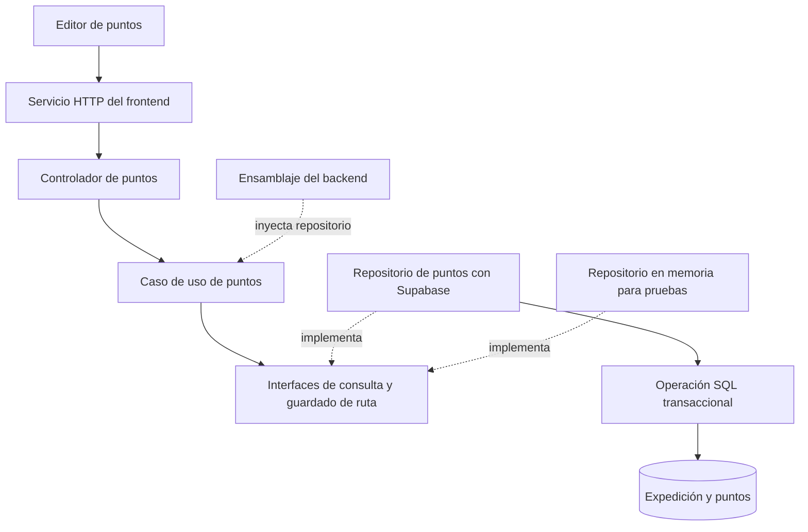

# HU-32 — Fase 1: preparación y mapa de cambios

Fecha de revisión: 1 de noviembre de 2026.

Responsable: Andriy Hitoshi Enciso Rojas (@Hitoshi).

Estado: análisis de la copia local completado. La funcionalidad y los contratos definitivos corresponden a las siguientes fases.

## 1. Alcance y criterios de aceptación

HU-32: registrar puntos intermedios de la ruta. Release 2, sprint 1, 5 SP.

Según el Product Backlog ISW2:

1. El propietario agrega, edita, elimina y reordena hasta 20 puntos en un plan programado.
2. Se validan nombre, latitud, longitud y orden único. Se conservan los extremos de la ruta.
3. Se guardan los puntos completos o se rechaza la operación sin dejar una colección parcial.

El incremento entregará la gestión online de los puntos de una expedición existente. La visualización del recorrido completo y su preparación corresponde a HU-33; los avances manuales corresponden a HU-34 y la gestión de la cola offline a HU-49. Sus necesidades orientan la compatibilidad del contrato.

Git, ramas, commits, push y PR quedan a cargo de Andriy. No se ejecutaron comandos de Git en esta fase. La rama de trabajo indicada por el equipo es `feat/hu-32-puntos`; su selección fue comunicada por Andriy y no se verificó contra Git o GitHub.

## 2. Base local observada

| Área | Evidencia en el repositorio | Consecuencia para HU-32 |
| --- | --- | --- |
| Identidad | `backend/src/presentation/http/middleware/middlewareAutenticacion.ts` obtiene el usuario del JWT y comprueba roles. | Reutilizar autenticación de senderista; la propiedad de cada expedición también debe verificarse en servidor. |
| API de expediciones | `backend/src/presentation/http/routes/rutasExpedicion.ts` expone creación, listado, activa, historial y retorno. | Incorporar consulta y actualización de puntos por ID de expedición. Actualmente no existe una consulta individual del plan programado. |
| Lógica actual | `backend/src/application/services/servicioExpedicion.ts` usa repositorios concretos como dependencias por defecto. | Introducir el caso de uso de puntos con interfaces inyectadas y responsabilidades propias. |
| Persistencia | `backend/src/infrastructure/repositories/RepositorioExpedicion.ts` accede a Supabase; la creación ejecuta varias solicitudes y compensaciones. | HU-32 necesita una operación transaccional real para actualizar la colección completa. |
| Esquema | `init_schema.sql` define expediciones con coordenadas de inicio y fin; no contiene puntos intermedios. | Añadir una tabla y una operación de guardado mediante migración incremental. |
| Listado de UI | `frontend/src/pages/PaginaListaExpediciones.tsx` enlaza las expediciones activas; las programadas se muestran como tarjetas sin detalle. | Ofrecer un acceso explícito a la gestión de puntos de un plan programado. |
| Creación de UI | `frontend/src/pages/PaginaCrearExpedicion.tsx` mezcla formulario de creación, plantillas y sincronización de borradores. | Preferir un editor propio para la colección de un plan ya creado y mantener acotada esta historia. |
| Cliente de expediciones | `frontend/src/services/expedicion.ts` no tiene operaciones para puntos ni detalle de plan programado. | Añadir un servicio específico para puntos y una consulta mínima del contexto del plan. |
| Coordenadas | `backend/src/shared/utils/coordinates.ts` y `frontend/src/lib/coordinates.ts` validan coordenadas decimales y un rectángulo geográfico de Perú. | Reutilizar las funciones existentes de cada capa. El rectángulo es una aproximación, no una comprobación de fronteras exactas. |
| Mapas | `frontend/src/components/maps/ExpeditionRouteMap.tsx` representa inicio y destino. | Su extensión al recorrido ordenado se abordará en HU-33. |
| Estados | `backend/src/domain/value-objects/enums.ts` incluye `programada`, `en_progreso`, `completada` y `alerta`. | Rechazar actualizaciones de puntos cuando el plan deje de estar programado. |

## 3. Dependencias y coordinación

| Dependencia | Situación observada o documentada | Coordinación necesaria |
| --- | --- | --- |
| HU-07, creación del plan | Hay implementación local de creación y persistencia de expediciones. | Conservar su contrato y comprobar regresión durante la implementación. Su estado histórico Done no es una prueba ejecutada ahora. |
| HU-23, coordenadas | Hay validadores y pruebas existentes. | Precisar representación numérica, precisión y alcance geográfico de los puntos en fase 2. |
| Favio: HU-26 y HU-27 | No aparecen rutas de edición/cancelación ni un contrato de versión en los archivos revisados. | Acordar cómo la actualización de puntos participa en la versión del plan y en la edición/cancelación concurrente. No se inspeccionaron sus ramas ni PR. |
| Sebastian: preparación de migraciones | `backend/migrations/` no existe en la copia revisada. | Coordinar nombres, orden y registro de aplicación antes de entregar la migración de HU-32. |
| Fernando: TECH #55 | No aparece `CRON_ENABLED`; `main.ts` inicia el cron automáticamente. | Antes de levantar otra API contra DEV compartido, integrar el interruptor y aplicar el acuerdo del equipo o usar un entorno aislado. |
| HU-33 y HU-34 | Ambas consumirán los puntos de HU-32. | Mantener orden e identificadores estables. HU-31 de Jhon es dependencia de HU-33, no de HU-32. |

Estas observaciones describen archivos locales. El estado del tablero, de las ramas remotas y de la base compartida no se comprobó en esta fase.

## 4. Diseño preliminar con SOLID

Los nombres siguientes son propuestas de responsabilidad. La fase 2 fijará firmas, nombres y respuestas HTTP.



| Principio del material de Semana 2 | Decisión de diseño prevista | Evidencia por construir |
| --- | --- | --- |
| SRP, p. 40 | Separar transporte HTTP, reglas de puntos, persistencia y edición visual. | Responsabilidades de cada componente y pruebas del caso de uso sin HTTP. |
| OCP, p. 46 | El caso de uso consumirá un contrato estable de persistencia. | Sustituir la implementación del contrato sin modificar el caso de uso. |
| LSP, p. 52 | Las implementaciones respetarán resultados, errores y garantías del contrato, incluida la atomicidad. | Suite de contrato compartida entre memoria y persistencia real cuando esté disponible el entorno de integración. La sustitución de tipos por sí sola no demuestra LSP. |
| ISP, p. 58 | Contratos acotados de consulta y guardado, según los consumidores reales. | Cada consumidor depende de operaciones que utiliza, sin métodos de correo, salud o rescate. |
| DIP, p. 64 | Inyectar los contratos por constructor; conectar Supabase en el ensamblaje. | El nuevo caso de uso no importa infraestructura ni crea el repositorio concreto. |

Aplicar también alta cohesión, bajo acoplamiento, DRY, KISS y YAGNI. Reutilizar los validadores actuales dentro de cada capa y mantener al servidor como autoridad. El alcance de esta historia no requiere una refactorización general de los servicios históricos ni una jerarquía de herencia artificial.

### Garantía de guardado

La propuesta es recibir la colección completa y guardarla mediante una RPC transaccional de PostgreSQL, compatible con el acceso actual a Supabase. La operación debe comprobar propietario y estado dentro de la transacción y bloquear la expedición para coordinarse con su cambio de estado. Validar solo en TypeScript y ejecutar después un borrado y una inserción en peticiones separadas dejaría una ventana de inconsistencia.

El actor se obtendrá del JWT validado por el backend. El cliente no elegirá al propietario mediante el cuerpo de la petición. La migración debe definir RLS y permisos de tablas y funciones de acuerdo con el acceso exclusivo del servidor. Las escrituras concurrentes y los conflictos de versión se concretarán con el contrato de Favio.

## 5. Mapa de cambios para las fases siguientes

Los archivos propuestos aún no existen y las rutas definitivas se decidirán en fase 2. Todos los caminos de esta sección son relativos a la raíz del repositorio.

| Área | Archivos nuevos propuestos | Archivos existentes a integrar | Propósito |
| --- | --- | --- | --- |
| Dominio | `backend/src/domain/entities/PuntoRuta.ts` | Validadores de coordenadas y estados existentes, como referencia. | Representar identidad, nombre, latitud, longitud y orden de un punto. |
| Contratos | Interfaces pequeñas bajo `backend/src/application/ports/`. | Sin modificar los repositorios históricos para resolver toda la historia. | Describir lectura del contexto/colección y actualización atómica. |
| Aplicación | `backend/src/application/services/servicioPuntosRuta.ts` y DTO propio. | Convenciones de errores de aplicación. | Coordinar consulta, validación y guardado mediante dependencias inyectadas. |
| Infraestructura | `backend/src/infrastructure/repositories/RepositorioPuntosRuta.ts`. | `backend/src/infrastructure/database/supabase.ts`. | Adaptar operaciones del contrato a Supabase y a la RPC. |
| Datos | SQL incremental en la carpeta de migraciones acordada. | `init_schema.sql`, solo como referencia del esquema base. | Añadir tabla, restricciones, permisos y función transaccional. El script inicial contiene DROP TABLE y no se reutilizará sobre una base con trabajo. |
| HTTP y ensamblaje | Controlador propio y ensamblaje de la nueva funcionalidad. | `backend/src/presentation/http/routes/rutasExpedicion.ts` y, según diseño final, `app.ts`. | Incorporar rutas autenticadas, errores y conexión de dependencias. |
| Cliente | `frontend/src/services/puntosRuta.ts`. | `frontend/src/services/clienteApi.ts`, reutilizado. | Encapsular contratos y peticiones de puntos. |
| Pantalla | `frontend/src/pages/PaginaPuntosRuta.tsx` y componente editor si su tamaño lo requiere. | `frontend/src/pages/PaginaListaExpediciones.tsx` y `frontend/src/app/App.tsx`. | Abrir una expedición programada, administrar su colección y mostrar errores/guardado. |
| Pruebas | Suites del caso de uso, contrato de persistencia e integración SQL. | Script de pruebas del backend. | Verificar negocio, permisos, orden, identidad y rollback; comprobar descubrimiento de suites en Windows. |

## 6. Decisiones por cerrar en fase 2

| Tema | Propuesta inicial | Motivo o coordinación |
| --- | --- | --- |
| Flujo de UI | Crear el plan con el flujo existente y gestionar después sus puntos desde el listado de programadas. | Permite volver a editar la colección y reduce el cruce con la creación/offline actuales. |
| Colección vacía | Aceptar de 0 a 20 puntos. | Permite eliminar todos; inicio y destino permanecen en la expedición. Es una interpretación por concretar del criterio «hasta 20». |
| Nombres | Texto obligatorio tras quitar espacios, con límite explícito aún por fijar. | Mantener el mismo límite en validación, almacenamiento y UI. |
| Coordenadas | Latitud y longitud numéricas finitas; reutilizar límites geográficos existentes. | Acordar precisión y política geográfica sin presentar el rectángulo actual como frontera exacta. |
| Orden | Posiciones enteras consecutivas de 1 a N, únicas en cada expedición. | Evitar ambigüedad en UI, persistencia y consumo por HU-33. |
| Identidad | ID estable por punto, conservado al editar y reordenar. | HU-34 necesita referenciar el mismo punto. Definir origen de los IDs y protección contra IDs de otra expedición. |
| Edición simultánea | Compatibilidad con la versión del plan de HU-26. | Acordar con Favio el recurso versionado y la respuesta de conflicto; no inventar una segunda versión incompatible. |
| Inicio alcanzado | Precisar si también se exige salida futura cuando el cron todavía conserva `programada`. | Resolver la ventana entre la hora de salida y el siguiente tick. |
| Lectura | Consulta privada del contexto del plan y sus puntos; definir estados permitidos. | La escritura exige `programada`; la lectura servirá de base para consumo posterior por HU-33/HU-34. |
| Endpoints y errores | Evaluar GET/PUT bajo `/api/expediciones/:id/puntos`. | Fijar payload, respuesta, errores por campo y estados HTTP en fase 2. |

## 7. Verificación de la preparación local

| Comprobación | Resultado observado |
| --- | --- |
| Instrucciones locales `AGENTS.md` | No se encontraron en los ancestros comprobados ni en la búsqueda del proyecto. |
| Node instalado | `node --version`: `v24.16.0`. La referencia del equipo es Node 22; falta verificar la ejecución con esa versión. |
| npm instalado | `npm.cmd --version`: `11.13.0`. |
| PowerShell | `npm --version` falla porque se bloquea `npm.ps1` por la política de scripts. `npm.cmd` funciona; no se cambió la política del sistema. |
| Dependencias | No existen `backend/node_modules/` ni `frontend/node_modules/`. |
| Lockfiles | Existen los dos `package-lock.json`; ambos usan `lockfileVersion: 3`. |
| Pruebas actuales | Hay seis casos en `backend/src/shared/utils/coordinates.test.ts`, organizados en dos suites: semáforo y coordenadas. Lectura estática; no se ejecutaron. |
| Typecheck, tests y builds | Pendientes por ausencia de dependencias. No se declara una línea base aprobada. |
| Migraciones y servicios | No se aplicó SQL, no se arrancaron servidores y no se contactó Supabase ni correo. |

Cuando se prepare el entorno, instalar dependencias usando los lockfiles y ejecutar los comandos siguientes desde la raíz. Son comprobaciones previstas, no resultados de esta fase:

```powershell
npm.cmd ci --prefix backend
npm.cmd ci --prefix frontend
npm.cmd run typecheck --prefix backend
npm.cmd run typecheck --prefix frontend
npm.cmd test --prefix backend
npm.cmd run build:backend
npm.cmd run build:frontend
```

La instalación y la compilación no requieren arrancar la API. Las pruebas nuevas del caso de uso usarán colaboradores sustitutos; la verificación de RPC y concurrencia requerirá una base de pruebas acordada. Las seis pruebas históricas no cubren HU-32.

## 8. Matriz de comprobación futura

| Criterio o garantía | Escenario a demostrar |
| --- | --- |
| Operaciones de colección | Agregar, editar, eliminar, reordenar, guardar y volver a consultar. |
| Límite | Aceptar 20 puntos y rechazar 21 conservando los datos anteriores. |
| Validación | Rechazar nombre vacío, coordenadas inválidas/no finitas, orden inválido o repetido e IDs ajenos. |
| Propiedad y estado | Impedir acceso cruzado y escrituras en planes en progreso, en alerta o completados; probar cancelados al integrar HU-27. |
| Conservación | Verificar que inicio, destino, horarios, contactos y acompañantes no cambian por gestionar puntos. |
| Atomicidad real | Provocar un fallo durante el guardado en la base de pruebas y comprobar rollback completo. Un DAO en memoria no demuestra la transacción PostgreSQL. |
| Concurrencia | Competir guardado con inicio/cancelación y con otra edición según el contrato acordado; conservar una colección coherente. |
| Identidad | Editar y reordenar conserva IDs; la lectura mantiene el orden definido. |
| Interfaz | Carga inicial, colección vacía, límite, errores por punto, error de servidor, pérdida de conexión y recuperación tras guardar. |
| Regresión | Mantener creación, listado, confirmación de retorno, validación de extremos y borradores existentes. |

## 9. Cierre de fase 1

La fase entrega el inventario de la base local, el mapa de cambios, las dependencias, el diseño SOLID preliminar y las decisiones que debe resolver la fase 2. Los únicos cambios de esta fase son documentales.

Continuación: [fase 2 — contrato de puntos](fase-2-contrato.md), con ejemplos de petición/respuesta, invariantes, permisos, identidad, orden, errores y coordinación pendiente antes de implementar persistencia. El inventario de esta fase se conserva como fotografía de la revisión inicial.

Fuentes: Product Backlog ISW2 (HU-32), informe de continuidad, guía de asignaciones del Release 2, `INSTRUCCIONES.txt` y material de Semana 2 SOLID proporcionados por Andriy, junto con los archivos locales identificados en este documento. Las indicaciones operativas de esos documentos se usan como contexto del equipo; no se ejecutaron por su sola presencia.
