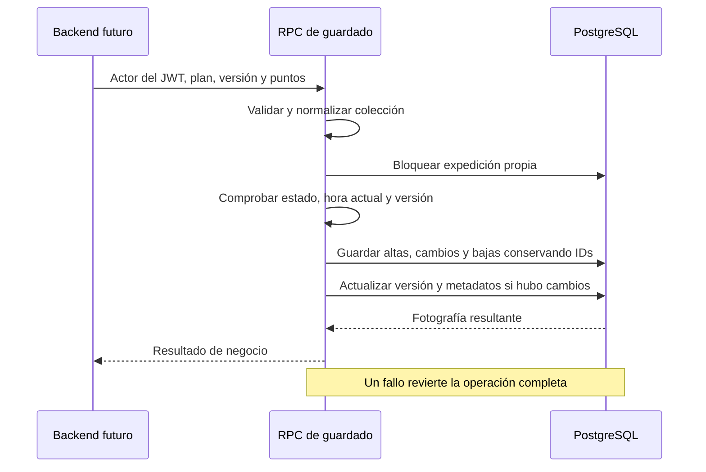

# HU-32 — Fase 3: persistencia y validación SQL

Fecha: 1 de noviembre de 2026. Responsable: Andriy Hitoshi Enciso Rojas (@Hitoshi).

Estado: migración incremental preparada y verificada en PostgreSQL local aislado. No aplicada en Supabase ni en el servicio PostgreSQL instalado. La creación de endpoints y la conexión con el backend corresponden a la fase 4.

## 1. Archivos entregados

| Archivo | Contenido |
| --- | --- |
| [hu32_puntos_ruta.sql](../../backend/migrations/hu32_puntos_ruta.sql) | Tabla, restricciones, validación, consulta y guardado transaccional; permisos de los objetos nuevos. |
| [README de migraciones](../../backend/migrations/README.md) | Requisitos, orden propuesto, resultados SQL, operación y registro pendiente de aplicación. |
| [test-hu32-sql.mjs](../../backend/scripts/test-hu32-sql.mjs) | Verificador reproducible con un clúster PostgreSQL temporal y datos ficticios, sin dependencias npm. |
| [Contrato de fase 2](fase-2-contrato.md) | Se enlaza esta entrega y se precisa que el acuerdo de versión condiciona la aplicación en DEV compartido; la preparación local usa una precondición verificable. |

El SQL es incremental: conserva las tablas y datos del esquema base. No modifica `init_schema.sql`, el cron, las rutas HTTP, los servicios TypeScript, la UI o los archivos de dependencias.

## 2. Requisito de versión y coordinación

El contrato preparado utiliza `public.expediciones.version BIGINT NOT NULL` con default. La migración comprueba ese requisito antes de crear objetos. Si falta, emite `HU32_VERSION_REQUERIDA` y revierte toda la migración.

La columna no se crea desde la migración de HU-32. Su migración de origen y la semántica compartida siguen pendientes de acuerdo con Favio y Sebastian. Las pruebas añaden la columna con valor inicial 1 exclusivamente a la base temporal después de verificar el rechazo del esquema sin versión. Ese fixture no es una decisión ya integrada por el equipo.

Esta preparación permite revisar y demostrar la persistencia sin atribuir a HU-32 la modificación unilateral del contrato de otras historias. Antes de aplicar en DEV se deben confirmar nombre/tipo, qué cambios incrementan la versión y orden de migraciones. Si el acuerdo difiere, ajustar SQL, contrato y pruebas.

## 3. Comportamiento implementado en SQL

- Tabla `puntos_ruta` con UUID v4 estable, referencia a expedición, nombre normalizado de 1 a 100 puntos de código Unicode, coordenadas numéricas a cinco decimales y orden único de 1 a 20.
- Validación de colección de 0 a 20 puntos, forma de cada objeto, propiedades permitidas, coordenadas originales antes de redondear, IDs repetidos y posiciones consecutivas. Los errores identifican campos con índices del arreglo original.
- Consulta privada de contexto y puntos ordenados desde una sola fotografía de datos. Una expedición inexistente y una ajena devuelven SQL `NULL`.
- Guardado completo con bloqueo de la expedición, comprobación de propietario, estado, salida futura y versión. La hora se evalúa después de conseguir el bloqueo.
- Conservación de IDs al editar y reordenar. El intercambio de posiciones usa una restricción única diferible y conserva referencias existentes a los puntos.
- Eliminación de puntos omitidos y de toda la colección mediante un arreglo vacío. Los extremos y demás datos operativos del plan permanecen intactos.
- Incremento de versión y actualización de metadatos solamente si cambia la colección canónica. Un guardado idéntico con versión vigente conserva ambos.
- Rollback completo ante fallos. La colisión concurrente de un UUID entre planes devuelve un rechazo sin dejar eliminaciones o modificaciones parciales.
- RLS y privilegios explícitos: clientes sin acceso a los objetos nuevos y `service_role` limitado a ejecutar las dos RPC, con tablas/funciones calificadas y `search_path` fijo en las funciones con privilegios elevados.



El backend todavía debe validar JWT/rol y pasar el actor confiable. Las RPC reciben ese ID del servidor; no reemplazan la autenticación HTTP. Los resultados SQL usan tipos de negocio sin estados HTTP; su traducción está descrita en el README de migraciones.

## 4. Diseño y SOLID

En esta fase la separación de responsabilidades se refleja en funciones distintas de normalización, validación, consulta y escritura. La validación pura se prueba sin acceder a tablas; la escritura se ocupa de las garantías transaccionales que deben residir en la base.

Los contratos pequeños de consulta/guardado, su inyección y la independencia del servicio respecto de Supabase se implementarán en la fase 4. Las pruebas reales de SQL respaldan las garantías que exigiremos también al repositorio en memoria para LSP. Esta fase no se presenta como demostración completa de los cinco principios antes de construir la capa de aplicación.

## 5. Verificación ejecutada

Comando desde la raíz del proyecto:

```powershell
node backend/scripts/test-hu32-sql.mjs --pg-bin "C:\Program Files\PostgreSQL\18\bin"
```

Entorno observado: Windows, Node.js `v24.16.0` y PostgreSQL `18.6`. La referencia Node 22 del equipo y la versión de PostgreSQL de Supabase quedan pendientes de validar antes de integrar/desplegar.

**Resultado final: 35 comprobaciones SQL aprobadas, proceso terminado con código 0 e instancia temporal detenida.**

Se verificaron: precondición sin versión y ausencia de cambios parciales en la migración; alta/consulta/orden; espacios Unicode y redondeo; IDs y referencias conservados al reordenar; guardado sin cambios; límite de 20 y nombre Unicode; rechazos de estructura, campos, IDs, coordenadas y orden; privacidad; versión obsoleta; eliminación; estados no editables; hora de salida; fallo inyectado tras modificar los puntos; dos sesiones concurrentes; lectura durante escritura; hora después de esperar un bloqueo; colisión concurrente de UUID entre planes; RLS y permisos efectivos.

La suite ejecuta el esquema real del proyecto en un clúster nuevo. Simula además los privilegios por defecto de Supabase sobre los objetos para verificar las revocaciones explícitas. No simula ni prueba PostgREST, JWT, rutas HTTP o interfaz: esas verificaciones corresponden a las fases siguientes.

El primer intento de inicio encontró una restricción del entorno de ejecución de Windows. Se usó la ejecución autorizada fuera de ese entorno. También se corrigió la captura de procesos de `pg_ctl` para evitar que los handles heredados bloquearan el verificador; la instancia de aquel intento se detuvo explícitamente. Las ejecuciones finales crean y detienen su propia instancia de forma automática.

Las carpetas temporales y logs se conservan para inspección, con la ubicación impresa por el verificador. No se arrancó el backend, no se leyó `.env`, no se conectó a Supabase y no se alteró el servicio PostgreSQL instalado.

## 6. Estado y siguiente fase

Preparación local de persistencia completada. Aplicación en DEV compartido pendiente de coordinación de versión y migraciones. No hay cambios de Git, commits, push o publicación realizados por el asistente.

Continuación: [fase 4 — caso de uso, adaptador y API](fase-4-api.md). La UI seguirá en la fase 5.
