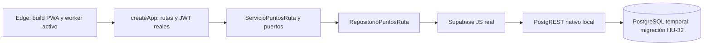

# HU-32 — Fase 6: integración, regresión y PWA

Fecha: 1 de noviembre de 2026. Responsable: Andriy Hitoshi Enciso Rojas (@Hitoshi).

Actualización posterior: el 3 de noviembre de 2026 se adaptó HU-32 al acuerdo `expediciones.version INTEGER` y se repitió la validación completa con éxito. Los resultados actuales están en [ajuste INTEGER](ajuste-integer.md); este documento conserva el registro de la fase original.

Estado: validación completa aprobada en un entorno local aislado con Node 22, API de producción, cliente Supabase, PostgREST nativo, PostgreSQL temporal y PWA con service worker activo. La base DEV de Supabase no se modificó. El acuerdo de versión y la integración con las historias de otros integrantes siguen pendientes antes de aplicar allí la migración.

## 1. Recorrido probado



El servidor de integración utiliza `createApp()` compilado, con su ensamblaje real. No arranca `main.ts` ni el cron. Sirve el build del frontend y adapta únicamente el prefijo `/rest/v1` del SDK al servidor PostgREST nativo; no simula resultados SQL, filtros, joins, roles o funciones.

Los usuarios de prueba inician sesión mediante `/api/auth/iniciar-sesion`, usando los hashes bcrypt del esquema semilla. El navegador recibe JWT emitidos por la aplicación. El SDK utiliza una clave ficticia de servidor firmada para `service_role` del entorno temporal. Las RPC y sus permisos se ejecutan en PostgreSQL real.

Las operaciones de preparación y observación de fixtures viven exclusivamente en `backend/scripts/hu32-integration-server.mjs`, fuera del código desplegado. Requieren un nonce generado por el runner y una conexión de loopback al rol del clúster temporal. Permiten preparar un plan, consultar su estado en SQL e inyectar un fallo transaccional controlado.

El loader histórico de configuración puede leer `backend/.env` al importarse. El servidor de pruebas sustituye todos sus campos por valores ficticios y locales antes de llenar su caché o importar `createApp` y los repositorios; no modifica el archivo ni reutiliza sus destinos o claves para las conexiones.

## 2. Entorno y herramientas

| Componente | Versión comprobada |
| --- | --- |
| Node.js de referencia | `22.23.4`, ejecutado desde una carpeta temporal, sin cambiar el Node instalado. |
| PostgreSQL | `18.6`, binarios instalados y clúster nuevo en otro puerto. |
| PostgREST | `16.5`, paquete oficial Windows x86-64 en carpeta temporal. |
| Supabase JS | `2.108.2`, dependencia existente del backend. |
| Playwright | `1.64.1`, dependencia de desarrollo del frontend. |
| Microsoft Edge | `156.0.4314.58`, modo sin ventana. |

El paquete PostgREST se obtuvo del [release oficial v16.5](https://github.com/PostgREST/postgrest/releases/tag/v16.5). Su SHA256 coincidió con el digest publicado en los metadatos del release:

```text
17f595b0d8dd37473d0231417dea07c5ac9f791282ff5b017fae51ff29e5de2f
```

Se configuró mediante variables `PGRST_*` siguiendo la [documentación oficial de configuración](https://docs.postgrest.org/en/stable/references/configuration.html), con host de loopback, esquema público, roles ficticios y secreto de pruebas. En Windows el proceso recibe el directorio de binarios PostgreSQL en su PATH para localizar `libpq`; no se modifica el PATH permanente.

Los binarios temporales no se incorporaron al repositorio ni se añadieron dependencias del proyecto en esta fase.

## 3. Archivos de esta fase

| Archivo | Propósito |
| --- | --- |
| [test-hu32-sql.mjs](../../backend/scripts/test-hu32-sql.mjs) | Nuevo modo `--with-browser --postgrest`: compila, comprueba tipos, ejecuta regresión y levanta/cierra el entorno integrado. |
| [hu32-integration-server.mjs](../../backend/scripts/hu32-integration-server.mjs) | API y PWA locales, PostgREST y controles protegidos de fixture. |
| [playwright.integration.config.ts](../../frontend/playwright.integration.config.ts) | Suite integrada con service workers habilitados y URL de loopback proporcionada por el runner. |
| [puntosRuta.integration.spec.ts](../../frontend/tests/hu32-integration/puntosRuta.integration.spec.ts) | Nueve escenarios contra la cadena real. |
| [playwright.config.ts](../../frontend/playwright.config.ts) | Preview con el mismo ejecutable de Node que lanza la prueba, para comprobar Node 22 de extremo a extremo. |
| [tsconfig.playwright.json](../../frontend/tsconfig.playwright.json) | Incluye los tipos de la nueva configuración y los escenarios integrados. |

Los cambios de esta fase se concentran en el verificador, su entorno y la documentación. Se mantuvo la implementación funcional de HU-32 de las fases anteriores.

## 4. Resultados registrados

La ejecución completa terminó con código **0**:

| Grupo | Resultado |
| --- | --- |
| Typecheck backend | Aprobado con Node 22. |
| Build backend | Aprobado con Node 22. |
| Typecheck frontend | Aprobado con Node 22. |
| Typecheck configuración/pruebas UI | Aprobado con Node 22. |
| Build frontend y generación de worker | Aprobado con Node 22 y `VITE_API_URL=/api`. |
| Pruebas backend habituales | 43 aprobadas, incluidas las seis históricas. |
| Interfaz con API controlada, worker bloqueado | 12 aprobadas. Conserva la suite de fase 5. |
| Garantías SQL nativas | 35 comprobaciones aprobadas. |
| Contrato común | 24 aprobadas: los mismos 12 escenarios en memoria y PostgreSQL. |
| Integración real, worker activo | 9 aprobadas. |

Los casos de memoria se repiten entre ejecuciones para verificar sustitución; los grupos no se suman como un número de casos únicos ni como un porcentaje de cobertura.

### Nueve escenarios integrados

1. Agregar, reordenar, guardar, recargar y eliminar puntos desde el navegador; verificar en SQL IDs, orden, redondeo decimal y conservación de los datos del plan.
2. Competencia entre dos sesiones reales: un cambio queda persistido, el otro recibe conflicto y el navegador exige revisión antes de reemplazarlo.
3. Fallo SQL después de mutar los puntos: rollback completo de puntos, versión y metadatos, edición local conservada y recuperación posterior.
4. JWT ausente/inválido, rol rescatista, plan ajeno, exceso de 20, actor añadido al cuerpo, coordenada fuera de rango y acceso directo no autorizado a la RPC.
5. Hora de salida alcanzada y estados en progreso, alerta y completada rechazan la escritura sobre la base real.
6. PWA activa: los puntos no se almacenan en Cache API; sin red no aparece una respuesta antigua, se conserva la edición abierta y reconectar requiere guardar explícitamente. Al reingresar offline carga la aplicación, pero no inventa una lista de puntos; al reconectar se recupera la lista del servidor.
7. Cierre de sesión y acceso con otro usuario: la sesión nueva no recibe los puntos del anterior, tampoco al reingresar offline.
8. Respuesta perdida tras un commit real: se corta únicamente su entrega, se consulta lo persistido y se recuperan los mismos IDs sin otro guardado.
9. Regresión de creación de expedición, coordenadas, contactos, ficha médica cifrada, confirmación de retorno e historial: los flujos existentes conservan su comportamiento y los puntos permanecen consultables al completar el plan.

Solo el escenario de respuesta perdida intercepta la entrega del PUT después de ejecutar `route.fetch()` contra la API real. No sustituye el guardado ni la consulta posterior. Los demás escenarios integrados no usan respuestas API simuladas.

El mensaje de error técnico observado durante la inyección de fallo es deliberado: el escenario verifica que su respuesta sea genérica y que no quede ninguna mutación parcial.

## 5. Matriz de criterios de aceptación

| Criterio de HU-32 | Evidencia | Resultado local |
| --- | --- | --- |
| Propietario agrega, edita, elimina y reordena hasta 20 puntos en un plan programado. | Suite UI; contrato de ambas implementaciones; SQL con límite 20/21; escenarios integrados 1, 4 y 5. | Aprobado. |
| Valida nombre, latitud, longitud y orden único; conserva los extremos. | Validación de servicio y UI; SQL; snapshots integrados del plan, contactos y acompañantes; regresión de ficha médica. | Aprobado. |
| Guarda toda la colección o rechaza sin datos parciales. | Fallo inyectado SQL/API; conflicto entre sesiones; colisión concurrente de UUID; lectura consistente y comparación completa de snapshots. | Aprobado. |

La comparación del plan permite únicamente cambios de `version` y `actualizado_en` al guardar puntos. Sus extremos, horarios, estado, contactos y acompañantes permanecen intactos. La regresión distingue la posterior confirmación de retorno, que sí cambia el estado por su operación propia.

## 6. Reproducción

Requisitos: dependencias registradas de backend/frontend instaladas, Node 22, PostgreSQL nativo, PostgREST y Edge en Windows (Chromium de Playwright en otros sistemas).

Desde la raíz, con Node 22 seleccionado:

```powershell
node backend/scripts/test-hu32-sql.mjs --pg-bin "C:\Program Files\PostgreSQL\18\bin" --with-browser --postgrest "C:\ruta\PostgREST\postgrest.exe"
```

El modo completo prepara ambos builds, fija `VITE_API_URL=/api` solo en el proceso de build y ejecuta todas las comprobaciones de la tabla. `--with-browser` incluye la validación de contrato de `--with-backend`.

`playwright.integration.config.ts` no se ejecuta por separado contra cualquier URL: exige la configuración temporal que proporciona el runner. El servidor de integración también exige IPC y configuración restringida al clúster de pruebas.

Al finalizar se cerraron API, PostgREST y PostgreSQL temporal. Se comprobó que el clúster temporal ya no tenía `postmaster.pid` y que el servicio instalado `postgresql-x64-18` seguía en estado Running. Se conservan las carpetas y logs temporales para inspección.

## 7. Límites de esta evidencia y siguiente fase

- La versión compartida se crea como fixture temporal. Sigue pendiente acordar con Favio/Sebastian su nombre, tipo, semántica y migración de origen antes de aplicar HU-32 en DEV.
- No se conectó al proyecto remoto de Supabase. La configuración real de hosting, PostgREST y permisos de ese proyecto requiere una comprobación posterior coordinada.
- HU-27 todavía no aporta el estado cancelada en la copia revisada. Su integración y las carreras con las ediciones/cancelaciones de otras ramas se verificarán al integrarlas; los estados existentes sí se comprobaron.
- La regresión cubre los flujos indicados, no certifica todas las historias históricas ni las nuevas historias de otros responsables. El cron y el correo real no se ejecutaron.
- Edge en escritorio con tamaños móviles no sustituye la revisión en dispositivos físicos.

La fase 6 queda completada para la implementación local y su contrato propuesto. La aceptación del PO, la revisión del equipo y la integración en DEV no se declaran realizadas.

Continuación: [fase 7 — preparación de entrega](fase-7-entrega.md), con guía de demostración, diseño SOLID y borrador de PR. El [índice de HU-32](README.md) resume el estado final. Git, ramas, commits, push y publicación siguen bajo el control de Andriy.
