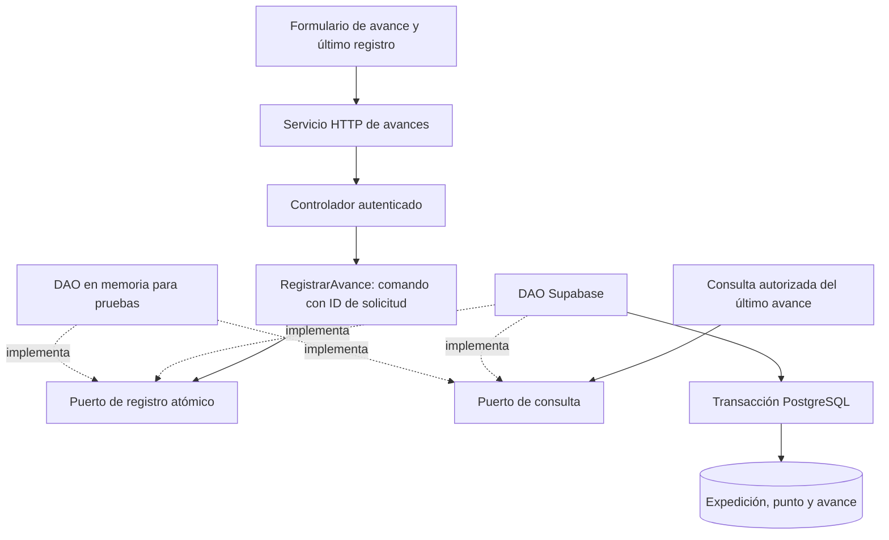

# HU-34 — Fase 1: preparación y mapa de cambios

Fecha: 5 de noviembre de 2026. Responsable: Andriy Hitoshi Enciso Rojas (@Hitoshi).

Estado: análisis local completado. Las decisiones de detalle indicadas como propuestas se concretarán en fase 2; no constituyen requisitos adicionales aprobados por el equipo.

## 1. Alcance confirmado en los documentos

HU-34, «Registrar un avance manual de la expedición»: prioridad alta, 5 SP, dependencia HU-32.

Historia: como senderista, quiero registrar que llegué a un punto de la ruta con una nota opcional para dejar constancia de mi avance durante el recorrido.

Criterios del Product Backlog ISW2:

1. Solo el propietario registra avances online en una expedición en progreso.
2. Se registra punto, hora del servidor y nota. Repetir el mismo ID de solicitud no duplica el avance.
3. Un avance no completa la expedición, no cambia el plazo y no evita una alerta por falta de retorno.

El backlog también propone `RegistrarAvance`, Command y DAO, persistir un evento y mostrar el último avance en el detalle autorizado. La guía de asignaciones confirma el carácter online y la dependencia de los puntos de HU-32. No se necesita HU-31 ni implementar primero el mapa de HU-33.

No se incorpora GPS continuo ni una cola offline de avances. La navegación y el retorno seguro conservan sus propios flujos.

## 2. Base observada

| Área | Evidencia local | Implicación |
| --- | --- | --- |
| Rama y estado | `git status --short --branch` mostró `feat/hu-34-avances-manuales`, sin cambios locales iniciales. | La preparación se realizó en la rama que ya eligió Andriy. No se modificaron referencias de Git. |
| Dependencia HU-32 | No hay `PuntoRuta`, puertos de puntos, rutas ni migración HU-32 en los archivos de esta rama. Sí existen en la rama local `feat/hu-32-puntos`, consultada con `git show`. | No recrear una segunda implementación ni inventar IDs de puntos. Disponer de HU-32 antes de validar la cadena real. |
| Autenticación | `backend/src/presentation/http/middleware/middlewareAutenticacion.ts` y `routes/rutasExpedicion.ts` autentican y exigen rol senderista. | Tomar al actor del JWT y comprobar propiedad en servidor, no aceptar un propietario elegido en el cuerpo. |
| Estados | `backend/src/domain/value-objects/enums.ts` define `programada`, `en_progreso`, `completada` y `alerta`. | Registrar solo en `en_progreso`; contemplar también `cancelada` cuando se incorpore HU-27. |
| Expedición activa | `servicioExpedicion.ts` y `RepositorioExpedicion.ts` consultan la expedición propia y calculan el límite a partir de retorno y tolerancia. | Reutilizar contexto sin convertir un avance en actualización de plazo o retorno. |
| Pantalla activa | `frontend/src/pages/PaginaExpedicionActiva.tsx` muestra temporizador, alerta y retorno seguro; consulta cada 30 segundos. | Integrar el formulario y el último avance conservando esos comportamientos. |
| Transporte frontend | `frontend/src/services/clienteApi.ts` aplica `cache: 'no-store'` y rechaza respuestas de una sesión anterior. | Usar este cliente y evitar que el estado local del nuevo formulario sobreviva a otra cuenta. |
| Privacidad y PWA | `app.ts` aplica `Cache-Control: no-store`; `vite.config.ts` conserva `prompt` y reglas `NetworkOnly` para API/autenticación. | Los avances, sus notas y sus respuestas no se guardarán en caché persistente. No ampliar las claves offline para esta HU. |
| Cron | `cronFechaLimiteExpedicion.ts` promueve programadas y marca expiradas; admite colaboradores sustitutos. `main.ts` contempla `CRON_ENABLED`. | Probar vencimiento posterior al avance sin iniciar el cron real ni enviar correos. |
| Versionado | HU-26 aporta `expediciones.version INTEGER` y `eventos_plan` con tipos restringidos. | Conservar el tipo INTEGER y no insertar un tipo de evento de avance en una tabla que no lo admite. |
| Reloj | Existe `IReloj.ahora(): Date` y `RelojSistema`. | Reutilizar la abstracción cuando corresponda; fijar una única autoridad de tiempo en la operación persistida. |
| Pruebas compartidas | CI separa backend, tipos frontend/pruebas, `test:equipo`, build y `test:pwa:privacidad`. | Añadir cobertura propia sin sustituir las suites HU-29/HU-30 o privacidad. |

La revisión describe archivos locales. No se descargaron cambios remotos ni se consultó el esquema efectivo de Supabase. Los resultados de validaciones de otras tareas no se atribuyen a esta rama.

## 3. Contrato existente de HU-32 que se debe reutilizar

La lectura de la rama local `feat/hu-32-puntos` muestra:

- `PuntoRuta`: `id`, `nombre`, `latitud`, `longitud`, `orden`. La identidad se conserva al editar/reordenar.
- `IConsultaPuntosRuta.consultarPropia(senderistaId, expedicionId)`: devuelve contexto y puntos propios, o `null` para ajena/inexistente.
- Consulta HTTP `GET /api/expediciones/:id/puntos` y guardado completo mediante `PUT`.
- Tabla `public.puntos_ruta`, vinculada a expediciones. La colección solo se edita en un plan programado con salida futura y versión vigente.
- Migración `backend/migrations/hu32_puntos_ruta.sql`, dependiente de la versión INTEGER compartida con HU-26.

Esto permite referenciar el UUID real de un punto. La operación de registrar deberá verificar también dentro de la transacción que ese punto pertenece a la expedición propia. Una consulta previa desde TypeScript no garantiza por sí sola la integridad del registro.

No se copiaron esos archivos a esta rama ni se incorporó su historial. Andriy mantiene el control de esa preparación por Git. La fase 2 puede redactarse con este contrato como referencia; la persistencia y la aceptación integrada requieren la dependencia efectiva y su revisión tras incorporarla.

## 4. Diseño preliminar: Command, DAO y SOLID

Los nombres y firmas definitivos pertenecen a fase 2. El comando representará una acción concreta con datos, identificador y resultado; no basta con nombrar una clase «Command». Su ejecución se probará con una dependencia sustituible. No se necesita una cola ni una jerarquía genérica de comandos.

| Principio del curso | Aplicación prevista | Evidencia posterior |
| --- | --- | --- |
| SRP, Semana 2 p. 40 | Separar validación HTTP, ejecución del comando, almacenamiento y formulario. | Pruebas de negocio sin Express ni React. |
| OCP, p. 46 | Cambiar el adaptador mediante el puerto, conservando el comando. | Ensamblaje de memoria/Supabase sin condicionales por proveedor en el caso de uso. |
| LSP, p. 52 | Exigir las mismas garantías de permisos, repetición y errores a ambos DAO. | Contrato compartido; pruebas reales adicionales de concurrencia y transacción. |
| ISP, p. 58 | Separar registro y consulta con las operaciones que usa cada consumidor. | Puertos sin métodos de salud, correo o gestión completa del plan. |
| DIP, p. 64 | Inyectar puertos en la aplicación; crear Supabase en el ensamblaje. | El comando no importa repositorios concretos ni obtiene credenciales. |

La hora persistida será de servidor. La propuesta es que PostgreSQL asigne la hora del registro aceptado; si se usa `IReloj` en reglas de aplicación, su valor no sustituirá la comprobación transaccional. Concretar esta decisión y sus pruebas en fase 2.

## 5. Garantías por diseñar antes de implementar

| Tema | Propuesta y motivo |
| --- | --- |
| Identidad de solicitud | UUID estable generado al preparar el envío. Reintentar una respuesta perdida conserva el ID y el contenido. |
| Idempotencia concurrente | Restricción única y transacción; dos solicitudes simultáneas no producen dos registros. Precisar el alcance de la clave. |
| Mismo ID, contenido diferente | Rechazar el uso incompatible en lugar de devolver silenciosamente otro registro. Definir normalización y código de error. |
| Estado y pertenencia | Comprobar propietario, estado y punto bajo una estrategia transaccional compatible con HU-32 y el cambio a alerta/retorno. |
| Carrera con alerta o retorno | Definir el orden de bloqueo y la respuesta si la expedición cambia de estado; no revertir ese cambio. |
| Plazo vencido antes del tick | Definir si se admite un avance mientras el estado aún es `en_progreso` después del límite. En ambos casos el cron debe poder alertar sin ampliar el plazo. No añadir silenciosamente una regla de negocio al backlog. |
| Reenvío después de completar/alertar | Diferenciar una nueva acción de la recuperación autorizada de un resultado ya persistido. Nunca crear un segundo avance. |
| Nota | Opcional, renderizada como texto. Fijar límite, espacios y tratamiento de `null`/cadena vacía de forma consistente en UI/API/SQL. |
| Visitas repetidas | El criterio deduplica solicitudes, no puntos. Determinar el tratamiento de varias llegadas al mismo punto con IDs diferentes. No imponer avance secuencial sin requisito. |
| Último avance | Consulta privada con orden estable incluso si dos registros comparten hora. Acordar endpoint propio o ampliación compatible del detalle. |
| Versión y eventos | Propuesta: almacenar avances en tabla propia y no incrementar la versión del plan por una llegada. Concretar compatibilidad con consumidores; no modificar el enum de `eventos_plan` por suposición. |
| Ausencia de puntos | Mostrar una explicación y mantener el retorno seguro disponible. No generar puntos ficticios. |
| Offline y sesión | Deshabilitar envío sin conexión, gestionar fallo de red y conservar solo estado en memoria de la sesión activa. Sin sincronización automática ni almacenamiento de notas en borradores de expedición. |

## 6. Mapa de archivos previsto

Las rutas nuevas son propuestas; no se crearon en esta fase.

| Capa | Archivo o área | Trabajo previsto |
| --- | --- | --- |
| Dominio | `backend/src/domain/entities/AvanceExpedicion.ts` | Representación del avance persistido. |
| Contratos | `backend/src/application/ports/avancesExpedicion.ts` | Registro atómico y lectura autorizada, con resultados explícitos. |
| Aplicación | `backend/src/application/use-cases/RegistrarAvance.ts` y consulta acotada | Comando y coordinación mediante puertos. |
| DTO | DTO específico de avances | UUID, punto y nota; actor y hora no los determina el navegador. |
| Persistencia | `backend/src/infrastructure/repositories/RepositorioAvancesExpedicion.ts` | Adaptador Supabase y traducción de resultados SQL. |
| Migración | Archivo incremental propio en `backend/migrations/` | Tabla, claves, permisos/RLS y operación transaccional. Coordinar nombre y orden con el registro existente. |
| HTTP | Controlador y rutas de avances; integración acotada en rutas/app | Autenticación, ensamblaje, códigos y cabeceras privadas. Evaluar `/api/expediciones/:id/avances`. |
| Frontend | `frontend/src/services/avancesExpedicion.ts` | Tipos y peticiones mediante `clienteApi`. |
| Interfaz | Componente de avance integrado en `PaginaExpedicionActiva.tsx` | Puntos, nota, último avance y envío online; conservar temporizador y retorno. |
| Verificación | Suites propias backend/SQL/UI/PWA | Reenvíos, pertenencia, estados, carrera, hora y privacidad; regresión de historias existentes. |
| Entrega | `docs/hu-34/` | Contratos, diseño SOLID, resultados y demostración por fases. |

## 7. Matriz de aceptación futura

| Escenario | Resultado esperado |
| --- | --- |
| Propietario, expedición en progreso y punto válido | Un avance con hora del servidor y nota opcional; visible en detalle autorizado. |
| Sin autenticación, otro rol o cuenta ajena | Rechazo sin escritura ni filtración de contenido privado. |
| Punto inexistente o de otra expedición | Rechazo sin avance parcial. |
| Programada, completada, alerta o cancelada integrada | No se admite un registro nuevo. |
| Reenvío tras respuesta perdida | Mismo resultado persistido; una sola entrada. |
| Solicitudes duplicadas simultáneas | Una entrada; comportamiento consistente para ambos clientes. |
| ID reutilizado con datos distintos | Conflicto conforme al contrato de fase 2. |
| Intento de enviar hora/propietario falsos | El cliente no controla la identidad ni la hora persistida. |
| Avance seguido de vencimiento | Retorno, tolerancia y estado de completado no se alteran; el tick de prueba genera la alerta correspondiente. |
| Avance concurrente con retorno/alerta | Resultado coherente con el estado definitivo; sin resucitar expedición ni perder registros aceptados. |
| Sin conexión o error de red | No se afirma un guardado inexistente; reintento controlado sin cola offline. |
| Logout, otra cuenta y respuestas tardías | No reaparecen notas/puntos de la cuenta anterior ni se persisten respuestas privadas en Cache Storage. |
| Regresión | Funcionan retorno seguro, temporizador, HU-26, puntos HU-32, HU-29/HU-30 y política PWA. |

Las pruebas reales de SQL y concurrencia se harán en un entorno desechable; un DAO en memoria no certifica dichas garantías.

## 8. Comprobaciones de esta fase y siguiente paso

Se leyeron el backlog Excel, el informe de continuidad, la guía de asignaciones, `INSTRUCCIONES.txt`, los archivos locales citados y los documentos/contratos de HU-32 mediante lectura de su rama local. No se encontraron `AGENTS.md` en los ancestros comprobados ni en el listado de archivos del proyecto.

No se ejecutaron pruebas, builds, instalaciones ni servicios: esta fase solo añade documentación y no establece una nueva línea base de CI. No se modificaron `.env`, Supabase, migraciones existentes o código de aplicación; no se aplicó SQL. Git se usó únicamente para lecturas de estado y contenido; no hubo fetch, switch, merge, add, commit ni push.

El siguiente incremento es la fase 2: fijar el contrato y resolver explícitamente las propuestas de la sección 5. Después será necesario disponer de HU-32 en esta rama para avanzar con la persistencia e integración real. No se solicita recrear puntos ni se declara integrada una dependencia ausente.

Fuentes: `TrekSafe_Product_Backlog_ISW2.xlsx` (fila HU-34), `TrekSafe_Informe_Continuidad_ISW2.docx`, `TrekSafe_Asignaciones_y_Arranque_Release2.docx`, `INSTRUCCIONES.txt` y trazabilidad SOLID de los documentos de HU-32. Los documentos aportan contexto y criterios; sus instrucciones operativas no se ejecutan por sí solas ni sustituyen las indicaciones actuales de Andriy.
