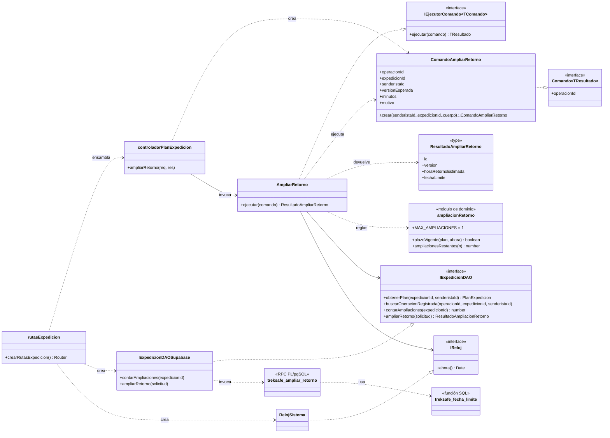
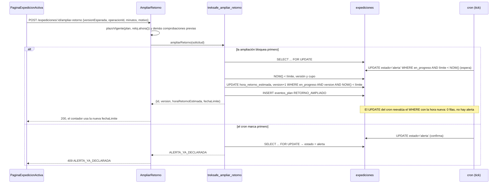

# HU-35: Ampliar el retorno antes del vencimiento

Como senderista, quiero ampliar mi hora de retorno estimada mientras mi expedición sigue dentro del plazo para actualizar una demora prevista antes de que se genere una alerta.

**Criterios de aceptación**

1. Permite una ampliación online de 1 a 120 minutos, antes del límite y solo al propietario.
2. Una transacción verifica estado y versión. Si el cron ya declaró la alerta, rechaza la ampliación.
3. Registra hora anterior, nueva hora y motivo. Actualiza el contador y el próximo control del cron.

## Reglas

| Regla | Decisión |
|---|---|
| Estado | Solo `en_progreso`. Una `programada` se corrige con la edición (HU-26). |
| Límite | `hora_retorno_estimada + minutos_tolerancia`. Se amplía solo si `NOW() < límite`, comprobado en SQL con el reloj de la base. La fila sigue `en_progreso` hasta el tick siguiente al vencimiento, así que el estado no basta. |
| Minutos | Entero de 1 a 120, sumado a `hora_retorno_estimada` (no a "ahora"). La tolerancia no cambia. |
| Cantidad | `MAX_AMPLIACIONES = 1` por expedición, contada con los eventos `RETORNO_AMPLIADO`. **Pendiente de confirmar por el PO**: vive en `backend/src/domain/value-objects/ampliacionRetorno.ts` y en `c_max_ampliaciones` de la 007; si cambia, se cambian las dos. |
| Motivo | Obligatorio, de 3 a 200 caracteres sin contar espacios al inicio y al final. |
| Contraseña | No se pide. |
| Concurrencia | `versionEsperada` obligatoria (compare-and-swap) y `operacionId` para idempotencia. |
| Correos | No se envían. HU-37 leerá el evento. |
| Próximo control del cron | No existe como dato: el cron recalcula el límite en cada tick. Basta con actualizar `hora_retorno_estimada` en la misma transacción. |

## Tarjeta CRC

| Clase: `AmpliarRetorno` (`backend/src/application/use-cases/AmpliarRetorno.ts`) | |
|---|---|
| **Responsabilidades** | **Colaboradores** |
| Ejecutar un `ComandoAmpliarRetorno` y devolver `ResultadoAmpliarRetorno` | `ComandoAmpliarRetorno` |
| Responder 404 si la expedición no existe o es de otro senderista | `IExpedicionDAO` |
| Saltar las comprobaciones previas si la operación ya está registrada | `IReloj` |
| Rechazar si no está en curso, si la alerta ya se declaró o si el plazo venció, con el reloj inyectado | `plazoVigente` → `calcularFechaLimite` |
| Rechazar una versión obsoleta o una ampliación ya usada | `ampliacionesRestantes`, `MAX_AMPLIACIONES` |
| Delegar la ampliación atómica (compare-and-swap) a la persistencia | `ErrorAmpliacionRetorno` |
| Traducir los rechazos de negocio a errores HTTP (nunca 401) | `ErrorAplicacion` |

| Clase: `ComandoAmpliarRetorno` (`backend/src/application/commands/ComandoAmpliarRetorno.ts`) | |
|---|---|
| **Responsabilidades** | **Colaboradores** |
| Llevar la identidad de la operación (`operacionId`) | `ampliarRetornoSchema` |
| Llevar los parámetros: plan, propietario, versión esperada, minutos y motivo | `Comando<ResultadoAmpliarRetorno>` |
| Validar la entrada al construirse y quedar inmutable | |

## Patrón Command

`ComandoAmpliarRetorno` es el comando: un objeto inmutable con identidad (`operacionId`), parámetros y un tipo de resultado. `AmpliarRetorno` es su ejecutor y reutiliza `IEjecutorComando` de HU-27. El controlador solo construye el comando a partir de la petición y lo entrega al ejecutor.



## Compare-and-swap con el cron

`treksafe_ampliar_retorno` bloquea la fila con `SELECT ... FOR UPDATE`, compara el límite con `NOW()` y escribe con un `UPDATE` que vuelve a exigir `estado = 'en_progreso'`, la versión esperada y `NOW() < límite`. El `UPDATE` del cron (`treksafe_marcar_expiradas_en_progreso_como_alerta`) sobre la misma fila espera al bloqueo y, en `READ COMMITTED`, reevalúa su `WHERE` con la hora nueva. Solo una de las dos operaciones gana.



### Fallback del cron (riesgo R4)

Si la RPC del cron falla, `RepositorioExpedicion.marcarEnProgresoExpiradaComoAlerta` usa una alternativa en TypeScript que lee las filas y luego las actualiza. Antes de HU-35, su `UPDATE` no volvía a comprobar el límite y el error de la RPC se ignoraba. Una ampliación confirmada entre la lectura y la escritura generaba una alerta falsa. Ahora:

- registra el error de la RPC con `console.error` antes de usar la alternativa;
- actualiza fila por fila exigiendo `estado = 'en_progreso'` y la misma `hora_retorno_estimada` y `minutos_tolerancia` que leyó. Si la hora cambió, la fila no se marca.

No cambió `CRON_ENABLED`, el arranque ni `cronFechaLimiteExpedicion.ts`.

## Principios SOLID y DRY

- **SRP:** `ComandoAmpliarRetorno` define y valida qué se pide. `AmpliarRetorno` decide las reglas. `ExpedicionDAOSupabase` persiste y traduce los códigos de la RPC. El controlador solo adapta HTTP. `ampliacionRetorno.ts` concentra la regla del plazo y la constante pendiente del PO.
- **OCP:** HU-35 se agregó como un comando y un ejecutor nuevos. `EditarPlan` y `CancelarPlan` no cambiaron.
- **DIP:** `AmpliarRetorno` depende de `IExpedicionDAO` e `IReloj`, definidos en el dominio. No importa Supabase ni usa `Date.now()`. Las clases concretas se ensamblan solo en `crearRutasExpedicion()`. Por eso las pruebas usan un DAO en memoria y un reloj fijo.
- **DAO:** `IExpedicionDAO.ampliarRetorno` y `contarAmpliaciones` ocultan PostgREST, la RPC y las tablas.
- **DRY del límite:** hay una definición por capa, y todas dicen lo mismo:

| Capa | Definición | Quién la usa |
|---|---|---|
| TypeScript | `calcularFechaLimite` (`backend/src/domain/entities/Expedicion.ts`) | `plazoVigente` (HU-35), `servicioExpedicion`, rescate, fallback del cron |
| SQL nuevo | `treksafe_fecha_limite(hora, tolerancia)` (007) | `treksafe_ampliar_retorno` |
| SQL del cron | Expresión dentro de `treksafe_marcar_expiradas_en_progreso_como_alerta` (`init_schema.sql`) | Cron |

No se reemplazó la función del cron para no tocar `init_schema.sql`. La 007 documenta la equivalencia, que se probó en PGlite para tolerancias de 1, 30, 45, 120 y 1440 minutos. Si alguna vez cambia la fórmula, hay que cambiar las tres.

## Idempotencia

| Caso | Resultado |
|---|---|
| Misma `operacionId` repetida | El mismo `{id, version, horaRetornoEstimada, fechaLimite}`. No suma minutos, no sube la versión ni registra otro evento. Vale aunque la versión ya no coincida. |
| `operacionId` de otro plan u otro senderista | 404 `EXPEDICION_NO_ENCONTRADA`, sin revelar nada ajeno |
| `operacionId` ya usada por otra operación del plan (por ejemplo, una edición) | 400 `DATOS_INVALIDOS` |
| Otra `operacionId` tras una ampliación | 409 `AMPLIACION_NO_DISPONIBLE` |

El caso de uso consulta `buscarOperacionRegistrada` primero. Si la operación existe, omite las comprobaciones previas y deja que la RPC devuelva el resultado registrado. La RPC vuelve a buscar la operación después de bloquear la fila, por si un reintento simultáneo se confirmó mientras esperaba.

## API

### `POST /api/expediciones/:id/ampliar-retorno`

```json
{
  "versionEsperada": 1,
  "operacionId": "<uuid generado por el cliente, uno por intento>",
  "minutos": 30,
  "motivo": "Avanzamos lento por la nieve"
}
```

Respuesta `200`:

```json
{
  "mensaje": "Retorno ampliado",
  "expedicion": {
    "id": "<uuid>",
    "version": 2,
    "horaRetornoEstimada": "2030-01-15T12:30:00.000Z",
    "fechaLimite": "2030-01-15T13:00:00.000Z"
  }
}
```

| Estado | Código | Cuándo |
|---|---|---|
| 400 | Sin código (`ErrorValidacion`, con `detalles`) | `:id`, `versionEsperada`, `operacionId`, `minutos` o `motivo` no pasan el schema |
| 400 | `DATOS_INVALIDOS` | La RPC rechaza los datos o la operación |
| 404 | `EXPEDICION_NO_ENCONTRADA` | No existe o es de otro senderista |
| 409 | `RETORNO_NO_AMPLIABLE` | Está `programada`, `completada` o `cancelada` |
| 409 | `ALERTA_YA_DECLARADA` | El cron ya la pasó a `alerta` |
| 409 | `PLAZO_VENCIDO` | `NOW() >= límite`, aunque siga `en_progreso` |
| 409 | `VERSION_OBSOLETA` | `versionEsperada` no coincide. El cuerpo incluye `versionActual` |
| 409 | `AMPLIACION_NO_DISPONIBLE` | Ya usó las `MAX_AMPLIACIONES` permitidas |

Las respuestas de negocio nunca usan 401, porque el frontend lo interpreta como sesión vencida.

### `GET /api/expediciones/activa`

Agrega el campo `ampliacionesRestantes` (entero ≥ 0), calculado con `ampliacionesRestantes()` a partir de los eventos `RETORNO_AMPLIADO`. Es un cambio aditivo.

## Evento en `eventos_plan`

Sigue el contrato de `docs/hu-26/diseno.md`.

| Columna | Valor |
|---|---|
| `tipo` | `RETORNO_AMPLIADO` |
| `cambios` | `{"horaRetornoEstimada": {"antes": "<hora anterior>", "despues": "<hora nueva>"}}` |
| `motivo` | Texto recortado (obligatorio) |
| `version_resultante` | `version` anterior + 1 |
| `actor_id` | El propietario |
| `operacion_id` | El del comando |

Los minutos ampliados no se guardan aparte: se derivan de `despues - antes`, para mantener el formato uniforme `{"campo": {"antes", "despues"}}` que leerán HU-36 y HU-37.

## Migración

| Archivo | Contenido |
|---|---|
| `007_hu35_rpc_ampliar_retorno.sql` | Funciones `treksafe_fecha_limite` y `treksafe_ampliar_retorno`. Requiere `002`. Re-ejecutable. Solo `service_role` puede ejecutarlas. |

## Frontend

- `ampliarRetorno(id, datos, operacionId)` está en `frontend/src/services/expedicion.ts`.
- `DialogoAmpliarRetorno` genera el `operacionId` una vez al abrirse y lo reutiliza en los reintentos. Los minutos se guardan como texto (se pueden vaciar y reescribir) y se validan al enviar. El motivo es obligatorio y tiene un contador de 200 caracteres. Los botones quedan deshabilitados mientras se envía. Cada 409 muestra un mensaje propio; `VERSION_OBSOLETA` ofrece recargar.
- `PaginaExpedicionActiva` muestra "Ampliar retorno" solo en `en_progreso`, dentro del plazo y con `ampliacionesRestantes > 0`. Al confirmar, aplica la nueva `fechaLimite` sin recargar (el contador se recalcula), limpia el descarte del recordatorio con `clearReminderDismissal` y reinicia el aviso de urgencia.
- **Limitación conocida:** `AnfitrionRecordatorioSenderista` tiene su propio estado y consulta cada 30 s. Si su hoja estaba visible al ampliar, puede seguir con el límite anterior hasta su siguiente consulta. No se modificó ese componente.

## Pendientes del Product Owner

- **`MAX_AMPLIACIONES = 1`.** Confirmar el valor.
- **Estadística de duración del historial.** `servicioExpedicion.obtenerHistorialExpediciones` calcula la duración media con `hora_retorno_estimada - hora_inicio`. Después de ampliar, esa duración incluye los minutos ampliados. Si el PO quiere la duración original, se puede obtener con el `antes` del primer evento `RETORNO_AMPLIADO`; no se cambió en esta HU.
