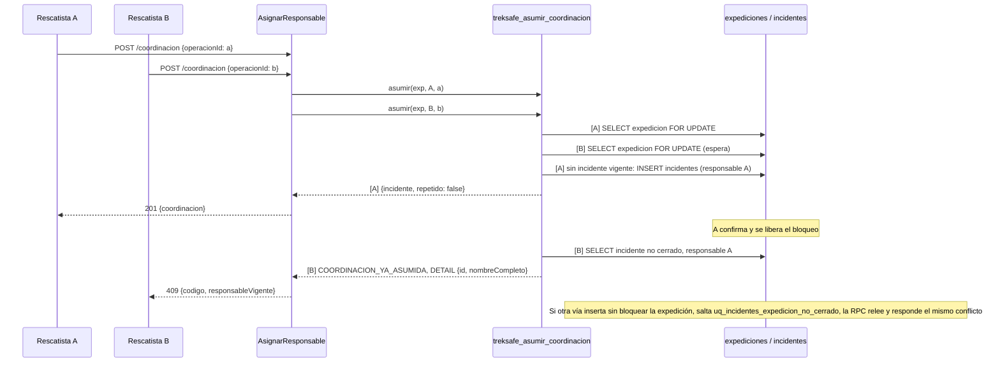

# HU-39: Asumir la coordinación de una alerta

Como rescatista, quiero asumir una alerta como responsable principal para evitar que varios equipos coordinen el mismo caso sin conocerse.

**Criterios de aceptación**

1. **CA-01 Asunción:** un rescatista validado asume una alerta abierta que no tenga responsable.
2. **CA-02 Un solo responsable:** dos solicitudes concurrentes dejan un solo responsable. La otra recibe un conflicto que indica el responsable vigente.
3. **CA-03 Visibilidad sin datos médicos:** la consola muestra la asignación a todos los rescatistas autorizados sin exponer datos médicos.

## Reglas

| Regla | Decisión |
|---|---|
| Quién | Un rescatista validado: el que tiene fila en `perfiles_rescatista`. |
| Qué alerta | Una expedición en estado `alerta` sin incidente no cerrado. Si no existe o ya salió de `alerta`, se responde como si no existiera (`ALERTA_NO_ENCONTRADA`). |
| Un solo responsable | Índice único parcial `uq_incidentes_expedicion_no_cerrado` sobre `incidentes(expedicion_id) WHERE estado <> 'cerrado'`, más el bloqueo `FOR UPDATE` de la expedición. |
| Concurrencia | Una transacción en la RPC `treksafe_asumir_coordinacion` (017). Quien llega segundo espera el bloqueo y recibe el conflicto con el responsable vigente. |
| Idempotencia | `operacionId` (UUID del cliente, uno por intento), guardado en `incidentes.operacion_id` (único). |
| Mismo responsable, otra operación | Es una repetición segura: devuelve el incidente vigente y no escribe (200). |
| Separación de HU-14 | La recepción histórica (`confirmarAlerta`, `bitacoras_rescate`) no cambia y no depende de la coordinación. |
| Datos médicos | Ninguno: la tabla, la RPC, la lectura y la respuesta solo identifican al responsable. |
| CA-03 | Se cumple para el objeto `coordinacion` y para las tres lecturas de la consola (monitor, alertas y detalle), que lo informan a todo rescatista autorizado sin datos médicos. `fichaMedica` sigue en el detalle de la alerta hasta HU-50 (Sebastian). |
| Estados | `abierto`, `localizado` y `cerrado` existen en la tabla. Las transiciones son de HU-40 y HU-42. |

## Tarjeta CRC

| Clase: `AsignarResponsable` (`backend/src/application/use-cases/AsignarResponsable.ts`) | |
|---|---|
| **Responsabilidades** | **Colaboradores** |
| Ejecutar un `ComandoAsignarResponsable` y devolver `{incidente, repetido}` | `ComandoAsignarResponsable` |
| Delegar la asunción atómica e idempotente a la persistencia | `IIncidenteDAO` |
| Traducir los rechazos de negocio a errores HTTP (nunca 401) y añadir `responsableVigente` al 409 | `ErrorCoordinacion`, `ErrorAplicacion` |
| No repetir las reglas de la RPC | |

| Clase: `ComandoAsignarResponsable` (`backend/src/application/commands/ComandoAsignarResponsable.ts`) | |
|---|---|
| **Responsabilidades** | **Colaboradores** |
| Llevar la identidad de la operación (`operacionId`) | `asignarResponsableSchema` |
| Llevar los parámetros: rescatista (del JWT) y expedición (de la ruta) | `Comando<ResultadoAsignarResponsable>` |
| Validar la entrada con zod al construirse y quedar inmutable | |

El `rescatistaId` y la `expedicionId` nunca vienen del cuerpo: el cuerpo solo trae `operacionId`.

## Concurrencia (CA-02)



## Principios SOLID y DRY

- **SRP:** `ComandoAsignarResponsable` define y valida qué se pide. `AsignarResponsable` solo ejecuta y traduce errores. `IncidenteDAOSupabase` persiste y traduce los códigos de la RPC. `controladorCoordinacion` solo adapta HTTP. `BloqueCoordinacion` dibuja; la lógica del `operacionId` y de los textos vive aparte, en `lib/coordinacionRescate.ts`.
- **OCP:** HU-39 se agregó como un comando, un ejecutor y un DAO nuevos. `confirmarAlerta`, `bitacoras_rescate` y `AmpliarRetorno` no cambiaron.
- **DIP:** `AsignarResponsable` depende de `IIncidenteDAO`, definido en el dominio, y no importa Supabase. `ServicioRescate` recibe el DAO tipado como `IIncidenteDAO` (la clase concreta solo es el valor por defecto, igual que sus otros cuatro colaboradores). `crearRutasRescate` es el único sitio que crea `IncidenteDAOSupabase` y `AsignarResponsable`. Las pruebas usan `IncidenteDAOMemoria`.
- **DAO:** `IIncidenteDAO` (`asumir`, `leerCoordinaciones`) oculta PostgREST, la RPC y las tablas.
- **Command:** el comando es un objeto inmutable con identidad (`operacionId`); el ejecutor reutiliza `IEjecutorComando` de HU-27.
- **DRY:**

| Qué | Definición única | Quién la usa |
|---|---|---|
| Forma de `Coordinacion` | `IIncidenteDAO.ts` | `GET /rescate/*`, respuesta del `POST`, frontend (`services/rescate.ts`) |
| Resultado de la RPC | `treksafe_resultado_coordinacion` (017) | Todos los caminos de `treksafe_asumir_coordinacion` y el `DETAIL` del 409 |
| Estados HTTP de coordinación | `RESPUESTAS_COORDINACION` | `AsignarResponsable` y su prueba |
| Textos y reglas de `operacionId` | `lib/coordinacionRescate.ts` | `BloqueCoordinacion` |
| UUID | `lib/uuid.ts` | `BloqueCoordinacion` |

## Idempotencia

| Caso | Resultado |
|---|---|
| Misma `operacionId` del mismo rescatista y alerta | El mismo incidente, 200, sin escribir |
| Mismo responsable con otra `operacionId` | El incidente vigente, 200, sin escribir y sin registrar la operación nueva |
| `operacionId` de otro rescatista o de otra alerta | 404 `ALERTA_NO_ENCONTRADA`, sin revelar nada ajeno |
| `operacionId` ya usada por otra operación del plan (`eventos_plan`) | 400 `DATOS_INVALIDOS` |
| Otro rescatista con otra `operacionId` | 409 `COORDINACION_YA_ASUMIDA` con el responsable vigente |

## API

### `POST /api/rescate/alertas/:expedicionId/coordinacion`

Requiere token de rescatista. Cuerpo: `{ "operacionId": "<uuid generado por el cliente, uno por intento>" }`.

Respuesta `201` (se creó) o `200` (repetición):

```json
{
  "coordinacion": {
    "incidenteId": "<uuid>",
    "version": 1,
    "responsableId": "<uuid>",
    "nombreResponsable": "Ana Rescate",
    "asumidoEn": "2030-01-15T12:00:00.000Z",
    "esMia": true
  }
}
```

| Estado | Código | Cuándo |
|---|---|---|
| 400 | Sin código (`ErrorValidacion`, con `detalles`) | `:expedicionId` u `operacionId` no son UUID |
| 400 | `DATOS_INVALIDOS` | La operación ya se usó en otro tipo de operación |
| 403 | `PROHIBIDO` | El token es de un senderista |
| 403 | `NO_ES_RESCATISTA` | Token de rescatista sin perfil validado |
| 404 | `ALERTA_NO_ENCONTRADA` | No existe, ya no está en `alerta` o la operación es ajena |
| 409 | `COORDINACION_YA_ASUMIDA` | Otro rescatista coordina. El cuerpo incluye `responsableVigente: {responsableId, nombreResponsable}` |

Solo la falta de token o un token inválido responden 401. Ningún rechazo de negocio lo hace, porque el frontend lo interpreta como sesión vencida.

### Campo `coordinacion` en las lecturas

`GET /api/rescate/expediciones`, `GET /api/rescate/alertas` y `GET /api/rescate/alertas/:expedicionId` agregan `coordinacion`: el objeto de arriba, visto por quien consulta (`esMia` según el rescatista), o `null` si no hay incidente no cerrado. Es un cambio aditivo. Cada lista hace una sola lectura de `incidentes` (sin N+1).

## Contrato de `incidentes` para el equipo

Lo usan Sebastian (HU-41, HU-42, HU-50), Jhon (HU-43) y Fernando (HU-46).

| Columna | Tipo | Notas |
|---|---|---|
| `id` | UUID | PK |
| `expedicion_id` | UUID | FK a `expediciones`, `ON DELETE CASCADE` |
| `estado` | TEXT | `abierto` (por defecto), `localizado` o `cerrado` |
| `responsable_id` | UUID | `NOT NULL`, FK a `perfiles_rescatista(usuario_id)`, `ON DELETE RESTRICT` |
| `version` | INTEGER | Empieza en 1. Control optimista para relevo y cierre |
| `asumido_en`, `abierto_en` | TIMESTAMPTZ | `NOW()` del servidor |
| `cerrado_en` | TIMESTAMPTZ | Nulo mientras no esté cerrado |
| `operacion_id` | UUID | `NOT NULL UNIQUE`: la operación que abrió el incidente |

- Índice único parcial `uq_incidentes_expedicion_no_cerrado`: un solo incidente no cerrado por expedición.
- "Alerta sin responsable" = expedición en `alerta` sin incidente no cerrado.
- RLS activo con `treksafe_deny_anon_authenticated`. `service_role` tiene `SELECT` e `INSERT`; los demás permisos los añade quien los necesite (HU-40, HU-42).
- La tabla no guarda datos médicos y no debe hacerlo.

### Restricción que HU-40 y HU-42 deben respetar

`chk_incidentes_cierre`: `(estado = 'cerrado') = (cerrado_en IS NOT NULL)`.

- Cerrar es **un solo `UPDATE`** que fija `estado = 'cerrado'` y `cerrado_en` a la vez. Cambiar uno sin el otro viola la restricción.
- Reabrir exige limpiar `cerrado_en` en el mismo `UPDATE`.
- El relevo (HU-40) cambia `responsable_id` bloqueando la fila (`FOR UPDATE`) y sube `version`. Un incidente `cerrado` no cuenta como coordinación vigente.

## Migración

| Archivo | Contenido |
|---|---|
| `017_hu39_asumir_coordinacion.sql` | Tabla `incidentes`, índices, RLS, la función `treksafe_resultado_coordinacion` y la RPC `treksafe_asumir_coordinacion`. Requiere `002`. Aplicar una sola vez. Solo `service_role` ejecuta las funciones. |

La 015 sigue reservada para HU-45. Si al hacer merge el 017 está ocupado, se renumera.

## Frontend

- `BloqueCoordinacion` aparece en el monitor (`PaginaConsolaRescate`), en la lista de alertas (`PaginaInicioRescatista`) y en `PaginaDetalleAlertaRescate`.
- "Sin responsable" con el botón "Asumir coordinación" solo si `estado === 'alerta'` y `coordinacion` es `null`. Con responsable: "Coordinada por <nombre> · desde HH:MM". Si `esMia`: "Tú coordinas esta alerta" (solo depende de `esMia`, nunca de comparar nombres).
- El `operacionId` se genera con `generarUuid()` en el primer clic y se reutiliza mientras el resultado sea desconocido (error de red o 5xx). Tras cualquier respuesta definitiva se descarta. El botón queda deshabilitado mientras se envía.
- Ante un 409 se muestra "Coordinada por <nombre del error>" (`extras.responsableVigente`, validado) y se vuelve a leer la pantalla.
- `ErrorClienteApi` conserva ahora los campos extra del cuerpo del error (`extras`), de forma genérica y retrocompatible.
- "Confirmar recepción" (HU-14) sigue separado y sin cambios.

## Verificación

| Evidencia | Resultado |
|---|---|
| Suite SQL (`backend/migrations/tests/hu39_asumir_coordinacion.test.sql`) sobre PostgreSQL 18.6 desechable, con `init_schema.sql` y las migraciones hasta la 016 | 12 de 12 casos |
| Concurrencia con sesiones reales (`backend/scripts/test-hu39-postgres.mjs`) | 10 de 10 casos, incluida una barrera con bloqueo y 25 rondas simultáneas |
| `AsignarResponsable`, comando y DAO en memoria | 13 + 5 + 4 pruebas |
| `IncidenteDAOSupabase` (cliente simulado) | 26 pruebas |
| `ServicioRescate`: campo `coordinacion` | 5 pruebas |
| HTTP con JWT real | 9 pruebas |
| Frontend (`uuid`, `ErrorClienteApi`, lógica y bloque) | 7 + 3 + 16 + 10 pruebas |

Para repetir la suite local: `node backend/scripts/test-hu39-postgres.mjs` (Docker, puerto 55432) o con `--pg-bin <carpeta>`. El script solo acepta `127.0.0.1`/`localhost` y bases con "desechable" en el nombre.

**Pendiente para la prueba manual (no cubierto por la suite local):**

- Que con Supabase real el código del `RAISE EXCEPTION` llegue en `error.message` y el JSON en `error.details`.
- Que el embed `perfiles_rescatista(nombre_completo)` funcione con `service_role`, con el esquema recargado tras aplicar la 017.

## Pendientes del Product Owner y notas para el PR

- **Ficha médica en el detalle hasta HU-50.** `GET /rescate/alertas/:id` sigue devolviendo `fichaMedica`, como antes. Sebastian la cambia en HU-50. El campo `coordinacion` es distinto: nunca lleva datos médicos, y una prueba lo comprueba.
- **`operacion_id` es único por tabla (nota para que el equipo decida, no bloquea HU-39).** La unicidad vale dentro de cada tabla: `eventos_plan.operacion_id` e `incidentes.operacion_id`. La 017 sí revisa `eventos_plan` y responde 400 `DATOS_INVALIDOS` si el `operacionId` ya se usó allí. La comprobación inversa no existe: `treksafe_editar_expedicion` (003), `treksafe_cancelar_expedicion` (005) y `treksafe_ampliar_retorno` (007) solo consultan `eventos_plan` y no revisan `incidentes.operacion_id`. Por eso el mismo `operacionId` podría usarse una vez en una coordinación y otra en un evento del plan. Los clientes generan un UUID nuevo por intento, así que no es esperable. Si el equipo quiere cerrar el hueco, habría que añadir esa comprobación a las tres RPC, un cambio fuera de HU-39.
- **Incidente abierto cuando la expedición sale de `alerta` (pendiente del PO y de HU-42).** Lo que hace hoy el código, comprobado:
  - La única transición que saca una expedición de `alerta` es `completarConfirmacionRetorno` (el senderista confirma su retorno): pasa `en_progreso` o `alerta` a `completada` (`RepositorioExpedicion.ts`). La cancelación solo parte de `programada` (005) y nada devuelve `alerta` a `en_progreso`.
  - Ningún código de la aplicación cierra el incidente al completarse la expedición: lo único que escribe en `incidentes` es la RPC de asunción. El incidente queda en `abierto` o `localizado`.
  - La consola no lo muestra: el monitor lista solo expediciones `en_progreso` o `alerta`, la lista de alertas solo `alerta`, y el detalle devuelve 404 (`buscarContextoAlertaRescate` exige `alerta`) antes de leer la coordinación. `leerCoordinaciones` solo recibe ids de esas listas. Asumir de nuevo también da 404 (`ALERTA_NO_ENCONTRADA`).
  - `leerCoordinaciones` filtra por el estado del incidente, no por el de la expedición: si algún día se llamara con el id de una expedición ya completada, devolvería su coordinación.
  - Queda por decidir con el PO, y resolver en HU-42, quién cierra el incidente y cuándo.
- **Numeración.** La 017 puede cambiar de número si al hacer merge ya está ocupada.
