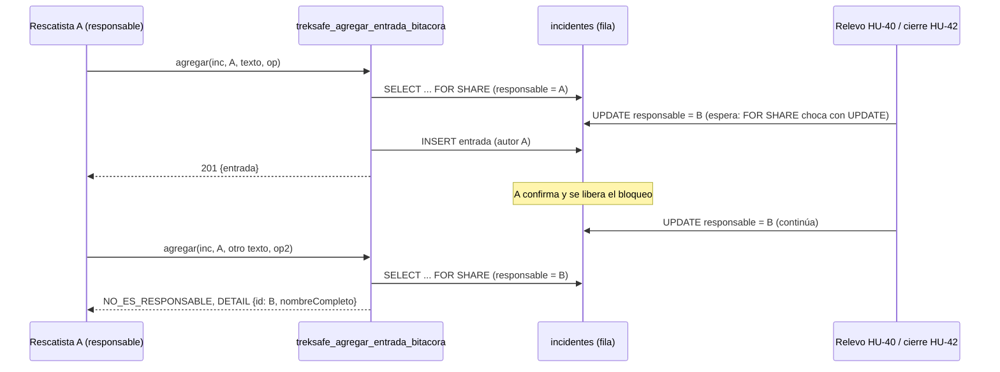

# HU-41: Bitácora cronológica del incidente

Como rescatista responsable de un incidente, quiero registrar entradas cronológicas en una bitácora compartida para que todos los rescatistas autorizados conozcan el avance del rescate y quede constancia ordenada de lo ocurrido.

**Criterios de aceptación y trazabilidad a pruebas**

| CA | Enunciado | Pruebas principales |
|---|---|---|
| CA-01 | El responsable vigente añade una entrada con la hora del servidor. | SQL casos 3, 4 y 12; contrato del DAO (nota, conservación, orden); `rutasBitacoraIncidente.test.ts` ("CA-01"); componente ("un envío llama a agregar…") |
| CA-02 | Las entradas se conservan y se muestran en orden cronológico estable; no se editan ni se borran. | SQL casos 5, 9, 12 y 15; contrato (conservación, orden estable, sin métodos de actualización); concurrencia (d); `entradaBitacora.test.ts` |
| CA-03 | Los rescatistas autorizados leen la bitácora; solo el responsable escribe; la corrección es una entrada nueva que cita la original. | SQL casos 6, 9 y 11; contrato (corrección, transferencia tras el relevo); `rutasBitacoraIncidente.test.ts` ("CA-03", "corrección"); concurrencia (a) y (b); componente (solo lectura, "Corregir") |

## Reglas

| Regla | Decisión |
|---|---|
| Quién escribe | Solo el responsable vigente, leído de `incidentes.responsable_id` dentro de la transacción y con la fila bloqueada (`FOR SHARE`). Nunca se cachea ni se decide en la capa de aplicación. |
| Quién lee | Cualquier usuario con rol `rescatista` en el JWT. |
| Actor | Siempre el del JWT. El cuerpo es `.strict()`: `tipo`, `autorId` o `registradaEn` dan 400. |
| Estados | Se escribe en `abierto` y `localizado`. En `cerrado` la escritura da `INCIDENTE_CERRADO` (409); la lectura sigue disponible. |
| Corrección | Entrada nueva de tipo `correccion` con `corrige_entrada_id` del mismo incidente (FK compuesta). La original no cambia. |
| Hora y orden | `registrada_en` la fija el servidor (`clock_timestamp()` en un trigger `BEFORE INSERT`); el orden es `(registrada_en, secuencia)`. El cliente no reordena. |
| Solo anexado | Triggers: UPDATE, DELETE directo y TRUNCATE dan `ENTRADA_BITACORA_INMUTABLE`. Solo pasa la cascada del ARCO del senderista. `service_role` solo tiene `SELECT` e `INSERT`. |
| Longitud | 1 a 2000 caracteres tras recortar espacios (zod, función SQL y `CHECK`). |
| Datos médicos | Ninguno: la tabla no tiene columnas médicas, ninguna consulta une fichas y la interfaz muestra un aviso fijo. El texto libre no se filtra en el servidor. |
| Separación de HU-14 | La bitácora personal de HU-14 (`bitacoras_rescate`, `PATCH /alertas/:id/bitacora`) no cambia. Todo lo nuevo lleva el sufijo `Incidente` o `BitacoraIncidente`. |

## Decisiones provisionales (pendientes del Product Owner y del equipo)

| # | Decisión | Valor provisional | Confirmar con |
|---|---|---|---|
| D1 | Estados en que se escribe | `abierto` y `localizado`; `cerrado` da `INCIDENTE_CERRADO` | Marko |
| D2 | Quién escribe | Solo el responsable vigente, con la fila bloqueada | Favio, Marko |
| D3 | Quién lee | Cualquier rescatista (`requerirRol('rescatista')`) | Marko, Jhon |
| D4 | Lectura tras el cierre | Siempre disponible; no depende de `expediciones.estado` | Marko |
| D5 | Direccionamiento | Por incidente: `/api/rescate/incidentes/:incidenteId/bitacora` | Favio |
| D6 | Tabla | `entradas_bitacora_incidente`, separada de `incidentes` y de `bitacoras_rescate` | Ariana |
| D7 | Orden estable | `ORDER BY registrada_en ASC, secuencia ASC` (`secuencia` es `GENERATED ALWAYS AS IDENTITY`) | Ariana |
| D8 | Corrección | Entrada nueva `correccion` con `corrige_entrada_id` obligatorio | Marko |
| D9 | Longitud | 1 a 2000 caracteres tras recortar | Marko |
| D10 | Idempotencia | `operacion_id` único; ver "Idempotencia" | n/a |
| D11 | Bloqueo frente al relevo | `FOR SHARE` sobre `incidentes` y `GRANT UPDATE (version)` explícito; nunca se bloquea `expediciones` | Favio |
| D12 | Tipos de entrada | `nota`, `correccion` y `cierre` (este último reservado para HU-42, con índice único parcial) | Sebastián (HU-42), Jhon (HU-47) |
| D13 | FK y borrado | Cascada desde `incidentes` (solo la cascada pasa el trigger); `RESTRICT` sobre el autor | Jhon, Ariana |
| D14 | Privacidad | Sin columnas médicas, sin uniones con fichas, aviso fijo en la interfaz | Jhon |
| D15 | Nombres | Sufijo `Incidente` o `BitacoraIncidente` en todo; en la interfaz "Bitácora del incidente" | n/a |

Códigos de error de negocio (en SQL `RAISE EXCEPTION '<CODIGO>'`; en TypeScript `ErrorBitacoraIncidente`):

| Código | HTTP | Cuándo |
|---|---|---|
| `DATOS_INVALIDOS` | 400 | Parámetros nulos, texto vacío o de más de 2000 caracteres, tipo inválido o incoherente con la corrección |
| `CORRECCION_INVALIDA` | 400 | `corrige_entrada_id` inexistente o de otro incidente |
| `NO_ES_RESPONSABLE` | 403 | El autor no es el responsable vigente. `DETAIL` con `{"id","nombreCompleto"}`; extras `responsableVigente` |
| `INCIDENTE_NO_ENCONTRADO` | 404 | No existe el incidente |
| `INCIDENTE_CERRADO` | 409 | Escritura sobre un incidente cerrado |
| `OPERACION_YA_REGISTRADA` | 409 | El `operacion_id` ya se usó con otro contenido o actor, o en otra operación (incidentes, eventos del plan); también un segundo `cierre` |
| `ENTRADA_BITACORA_INMUTABLE` | solo SQL | UPDATE, DELETE directo o TRUNCATE |

Ningún rechazo de negocio devuelve 401: el frontend lo interpreta como sesión vencida.

## Tarjetas CRC

| Clase: `ComandoAgregarEntradaBitacora` (`application/commands`) | |
|---|---|
| **Responsabilidades** | **Colaboradores** |
| Llevar la identidad (`operacionId`) y los parámetros (incidente de la ruta, autor del JWT, texto, entrada corregida) | `cuerpoAgregarEntradaBitacoraSchema`, `agregarEntradaBitacoraSchema` |
| Validar al construirse (cuerpo `.strict()`, UUID, texto 1..2000) y quedar inmutable | `Comando<ResultadoAgregarEntradaBitacora>` |

| Clase: `AgregarEntradaBitacora` (`application/use-cases`) | |
|---|---|
| **Responsabilidades** | **Colaboradores** |
| Ejecutar el comando y devolver `{entrada, repetido}` | `ComandoAgregarEntradaBitacora` |
| Delegar la escritura atómica e idempotente a la persistencia | `IRegistroBitacoraIncidente` |
| Traducir los rechazos de negocio a errores HTTP (nunca 401) y añadir `responsableVigente` al 403 | `ErrorBitacoraIncidente`, `ErrorAplicacion` |
| No comprobar el responsable por su cuenta (sería una lectura desfasada ante un relevo) | |

| Clase: `ConsultarBitacoraIncidente` (`application/use-cases`) | |
|---|---|
| **Responsabilidades** | **Colaboradores** |
| Leer la bitácora y armar la vista para el consultante (`esResponsable`, `puedeEscribir`, `autor.esMia`) | `ILectorBitacoraIncidente`, `admiteEntradas` |
| 404 si el incidente no existe; 400 (ZodError) si un id no es UUID | `ErrorAplicacion` |

| Interfaces: `ILectorBitacoraIncidente` / `IRegistroBitacoraIncidente` / `IBitacoraIncidenteDAO` (`domain/repositories`) | |
|---|---|
| **Responsabilidades** | **Colaboradores** |
| Lectura: `listar(incidenteId)` en orden, con el incidente en cualquier estado | `EntradaBitacora`, `BitacoraIncidente` |
| Registro: `agregar(solicitud)`, atómico e idempotente; sin actualizar ni eliminar | `ErrorBitacoraIncidente` |

| Clase: `BitacoraIncidenteDAOSupabase` (`infrastructure/repositories`) | |
|---|---|
| **Responsabilidades** | **Colaboradores** |
| `listar`: dos consultas con columnas explícitas y orden `registrada_en, secuencia`; normaliza fechas a ISO y el nombre embebido | `SupabaseClient`, `COLUMNAS_*` |
| `agregar`: llama a la RPC y traduce `error.message`/`error.details`; cualquier otro error es 500 sin exponer el mensaje | `treksafe_agregar_entrada_bitacora` |

| Clase: `BitacoraIncidenteDAOMemoria` (`infrastructure/repositories/memoria`) | |
|---|---|
| **Responsabilidades** | **Colaboradores** |
| Doble de prueba que replica el orden de comprobaciones de la RPC, con cola por incidente | `IBitacoraIncidenteDAO` |
| Simular el relevo (`relevar`), el estado (`cambiarEstado`) y el cierre de HU-42 (`anexarInterna`) | |

| Clase: `BitacoraIncidente.tsx` (`frontend/src/components/rescate`) | |
|---|---|
| **Responsabilidades** | **Colaboradores** |
| Mostrar la lista en el orden del servidor y, solo al responsable, el formulario con el aviso de privacidad | `services/bitacoraIncidente.ts` |
| Conservar el `operacionId` mientras el resultado sea desconocido; reintentar o descartar | `lib/bitacoraIncidente.ts`, `lib/coordinacionRescate.ts` |

## Concurrencia: relevo contra escritura



Si el relevo llega primero (`SELECT ... FOR UPDATE` y `UPDATE`), la escritura de A espera, relee la fila ya cambiada y recibe `NO_ES_RESPONSABLE`. Ambos sentidos y el cierre están probados con sesiones reales (casos (a), (b) y (c) de `test-hu41-postgres.mjs`).

- **Por qué `FOR SHARE`:** choca con cualquier `UPDATE` de la fila (relevo, cierre), lo haga o no la otra HU con un bloqueo explícito. `FOR KEY SHARE` no sirve: no choca con un `UPDATE` que no toca la clave. Varias escrituras de bitácora conviven entre sí.
- **Privilegio:** la documentación de PostgreSQL (`ddl-priv`) dice que `SELECT ... FOR UPDATE` y `FOR SHARE` exigen, además de `SELECT`, el privilegio `UPDATE` sobre al menos una columna. La 019 concede `UPDATE (version)` a `service_role` de forma explícita, para no depender de los privilegios por defecto de Supabase, que probablemente ya le dan `UPDATE` completo por accidente (la 017 nunca hizo `REVOKE`). El caso SQL 13 documenta la dependencia: solo con `UPDATE (version)` la RPC funciona; sin ningún `UPDATE` sobre `incidentes` da `permission denied`.
- **Por qué no bloquear `expediciones`:** HU-39 sí lo hace al asumir. Bloquear la expedición también aquí no aporta (cualquier `UPDATE` de `incidentes` ya se serializa) y abriría la posibilidad de un ciclo de bloqueos con HU-39 y con el relevo. HU-41 solo toma `FOR SHARE` sobre `incidentes`.
- **Orden y hora:** `clock_timestamp()` se toma después de obtener el bloqueo, así que se acerca al orden de commit, pero entre escritores concurrentes que conviven con `FOR SHARE` el orden puede no coincidir exactamente con el de commit. Es determinista (`secuencia` desempata) y estable entre lecturas.

## Principios SOLID y DRY

- **SRP:** el estado actual del incidente (`incidentes`) está separado de las entradas (`entradas_bitacora_incidente`); el servicio `services/bitacoraIncidente.ts` está separado de `rescate.ts`; el comando valida, el caso de uso delega y traduce, el DAO persiste, el controlador adapta HTTP.
- **ISP:** `ILectorBitacoraIncidente` e `IRegistroBitacoraIncidente`; `ConsultarBitacoraIncidente` solo depende del lector.
- **DIP:** los casos de uso dependen de interfaces del dominio y no importan Supabase, Express ni infraestructura. Los concretos solo se crean en `rutasRescate.ts` (un único `BitacoraIncidenteDAOSupabase` compartido por lectura y escritura).
- **OCP:** `TIPOS_ENTRADA_BITACORA` y `treksafe_anexar_entrada_bitacora_interna` permiten sumar tipos (`relevo`, HU-40) o el cierre (HU-42) sin tocar la RPC pública. `IIncidenteDAO` no se amplía.
- **LSP:** `verificarContratoBitacoraIncidenteDAO` ejecuta los mismos 13 casos sobre la memoria y sobre PostgreSQL real.
- **DRY:**

| Qué | Definición única | Quién la usa |
|---|---|---|
| Tipos, límite y estados con escritura | `domain/value-objects/entradaBitacora.ts` (con prueba de coherencia contra la 019) | DTO, DAO, caso de uso |
| Resultado de las respuestas del responsable | `treksafe_resultado_coordinacion` (017) | `DETAIL` de `NO_ES_RESPONSABLE` |
| Resolución de repeticiones | `treksafe_entrada_bitacora_repetida` | RPC pública y función interna |
| Estados HTTP | `RESPUESTAS_BITACORA` | `AgregarEntradaBitacora` y su prueba |
| `operacionId`, reintento y `leerResponsableVigente` | `lib/coordinacionRescate.ts` (sin moverlos) | `BloqueCoordinacion` y `BitacoraIncidente` |

## Idempotencia

| Caso | Resultado |
|---|---|
| Mismo `operacionId`, mismo incidente, autor, tipo, texto normalizado y entrada corregida | La entrada original, 200, `repetido: true`, aunque haya habido un relevo o un cierre entre el intento y el reintento (se resuelve **antes** de autorizar) |
| Mismo `operacionId` con otro contenido o de otro autor | 409 `OPERACION_YA_REGISTRADA`, sin revelar nada |
| `operacionId` ya usado en `incidentes` o `eventos_plan` | 409 `OPERACION_YA_REGISTRADA` |
| Dos solicitudes simultáneas con el mismo `operacionId` | Una escribe y la otra recibe la original (`unique_violation` capturada y releída); una sola fila |
| Otro autor con otro `operacionId` | Sigue las reglas normales (403 si no es el responsable) |

## API

Montaje `/api/rescate` (con `no-store`). Todas las rutas: `middlewareAutenticacion` y `requerirRol('rescatista')`. Sin token: 401 (la única). Con rol senderista: 403 `PROHIBIDO`.

### `GET /api/rescate/incidentes/:incidenteId/bitacora`

```json
{
  "bitacora": {
    "incidenteId": "uuid", "expedicionId": "uuid", "estado": "abierto",
    "responsable": { "responsableId": "uuid", "nombreResponsable": "Ana Rescate" },
    "esResponsable": true, "puedeEscribir": true,
    "entradas": [
      { "id": "uuid", "tipo": "nota", "texto": "…",
        "autor": { "autorId": "uuid", "nombreAutor": "Ana Rescate", "esMia": true },
        "registradaEn": "2026-11-10T15:04:05.123Z", "corrigeEntradaId": null }
    ]
  }
}
```

Las entradas van en el orden cronológico del servidor. Funciona con el incidente cerrado y con la expedición en cualquier estado. 400 `ErrorValidacion` si `incidenteId` no es UUID; 404 `INCIDENTE_NO_ENCONTRADO`.

### `POST /api/rescate/incidentes/:incidenteId/bitacora`

Cuerpo (`.strict()`): `{ "operacionId": "uuid", "texto": "1..2000 tras recortar", "corrigeEntradaId"?: "uuid" | null }`.
Respuesta `201 { "entrada": EntradaBitacoraVista }` si es nueva; `200` con el cuerpo idéntico si es una repetición.

| Estado | Código | Cuándo |
|---|---|---|
| 400 | `ErrorValidacion` (con `detalles`) | Falta un campo, UUID inválido, texto vacío o largo, claves extra (`tipo`, `autorId`) |
| 400 | `DATOS_INVALIDOS`, `CORRECCION_INVALIDA` | Ver la tabla de códigos |
| 403 | `PROHIBIDO` | Token de senderista |
| 403 | `NO_ES_RESPONSABLE` | Extras `responsableVigente: {responsableId, nombreResponsable}` |
| 404 | `INCIDENTE_NO_ENCONTRADO` | No existe |
| 409 | `INCIDENTE_CERRADO`, `OPERACION_YA_REGISTRADA` | Ver la tabla de códigos |
| 500 | `ErrorAplicacion` genérico | Cualquier otro fallo, sin exponer el mensaje de la base |

## Contrato de `entradas_bitacora_incidente` para el equipo

| Columna | Tipo | Notas |
|---|---|---|
| `id` | UUID | PK |
| `secuencia` | BIGINT | `GENERATED ALWAYS AS IDENTITY`; desempata el orden; no se expone en la API |
| `incidente_id` | UUID | FK a `incidentes`, `ON DELETE CASCADE` (solo la cascada pasa el trigger) |
| `autor_id` | UUID | FK a `perfiles_rescatista`, `ON DELETE RESTRICT`; no cambia con el relevo |
| `tipo` | TEXT | `nota`, `correccion` o `cierre` |
| `texto` | TEXT | 1 a 2000 caracteres, ya recortado, no solo espacios |
| `corrige_entrada_id` | UUID | Obligatorio si y solo si `tipo = 'correccion'`; FK compuesta `(incidente_id, corrige_entrada_id)` |
| `operacion_id` | UUID | `NOT NULL UNIQUE` |
| `registrada_en` | TIMESTAMPTZ | Hora del servidor (`clock_timestamp()` en el trigger) |

- Índices: `idx_entradas_bitacora_orden (incidente_id, registrada_en, secuencia)` y el único parcial `uq_entradas_bitacora_un_cierre (incidente_id) WHERE tipo = 'cierre'`.
- RLS activo con `treksafe_deny_anon_authenticated`. `service_role`: `SELECT` e `INSERT`.
- Funciones (todas `SECURITY INVOKER`, `search_path` vacío, solo `service_role` ejecuta): `treksafe_agregar_entrada_bitacora` (pública), `treksafe_anexar_entrada_bitacora_interna` (reutilizable), `treksafe_entrada_bitacora_repetida`, `treksafe_resultado_entrada_bitacora` y las dos de los triggers.
- La tabla no guarda datos médicos y no debe hacerlo.

## Contrato para HU-42 (queda preparado)

- **Esquema sin cambios:** el tipo `cierre` ya está en el `CHECK` y el índice `uq_entradas_bitacora_un_cierre` garantiza un solo cierre por incidente.
- **Misma transacción** dentro de la RPC de cierre de HU-42:
  1. `SELECT * FROM incidentes WHERE id = $1 FOR UPDATE`. Debe ser `FOR UPDATE` desde el principio: no usar la RPC pública de HU-41 (que toma `FOR SHARE`) y luego hacer `UPDATE`, porque subir el bloqueo puede provocar un deadlock.
  2. Comprobar el responsable y el estado (localizado y no cerrado).
  3. `INSERT` del informe.
  4. `PERFORM public.treksafe_anexar_entrada_bitacora_interna(p_incidente_id, p_rescatista_id, 'cierre', <resumen>, NULL, <operacion_id>)`. La función no comprueba el estado, así que puede ir antes o después del `UPDATE`.
  5. `UPDATE incidentes SET estado = 'cerrado', cerrado_en = now(), version = version + 1` en una sola sentencia (`chk_incidentes_cierre`).
- **Privilegios que HU-42 debe conceder:** `UPDATE (estado, cerrado_en, version)` sobre `incidentes` y `SELECT, INSERT` sobre su tabla de informes. Si hace `REVOKE UPDATE` de tabla, debe mantener `UPDATE (version)`.
- **Idempotencia:** HU-42 resuelve primero la suya. Si reutiliza el mismo `operacion_id` en la entrada de cierre, la función interna devuelve `repetido`. Si quiere que `treksafe_entrada_bitacora_repetida` rechace también los UUID de su tabla de informes, puede hacer `CREATE OR REPLACE` de esa función.
- **Conservación:** cerrar nunca borra; `listar` funciona con el incidente cerrado; el `DELETE` directo está prohibido por trigger.
- **TypeScript:** `IRegistroBitacoraIncidente` no se amplía. El cierre se registra solo en SQL, dentro de la RPC de cierre. Para pruebas en memoria existe `BitacoraIncidenteDAOMemoria.anexarInterna(..., 'cierre', ...)`.
- Probado en el caso SQL 14: la interna anexa el cierre junto al `UPDATE` a cerrado, un segundo cierre da `OPERACION_YA_REGISTRADA`, el reintento del mismo cierre es idempotente y la RPC pública posterior da `INCIDENTE_CERRADO`.

## Notas para HU-40 y HU-47

- **HU-40 (relevo):** basta que el relevo haga `UPDATE` de la fila de `incidentes` para serializarse con la bitácora; no necesita bloquear `expediciones` por HU-41 (si bloquea primero la expedición y luego el incidente, es compatible con el orden de HU-39). No debe quitar `UPDATE (version)`. Si quiere registrar el relevo en la bitácora, su migración puede ampliar `chk_entradas_bitacora_tipo` con `'relevo'` y `TIPOS_ENTRADA_BITACORA`, y llamar a la función interna.
- **HU-47 (métricas):** contar incidentes con `COUNT(DISTINCT incidentes.id)` o directamente desde `incidentes`, nunca uniéndolos con las entradas sin agregar. El cierre único por incidente sirve como marca.

## Migración 019 y su aplicación

| Archivo | Contenido |
|---|---|
| `019_hu41_bitacora_incidente.sql` | Tabla, índices, RLS, triggers de hora y solo anexado, `UPDATE (version)` sobre `incidentes`, funciones auxiliares, la interna reutilizable y la RPC pública. Requiere `017` y `002`. Aplicar una sola vez (no es re-ejecutable). |

- **Ariana:** reservar el número 019 y comprobar que nadie lo toma antes del merge (en `develop` la última es la 018; las PR #90, #93 y #94 traen `012_hu45_outbox.sql`, que choca con la 012 de HU-36, un asunto aparte). Anotar la aplicación en `REGISTRO_APLICACION.md` (esta HU no lo toca). No se aplicó en ningún entorno remoto.
- Confirmar en DEV con una consulta de solo lectura: `SELECT has_table_privilege('service_role','public.incidentes','UPDATE')`. Si es verdadero por los privilegios por defecto, una migración aparte (de Favio, no de HU-41) podría endurecerlo (`REVOKE UPDATE, DELETE, TRUNCATE ... FROM service_role` y volver a conceder por columna).

## Desviaciones respecto al plan

- **Secuencia identity:** el plan preveía quizá un `GRANT USAGE ON SEQUENCE`. No fue necesario: para una columna `GENERATED ... AS IDENTITY` basta el privilegio `INSERT` de la tabla (el `INSERT` como `service_role` pasa en los casos SQL 4, 9 y 14). La secuencia se revoca de `PUBLIC`, `anon` y `authenticated`.
- **Código de error del `RESTRICT`:** en la prueba SQL 15, el borrado del perfil del autor se captura con `restrict_violation` o `foreign_key_violation`, porque en PostgreSQL 17.6 el rechazo llegó como `foreign_key_violation` (`23503`) y no como `restrict_violation` (`23001`), pese a ser `ON DELETE RESTRICT`. Que la regla es `RESTRICT` lo comprueba el caso SQL 1 (`confdeltype = 'r'`).
- **Validación del cuerpo:** `ComandoAgregarEntradaBitacora.crear` valida primero el cuerpo con el esquema `.strict()` y después añade incidente y autor, para que un `autorId` enviado por el cliente nunca pueda sustituir al del JWT (un esquema único habría aceptado los campos de ruta desde el cuerpo).
- **`test-hu41-postgres.mjs`:** además de lo planificado, aplica la 017 y la 018 y verifica que la suite SQL ejecute exactamente 16 casos.

## Frontend

- `services/bitacoraIncidente.ts` (servicio aparte de `rescate.ts`), `lib/bitacoraIncidente.ts` (lógica pura) y `components/rescate/BitacoraIncidente.tsx`.
- `PaginaDetalleAlertaRescate` muestra `<BitacoraIncidente>` justo después de `BloqueCoordinacion`, solo si `detalle.coordinacion` existe, con `key` por incidente; `alCambiarResponsable` vuelve a leer el detalle. La sección HU-14 "Bitácora de rescate" no cambia (renombrarla a "notas personales" queda como pendiente del PO).
- La lista se muestra en el orden del servidor, con "Tú" según `esMia` y la hora local. El formulario solo aparece si `puedeEscribir`; si no, se explica el motivo (otro responsable o incidente cerrado).
- Aviso fijo de privacidad (`role="note"`) encima del cuadro de texto; contador `n/2000`.
- `operacionId`: `GestorOperacion` de `lib/coordinacionRescate.ts`. Ante un error sin respuesta (0) o 5xx el cuadro pasa a solo lectura y se ofrece "Reintentar envío" (mismo `operacionId`) o "Descartar" (otro nuevo). Ante una respuesta definitiva se descarta.
- Los incidentes cerrados no aparecen en esta página (la expedición sale de `alerta`). Su lectura queda disponible por API; la interfaz de solo lectura llegará con HU-42 o HU-50.

## Verificación

| Evidencia | Resultado |
|---|---|
| Suite SQL (`migrations/tests/hu41_bitacora_incidente.test.sql`) sobre PostgreSQL 17.6 desechable, con `init_schema.sql` y las migraciones hasta la 018 | 16 de 16 casos |
| Concurrencia con sesiones reales (`scripts/test-hu41-postgres.mjs`): relevo antes y después, cierre, 20 escrituras, mismo `operacionId`, error forzado | 6 de 6 casos |
| Suite TypeScript sobre Postgres real (contrato del DAO y casos de uso) | 15 de 15 pruebas |
| Backend: typecheck, `npm test` y build | Pasan; 600 pruebas, 0 fallos |
| Frontend: typecheck, `typecheck:tests`, `typecheck:ui`, `test:equipo`, build, `test:ui` | Pasan; 152 pruebas y 2 omitidas anteriores a HU-41 |
| `test:pwa:privacidad` | 5 fallos que ya ocurren en `origin/develop` sin estos cambios (inicio de sesión simulado) |

Detalle en `evidencias/resultado-postgres.md` y `evidencias/resultado-suites.md`. Para repetir la suite local: `node backend/scripts/test-hu41-postgres.mjs` (Docker, puerto 55432) o con `--pg-bin <carpeta>`. El script solo acepta `127.0.0.1`/`localhost` y bases con "desechable" en el nombre.

**Pendiente para la prueba manual en DEV** (`evidencias/prueba-manual.md`): que `error.message` y `error.details` de la RPC lleguen por PostgREST, que el embed del nombre funcione con el esquema recargado y que el orden por `registrada_en, secuencia` se respete.

## Privacidad (Jhon)

- La tabla no tiene columnas médicas (lo comprueba el caso SQL 1) y ninguna consulta de la bitácora une `fichas_medicas`.
- La respuesta de la API solo lleva nombres, textos y horas; una prueba HTTP busca palabras médicas en todas las respuestas.
- El texto libre puede contener datos médicos escritos por un rescatista: la mitigación es el aviso fijo en la interfaz. No se puede detectar texto médico de forma fiable en el servidor. Jhon debe validar este criterio.
- Riesgo anterior que no cambia: `obtenerDetalleAlerta` (HU-14) sigue devolviendo `fichaMedica`; HU-41 no lo amplía.

## Pendientes del Product Owner y notas para el PR

- **Marko (PO):** D1 (estados con escritura), D3 (quién lee), D4 (lectura tras el cierre), D8 (corrección) y D9 (2000 caracteres). Además: si la nota personal de HU-14 ("Bitácora de rescate") se mantiene, se renombra o se retira, y si hace falta una vista de la bitácora de incidentes cerrados (hoy solo por API).
- **Favio:** revisar D2 y D11 (bloqueo `FOR SHARE`, sin bloquear `expediciones`) y el aviso de `UPDATE (version)` para HU-40.
- **Jhon:** privacidad (ver arriba) y la nota de conteo para HU-47.
- **Ariana:** número 019 y la consulta de privilegios en DEV.
- **Sebastián (HU-42):** el "Contrato para HU-42" de este documento.
