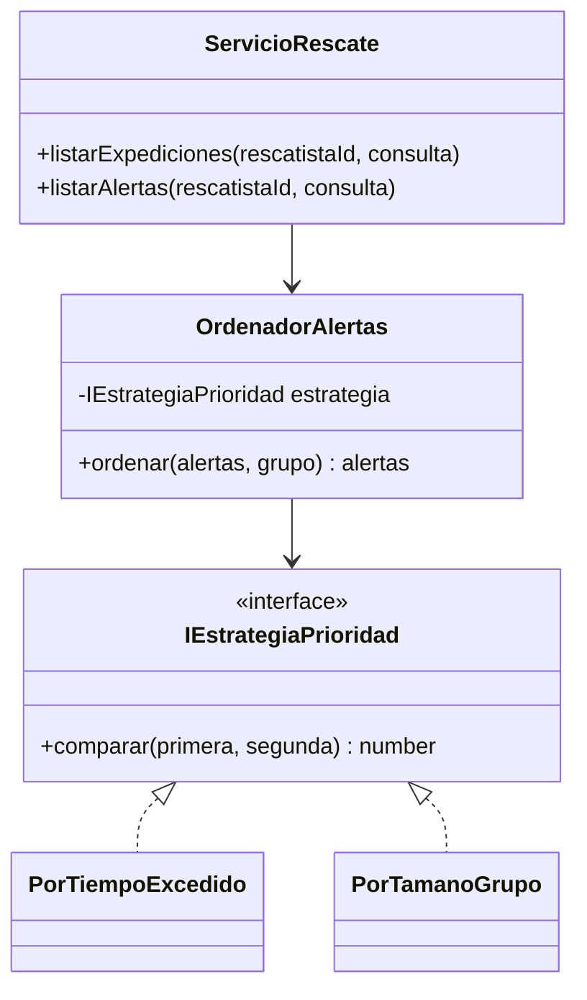

# HU-43 · Priorizar alertas con criterios operativos

La historia corresponde al issue #44. Permite elegir tiempo excedido o cantidad
de participantes declarados, conserva el conjunto de alertas abiertas y muestra
el criterio activo en la consola.

## Reglas de ordenación

- `tiempo_excedido` es el criterio predeterminado. Un plazo de retorno con
  tolerancia anterior se muestra primero. Se comparan instantes exactos para
  evitar empates artificiales al redondear minutos.
- `tamano_grupo` muestra primero la mayor cantidad declarada de participantes.
  Se cuenta al senderista más las filas de `acompanantes_expedicion`.
- Los empates se resuelven por fecha límite ascendente y después por identificador
  de expedición ascendente. El orden es reproducible con los mismos datos.
- El monitor conserva sus grupos operativos existentes, rojo, amarillo y verde.
  El criterio elegido ordena dentro de cada grupo. La lista de alertas aplica
  directamente el criterio elegido.
- Ordenar devuelve una copia de la lista y conserva sus objetos. El servicio
  consulta datos y coordinaciones vigentes de HU-39. No escribe estados, plazos,
  coordinaciones ni información médica.

El backlog deja abiertos el sentido del orden, la fecha de desempate y si el
senderista cuenta como participante. Las reglas anteriores son las decisiones
de implementación para revisar con Jhon y validar funcionalmente con Marko.

## Strategy y SOLID



- SRP. Cada estrategia compara un criterio. `OrdenadorAlertas` aplica el orden y
  los desempates comunes. El servicio reúne los datos y la coordinación.
- OCP. Una estrategia nueva implementa el contrato y se registra en la selección
  del servicio y en la validación de entrada. El ordenador conserva su algoritmo.
- LSP. Ambas estrategias aceptan `AlertaPriorizable` y conservan los contratos de
  comparación, conjunto e inmutabilidad. Comparten pruebas de desempates y listas.
- ISP y DIP. El ordenador depende únicamente de `IEstrategiaPrioridad`. El mapa
  de estrategias del servicio es inyectable. El contrato de dominio usa valores
  operativos y carece de dependencias de HTTP, Supabase o presentación.

## API de la fase de backend

Las llamadas existentes siguen admitidas. El parámetro `criterio` es opcional.

```http
GET /api/rescate/alertas?criterio=tiempo_excedido
GET /api/rescate/alertas?criterio=tamano_grupo
GET /api/rescate/expediciones?zona=Destino&criterio=tamano_grupo
```

Las respuestas conservan los contenedores `alertas` y `expediciones` y agregan
`numeroParticipantes` a cada elemento. Un criterio desconocido, vacío o repetido
responde 400. Se conserva la autenticación de rescatista y la validación del perfil.

Las dos consultas del repositorio añaden `acompanantes_expedicion(count)` para
recuperar el conteo en la misma petición. Las relaciones antiguas o ausentes se
interpretan como cero acompañantes. Esta fase utiliza tablas existentes.

## Fases y comprobación

1. Backend. Estrategias, desempates, selección por API y conteo de participantes.
   Las pruebas cubren mismo conjunto, permutaciones de entrada, instantes con
   distintos husos, selección HTTP, permisos, coordinación y ausencia de cambios.
2. Frontend. Selector en la consola, explicación del criterio activo, cantidad de
   participantes visible y pruebas del cambio de criterio y de sus respuestas.
3. Integración y evidencia. Verificar el conteo embebido en Supabase DEV y el
   comportamiento de la consola, preparar evidencias del PR y validación del PO.

Las pruebas HTTP de backend usan el servicio y middleware reales con repositorios
sustituidos. La fase de integración amplía esa evidencia con PostgreSQL local
desechable y consultas reales a Supabase DEV, cuyo conjunto de alertas está vacío.

## Resultado local de la fase de backend

Verificado el 11 de noviembre de 2026 con Node.js 22.23.4.

- 26 pruebas nuevas aprobadas entre ordenación, servicio, HTTP y consulta del SDK.
- Suite completa de backend con 626 pruebas aprobadas y cero fallos.
- Chequeo de tipos aprobado con `tsc --noEmit`.
- Las suites optativas de PostgreSQL quedaron omitidas por falta de conexión de
  pruebas. La consulta del SDK usa transporte sustituido y las pruebas HTTP usan
  un servidor local con JWT real y repositorios sustituidos.

Comandos ejecutados desde `backend` con Node.js 22 en el PATH.

```powershell
node node_modules/typescript/bin/tsc --noEmit
node --import tsx --test "src/**/*.test.ts"
```

## Frontend y resultado local

La consola ofrece las opciones Tiempo excedido y Participantes declarados. El
cliente envía `criterio` junto al filtro opcional de zona y cada tarjeta muestra
el total declarado de participantes.

`useConsolaRescate` reúne la lectura y el refresco periódico. La pantalla conserva
la última lista válida durante una actualización y muestra el criterio que produjo
esa lista. Una respuesta satisfactoria actualiza juntos la lista, el criterio y la
zona aplicada. Ante un fallo, el reintento utiliza la selección solicitada.

Las solicitudes llevan una secuencia para descartar respuestas de consultas
anteriores. El refresco espera si hay una carga pendiente y se detiene al salir
de la pantalla. La ordenación procede de las estrategias del backend.

Verificado el 11 de noviembre de 2026 con Node.js 22.23.4.

- Nueve pruebas nuevas aprobadas de cliente y consola con React y HTTP sustituido.
- Suite de frontend con 161 pruebas aprobadas y dos integraciones PostgreSQL
  omitidas por falta de conexión de pruebas.
- Chequeo de tipos y compilación de producción de la PWA aprobados.
- Consola compilada comprobada en Microsoft Edge mediante Playwright, con datos
  ficticios y respuestas HTTP sustituidas. Se verificaron tres alertas, selección
  del criterio, orden recibido, anchuras de 390 y 320 píxeles y ausencia de errores
  JavaScript y desbordamiento horizontal.

## Integración y evidencia

Se completaron siete casos con PostgreSQL 18.1 local desechable, la API y la consola
en navegador. Los escenarios cubren los dos criterios, empates, conteo real de
acompañantes, coordinación vigente, permisos, filtro de zona y conservación de la
persistencia. El SDK utiliza un puente de pruebas hacia SQL local.

Las cuatro consultas reales a Supabase DEV respondieron 200 con conjuntos vacíos
en los dos criterios. Jhon eligió ejecutar los escenarios con datos en la base local
desechable. Queda pendiente la validación funcional del PO y, si el equipo la requiere,
la ordenación con un conjunto ficticio preparado en DEV.

Las capturas, el alcance y los resultados están en
[la evidencia de integración](../evidencias/hu-43-local/evidencia.md).
