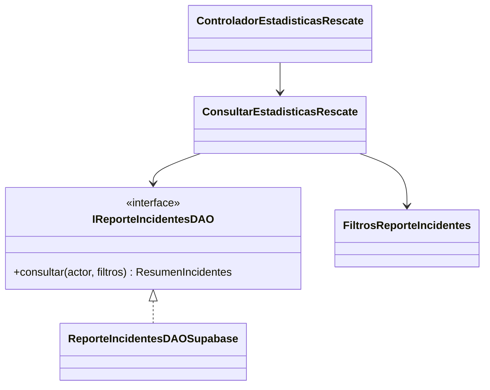

# HU-47 · Consultar estadísticas operativas de rescate

Responsable de la historia, John. Issue [#49](https://github.com/ArianaBlanco06/TrekSafe/issues/49).
Rama `feat/hu-47-estadisticas-rescate`.

## Fase 1 · Alcance y dependencias

La historia permite a un rescatista consultar conteos de incidentes por rango de
fechas, zona y resultado de cierre. La pantalla debe explicar qué fecha se utiliza
para el rango y mostrar incidentes atendidos, abiertos y cerrados.

Comprobación actualizada el 13 de noviembre de 2026 sobre `develop` y la rama de
John en `7a22acd7a2f60689c723be8b78a253c8237dbafa`.

- HU-41 está integrada. La migración 019 conserva la bitácora por incidente.
- HU-42 está integrada mediante el [PR #126](https://github.com/ArianaBlanco06/TrekSafe/pull/126).
  Su último commit, `1980d1133540caf9d734e663b42b92f2783b179c`, está incorporado
  en esta rama. El catálogo `ResultadoRescate` y la migración 025 están disponibles.
- La base local de HU-47 coincide con el `develop` comprobado. Se cumple la
  dependencia de integrar HU-41 y HU-42 antes de implementar el reporte.
- Esta comprobación describe el código. No confirma la aplicación de la migración
  025 en el Supabase DEV compartido.

## Criterios de aceptación

| Criterio | Resultado esperado | Evidencia prevista |
| --- | --- | --- |
| CA-01 | Filtros de fechas, zona y resultado aplicados dentro del alcance autorizado | Casos con y sin coincidencias, permisos y límites temporales |
| CA-02 | Cada incidente se cuenta una vez con varias entradas y cambios de responsable | Incidentes con bitácoras extensas y relevos |
| CA-03 | Conteos de atendidos, abiertos y cerrados y criterio de fechas visible | Respuesta agregada de la API y pantalla del reporte |

Los datos del reporte serán agregados operativos y filtros aplicados. La consulta
seleccionará únicamente los campos necesarios para contar y filtrar.

## Decisiones confirmadas por John

1. El reporte permitirá elegir entre fecha de apertura y fecha de cierre. El
   criterio seleccionado aparecerá junto al rango aplicado y en la respuesta de
   la API. La apertura se consultará mediante `incidentes.abierto_en`; el cierre,
   mediante `incidentes.cerrado_en`, conforme al contrato vigente de incidentes.
2. Cualquier rescatista con perfil validado podrá consultar las estadísticas del
   conjunto global de incidentes que cumpla los filtros seleccionados. El backend
   comprobará el rol del JWT y la existencia del perfil validado.
3. John confirmó utilizar el catálogo de cuatro resultados del PR #126,
   registrado en la sección de contrato. La validación de Marko sigue pendiente.

Al seleccionar la fecha de cierre, el rango se aplicará a los incidentes con
`cerrado_en` dentro del intervalo. En ese conjunto, el conteo de abiertos será
cero. Al seleccionar apertura, los incidentes se incluirán por su fecha de apertura
y los conteos reflejarán su estado operativo al consultar.

HU-48 reutilizará la selección de fecha y el mismo alcance autorizado del reporte.

## Definiciones propuestas para validar

- Un incidente atendido corresponde a una fila de `incidentes`, creada al asumir
  la coordinación. Se agregan los incidentes que cumplen los filtros del reporte.
- Abiertos comprende los estados `abierto` y `localizado`, que siguen pendientes
  de cierre operativo. Cerrados corresponde al estado `cerrado`.
- Para un mismo conjunto filtrado, atendidos equivale a abiertos más cerrados.
- Un filtro de resultado de cierre selecciona incidentes con ese resultado y,
  por tanto, solo incidentes cerrados. Sus conteos de abiertos serán cero.
- La zona se obtiene del destino declarado de la expedición, conforme al filtro
  existente de la consola. Su interpretación debe figurar junto al control.
- El rango de días incluye el día inicial y final. En la fase 2 se adopta UTC
  como zona horaria explícita del reporte. Se convierte a un intervalo de
  instantes con extremo final exclusivo; la pantalla deberá mostrar UTC junto
  con la fecha base. Esta decisión evita depender de la zona del servidor.
- Un rango sin coincidencias devuelve conteos en cero y conserva los filtros
  aplicados para que se pueda explicar el resultado.

Estas definiciones quedan como propuesta de diseño para revisar con John y Marko.

## Contrato de HU-42 revisado

Fuente del contrato, PR #126 de Sebastian, integrado con el commit de merge
`c9a5fc2`. Se comprobó el contrato disponible en la rama local.

| Dato | Definición del PR |
| --- | --- |
| Tabla | `public.informes_cierre_incidente` |
| Relación | `incidente_id` referencia a `incidentes.id` |
| Cardinalidad | `UNIQUE (incidente_id)`, un informe por incidente |
| Resultado | Columna `resultado`, validada con un catálogo de cuatro valores |
| Fecha de cierre | El trigger fija `informes_cierre_incidente.cerrado_en`; la RPC copia ese mismo instante a `incidentes.cerrado_en` |
| Tipo de dominio | `ResultadoRescate`, definido en `domain/value-objects/cierreIncidente.ts` |
| Catálogo de dominio | `RESULTADOS_RESCATE`, exportado desde el mismo archivo |
| Migración integrada | `025_hu42_cerrar_incidente.sql`, requiere 017 y 019 y sus dependencias; se aplica después de 021 |

Catálogo confirmado por John para los filtros de HU-47.

| Valor persistido | Etiqueta |
| --- | --- |
| `localizado_sin_asistencia` | Localizado sin asistencia |
| `asistido_en_terreno` | Asistido en terreno |
| `evacuado` | Evacuado |
| `falsa_alarma` | Falsa alarma |

HU-47 reutiliza el tipo y el catálogo de HU-42 ya integrados en `develop`.
El reporte obtendrá el resultado mediante la relación única con el informe.
La fecha de apertura seguirá siendo `incidentes.abierto_en` y el filtro de cierre
usará `incidentes.cerrado_en`.

El cierre operativo conserva el estado de la expedición. Una misma expedición
puede tener incidentes distintos en sucesivas coordinaciones. Cada id de incidente
se cuenta una vez, aunque varios correspondan a la misma expedición.

El conjunto sin filtro de resultado incluirá también incidentes cerrados históricos
que carezcan de informe. El adaptador conservará esas filas mediante una relación
opcional con el informe. Un filtro de resultado seleccionará los informes que
coincidan con el valor elegido.

Mensaje de coordinación preparado para que John pueda publicar en el PR #126.

> Confirmo por mi parte el catálogo para HU-47: localizado sin asistencia, asistido
> en terreno, evacuado y falsa alarma. El reporte permitirá elegir apertura o cierre
> y cualquier rescatista validado podrá consultar los agregados globales. Reutilizaré
> ResultadoRescate e informes_cierre_incidente, con un conteo por incidente y la fecha
> incidentes.cerrado_en para el cierre. Queda pendiente la validación de Marko.

## Diseño previsto con DAO y SOLID



- SRP. Los filtros validan el criterio. El caso de uso consulta el reporte. El
  adaptador reúne los datos de persistencia. El controlador adapta HTTP.
- ISP. `IReporteIncidentesDAO` expone operaciones de lectura de estadísticas.
- DIP. El caso de uso depende del contrato del DAO. Los adaptadores concretos se
  ensamblan en `infrastructure/composicion`, conforme al backend del PR #119.
- Reutilización. HU-48 utilizará los mismos filtros normalizados y el mismo
  alcance autorizado para obtener sus datos de exportación.

El agregado partirá de `incidentes`. Las relaciones con bitácora, responsables e
informes se resolverán preservando un registro por incidente antes del conteo.
Se seguirá la indicación de HU-41 de contar directamente por incidente o usar
`COUNT(DISTINCT incidentes.id)` cuando una relación pueda multiplicar las filas.

La consulta devolverá agregados calculados sobre el mismo conjunto y una misma
lectura consistente. La definición del adaptador evaluará el cálculo en base de
datos para que los conteos abarquen el conjunto completo del reporte.

## Fases siguientes

1. Contrato y dominio. Implementados en la fase 2 descrita abajo.
2. Backend. Implementado en la fase 3 descrita abajo. John confirmó la numeración
   029 para HU-47; queda pendiente su aplicación coordinada en DEV.
3. Frontend. Implementado en la fase 4 descrita abajo.
4. Integración y evidencia. Completada localmente en la fase 5, incluido PostgREST.
   Falta la aplicación coordinada y validación compartida en DEV.
5. Entrega. Texto de PR preparado en `docs/hu-47/pr.md`. John gestiona Git/GitHub;
   la aceptación funcional de Marko sigue pendiente.

## Fase 2 · Contrato y dominio implementados

- `FiltrosReporteIncidentes` valida días reales en formato `AAAA-MM-DD`, rechaza
  rangos invertidos y conserva una instantánea inmutable. El rango es obligatorio;
  el criterio predeterminado es apertura.
- Ambos días se incluyen mediante `desdeInclusivo` y `hastaExclusivo` en UTC.
  Por ejemplo, del 1 al 13 de noviembre se consulta desde
  `2026-11-01T00:00:00.000Z` hasta antes de `2026-11-14T00:00:00.000Z`.
- La zona se recorta, admite hasta 120 caracteres y vacía significa todas las
  zonas. El contrato pide coincidencia textual literal con el destino, sin
  distinguir mayúsculas. Los caracteres `%` y `_` no representan comodines.
- El resultado es opcional y reutiliza `RESULTADOS_RESCATE` de HU-42. Un valor
  vacío o desconocido se rechaza; para todos los resultados se omite el filtro.
- `IReporteIncidentesDAO.consultar(rescatistaId, filtros)` define una operación
  de lectura para rescatistas validados y alcance global. El actor proviene de la
  sesión del servidor. El adaptador deberá comprobar el perfil validado.
- `ResumenIncidentes` contiene solo atendidos, abiertos y cerrados. Se exige
  una misma lectura consistente, enteros seguros no negativos y
  `atendidos = abiertos + cerrados`, incluso para el conjunto vacío.
- El contrato exige contar cada incidente una vez, independientemente de sus
  notas, relevos o de compartir expedición con otro incidente. La consulta SQL
  y su validación con persistencia real corresponden a las fases siguientes.

Validación de esta fase: 14 pruebas de dominio aprobadas. Cubren rango de un día,
extremos inclusivos, cambio de mes/año, años bisiestos, fechas inexistentes,
criterios inválidos, normalización de zona, catálogo de HU-42 e inmutabilidad.

El dominio y el DAO no dependen de Express, Supabase ni de adaptadores concretos.
La siguiente fase implementará el caso de uso, la autorización, el agregado de
persistencia y el endpoint. Cualquier migración nueva necesita coordinación de
numeración antes de aplicarse. No se ha modificado Supabase en esta fase.

## Fase 3 · Consulta del backend implementada

`ConsultarEstadisticasRescate` valida la estructura de entrada, crea los filtros
de dominio y depende de `IReporteIncidentesDAO`. El adaptador
`ReporteIncidentesDAOSupabase` invoca una sola RPC y verifica que los tres conteos
sean enteros seguros no negativos y que `atendidos = abiertos + cerrados`.
El controlador solo adapta la sesión y la consulta HTTP; la composición concreta
se mantiene en `infrastructure/composicion/servicios.ts`.

### Endpoint

```http
GET /api/rescate/estadisticas?fechaDesde=2026-11-01&fechaHasta=2026-11-13&criterioFecha=apertura
Authorization: Bearer <token propio de TrekSafe>
```

| Parámetro | Contrato |
| --- | --- |
| `fechaDesde` | Día inicial obligatorio en `AAAA-MM-DD` |
| `fechaHasta` | Día final obligatorio, incluido completo |
| `criterioFecha` | `apertura` por defecto o `cierre` |
| `zona` | Opcional, destino declarado, texto literal sin distinguir mayúsculas |
| `resultado` | Opcional, uno de los cuatro resultados de HU-42; omitir para todos |

Las claves adicionales, parámetros repetidos y objetos se rechazan con 400.
El actor siempre sale del JWT del servidor; no se acepta `rescatistaId` del cliente.
Respuesta de ejemplo para un conjunto ficticio de cinco incidentes:

```json
{
  "resumen": { "atendidos": 5, "abiertos": 2, "cerrados": 3 },
  "filtros": {
    "fechaDesde": "2026-11-01",
    "fechaHasta": "2026-11-13",
    "criterioFecha": "apertura",
    "zona": null,
    "resultado": null,
    "zonaHoraria": "UTC",
    "desdeInclusivo": "2026-11-01T00:00:00.000Z",
    "hastaExclusivo": "2026-11-14T00:00:00.000Z"
  }
}
```

La respuesta solo contiene conteos y filtros. No entrega nombres, identidades,
bitácoras, resúmenes de cierre, contactos ni datos médicos. En conjunto vacío se
conservan los filtros y los tres conteos son cero.

| Situación | HTTP |
| --- | --- |
| Token ausente, inválido o expirado | 401 |
| Rol senderista | 403 `PROHIBIDO` |
| Rol rescatista sin perfil validado | 403 `RESCATISTA_NO_VALIDADO` |
| Filtros inválidos | 400, con código de dominio cuando corresponda |
| Error de base, transporte, RPC ausente o conteos inválidos | 500 `REPORTE_NO_DISPONIBLE` |
| Consulta correcta, incluso vacía | 200 |

Todas estas respuestas conservan `Cache-Control: no-store`. Un fallo de consulta
no se presenta como un reporte vacío ni como éxito. Los errores de persistencia
no exponen mensajes ni detalles internos.

### Persistencia y migración

`029_hu47_estadisticas_incidentes.sql` define
`treksafe_consultar_estadisticas_incidentes` y dos índices para apertura y cierre.
John confirmó que el número 029 está libre para HU-47. Su aplicación en DEV
se coordina con Sebastian y Ariana; esta fase no ha aplicado nada en Supabase DEV.

La función requiere 017 y 025 con sus dependencias. Usa `SECURITY INVOKER`,
`search_path` vacío, `STABLE`, ejecución exclusiva para `service_role` y valida
el rol persistido y la existencia del perfil de rescatista. Los filtros y los
tres conteos se evalúan en el snapshot del statement. El agregado parte de
incidentes, une la expedición una vez y usa `EXISTS` para resultado. Cuenta todos
los incidentes, incluso más de mil, sin descargar páginas a la API.

### Validación local de esta fase

- TypeScript del backend aprobado.
- Suite completa de backend: 1.031 pruebas aprobadas, cero fallos. Las suites de
  integración condicionadas a sus propios entornos PostgreSQL no se activaron.
- 20 pruebas nuevas del caso de uso, adaptador y HTTP. Cubren sesión, perfil
  rechazado por el DAO, alcance global, estructura de respuesta, validación,
  errores de transporte/base, conteos inválidos y cabeceras de privacidad.
- 13 comprobaciones separadas en PostgreSQL 18 local real, ejecutadas con
  `node backend/scripts/test-hu47-postgres.mjs --pg-bin "C:\Program Files\PostgreSQL\18\bin"`.
  Se aplicaron el esquema y las migraciones reales 000, 002, 017, 019, 021, 025 y
  029 únicamente en `treksafe_hu47_desechable`. Los fixtures son ficticios.
- La suite SQL comprobó extremos de fecha, mayúsculas y caracteres `%`/`_` literales,
  cierre con/sin informe, ceros, varias notas y relevo usando las RPC reales de
  HU-41/HU-40, dos actores validados, actores rechazados, filtros directos inválidos,
  permisos, 1.205 incidentes de volumen, lectura en transacción `READ ONLY`,
  instantáneas sin cambios y registro/rechazo de segunda aplicación de 029.

La instancia temporal quedó detenida. El runner no lee `.env` ni se conecta a
Supabase. En esta fase se probaron HTTP y adaptador con dependencias simuladas,
y el SQL con PostgreSQL real por separado. La fase 5 amplía ese alcance mediante
el recorrido completo por PostgREST y navegador; DEV sigue pendiente.

## Fase 4 · Pantalla del rescatista

La ruta protegida `/rescatista/estadisticas` está disponible en la navegación
inferior. El formulario permite apertura/cierre, ambos días, texto de destino y
los cuatro resultados de HU-42. El rango inicial comprende hoy y los 29 días
anteriores, calculados en UTC.

`services/estadisticasRescate.ts` construye la consulta autenticada sin caché.
`useEstadisticasRescate` administra solicitudes, error, reintento y el último
reporte correcto; el componente de página se ocupa del formulario y presentación.
La lógica de fechas está separada y el catálogo de resultados reutiliza HU-42.

El resumen muestra los filtros de la respuesta del servidor. Editar el formulario
no altera esos metadatos y se indica si hay filtros sin aplicar. Durante una
actualización se conserva la consulta anterior identificada como tal. Un fallo
de red/base ofrece reintento sin presentar ceros como éxito; un 401/403 retira el
reporte anterior. El hook descarta respuestas de solicitudes superadas y de un
componente desmontado. El cliente API también comprueba el ámbito de sesión.

La pantalla distingue vacío y error, explica abiertos/localizados/cerrados y
muestra UTC de forma visible. A 320 px las fechas se apilan para evitar recortes.
No se añadió exportación CSV; HU-48 podrá reutilizar los filtros y alcance.

## Fase 5 · Integración y entrega local

Además de las pruebas de la fase 3, se agregaron 13 pruebas frontend de servicio,
calendario y pantalla. La suite completa terminó con 260 aprobadas y 2 omitidas,
sin fallos. TypeScript de aplicación/pruebas/Playwright y el build PWA aprobaron.

El runner SQL admite `--postgrest <binario> --with-browser`. Ese modo usa un
PostgREST nativo real, un proxy que adapta únicamente el prefijo `/rest/v1`, el
SDK Supabase de producción, las rutas y el DAO reales del backend, el build PWA
y Edge con Service Worker activo. Los diez escenarios del flujo completo se
aprobaron y generaron [capturas y evidencia](../evidencias/hu-47-local/evidencia.md).
El conjunto del día contiene 1.212 incidentes ficticios, incluidos los 1.205 de
volumen. Se comprobaron filtros, permisos, reintento ante retirada real de un
privilegio en la base local, offline sin fallback, ausencia de caché API,
pantallas de 320/390/1.280 px y persistencia sin cambios por las consultas.

Se comprobó DEV en solo lectura con el registro de migraciones. Respondió 200
para el proyecto `ibnwggvqgjpeqcretjak`; 017/019/021/025 estaban registradas y
029 no estaba registrada. La implementación y validación local están terminadas.
John ya confirmó la numeración 029 como libre. El cierre compartido requiere
aplicar la migración nueva coordinadamente, adjuntar prueba en DEV y obtener
aceptación de Marko.

John dispone del [texto para el PR](pr.md), con `Closes #49` y pendientes
explícitos. No se realizaron acciones de Git/GitHub ni cambios de esquema/datos
en Supabase DEV.
