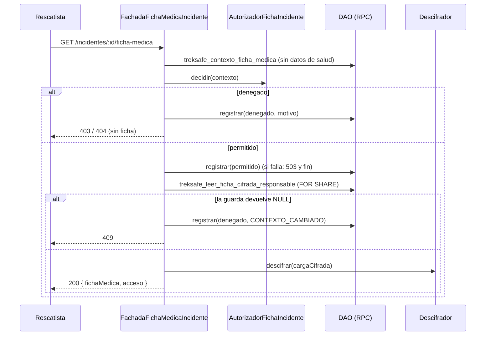

> **Estado:** implementado y verificado en local. Las decisiones D1 a D11 son valores por defecto pendientes de validar con Marko; D3 y D11 también con Jhon. Aplicación DEV de la 029 pendiente de Ariana.

# HU-50: restringir la ficha médica al responsable vigente

Como senderista que firmó el consentimiento, quiero que mi ficha médica solo la vea el rescatista que coordina mi incidente mientras esté abierto, para que ningún otro rescatista, ni un correo, ni un rescatista anterior pueda leer mis datos de salud.

**Criterios de aceptación y trazabilidad a pruebas**

| CA | Enunciado | Pruebas principales |
|---|---|---|
| CA-01 | Solo el responsable vigente de un incidente abierto, con consentimiento vigente, accede a la ficha; el servidor decide antes de descifrar. | `AutorizadorFichaIncidente.test.ts` (un caso por motivo y precedencias); `FachadaFichaMedicaIncidente.test.ts` (orden `contexto → auditar → leerCifrada → descifrar`, 0 lecturas y 0 descifrados al denegar, 20 consultas de un no responsable); SQL casos 4, 5, 6, 7 y 8; contrato del DAO; concurrencia (a), (b), (b2), (b3); `rutasFichaMedicaIncidente.test.ts` |
| CA-02 | Cada consulta, permitida o denegada, queda auditada con actor, incidente, resultado, motivo y hora del servidor, sin datos de salud; si no se puede auditar, la ficha no se muestra. | SQL casos 9, 10, 11 y 12; `FachadaFichaMedicaIncidente.test.ts` (503 fail-closed, el 403 sobrevive a un fallo de auditoría); concurrencia (c) y (d); `hu50Postgres.integration.test.ts` |
| CA-03 | La ficha no viaja por correo ni en el detalle de la alerta. | `rescueAlertEmail.test.ts`; `servicioAlertaRescate.test.ts`; `servicioRescate.coordinacion.test.ts` (sin la clave `fichaMedica`); `rutasFichaMedicaIncidente.test.ts` (`GET /alertas/:id` sin ficha) |
| CA-04 | Al cerrarse el incidente o cambiar el responsable, el acceso termina; un relevo o cierre en medio de la consulta no entrega datos. | SQL casos 6 y 7; concurrencia (a), (b), (b2) y (b3) con sesiones reales; `FachadaFichaMedicaIncidente.test.ts` (relevo, cierre y `CONTEXTO_CAMBIADO`); `FichaMedicaIncidente.test.tsx` |
| ARCO | Las notas libres de avance (HU-34) se anonimizan junto con las rutas. | SQL caso 13; `RepositorioUsuario.arcoNotas.test.ts` |

## Hallazgos que motivaron la HU

1. **Se descifraba antes de autorizar.** `RepositorioUsuario.obtenerFichaMedica` descifraba dentro del repositorio y `ServicioRescate.obtenerDetalleAlerta` lo llamaba para cualquier rescatista validado, devolviendo `fichaMedica` en `GET /api/rescate/alertas/:expedicionId`. La auditoría legada (`auditoria_acceso_medico`) no guardaba resultado ni motivo y tragaba los errores.
2. **El correo conservaba el bloque médico.** `servicioAlertaRescate.ts` ya pasaba `fichaMedica = null`, pero la plantilla imprimía "Ficha médica no registrada", lo que revela si existe una ficha, y mantenía el bloque "Ficha médica (descifrada para emergencia)".
3. **"Revocado" equivale a "sin ficha".** `fichas_medicas.chk_ficha_consentimiento` exige `consentimiento_firmado = TRUE`; hoy el único camino de revocación es el ARCO `eliminar_personal`.
4. **Notas libres de HU-34.** `avances_expedicion.nota` es texto libre y `anonimizarHistorialRutas` no la limpiaba.

## Reglas

| Regla | Decisión |
|---|---|
| Qué es "abierto" | `estado <> 'cerrado'`: `abierto` o `localizado` (D1). Constante `ESTADOS_INCIDENTE_CON_ACCESO_FICHA`. |
| Quién consulta | Solo el responsable vigente, leído de `incidentes.responsable_id`. El relevo (HU-40) lo mueve; el cierre (HU-42) lo termina. |
| Endpoint | `GET /api/rescate/incidentes/:incidenteId/ficha-medica`. `GET /api/rescate/alertas/:expedicionId` ya no devuelve `fichaMedica`: la clave desaparece. |
| Orden | contexto (sin salud) → autorizar (dominio puro) → auditar (siempre) → solo si se permite: leer el texto cifrado con la guarda SQL → descifrar. |
| Fail-closed | Si falla la auditoría de un permitido: 503 sin leer ni descifrar. Si falla la de un denegado: se responde igual con el rechazo y se registra el fallo sin datos. |
| Contexto cambiado | Si la guarda devuelve `NULL` (relevo o cierre en medio): se audita `denegado/CONTEXTO_CAMBIADO` y se responde 409 sin descifrar. |
| Guarda SQL | `treksafe_leer_ficha_cifrada_responsable` bloquea el incidente con `FOR SHARE`: se serializa con el relevo y el cierre, que hacen `UPDATE` de esa fila. La regla completa y los motivos viven solo en `AutorizadorFichaIncidente`. |
| Datos | El tipo de sangre y el texto cifrado salen solo de la guarda; el contexto de decisión nunca los lleva. Se descifra en la aplicación, nunca en la base. |

### Motivos y orden de evaluación

`AutorizadorFichaIncidente.decidir(contexto)` evalúa en este orden y el primero que falla gana:

1. `!actorEsRescatista` → `NO_ES_RESCATISTA`
2. `incidente === null` → `INCIDENTE_NO_ENCONTRADO`
3. estado `cerrado` → `INCIDENTE_CERRADO`
4. `responsableId !== actorId` → `NO_ES_RESPONSABLE`
5. `!consentimientoVigente` → `SIN_CONSENTIMIENTO`
6. en otro caso → permitido (`RESPONSABLE_VIGENTE`)

`CONTEXTO_CAMBIADO` no sale del autorizador: solo la fachada lo produce. El consentimiento se evalúa después del responsable a propósito: un tercero nunca descubre si el senderista tiene una ficha.

### Respuestas HTTP

Ningún rechazo es 401 (el frontend lo interpreta como sesión vencida) y ninguno lleva `fichaMedica`.

| Caso | Status | Cuerpo |
|---|---|---|
| Permitido | 200 | `{ fichaMedica: {tipoSangre, alergias, condiciones, medicamentos}, acceso: {incidenteId, auditoriaId, registradoEn} }` |
| `INCIDENTE_NO_ENCONTRADO` | 404 | `{error:'ErrorAplicacion', mensaje:'Incidente no encontrado', codigo:'INCIDENTE_NO_ENCONTRADO', motivo}` |
| `NO_ES_RESCATISTA`, `INCIDENTE_CERRADO`, `NO_ES_RESPONSABLE`, `SIN_CONSENTIMIENTO` | 403 | `{error, mensaje:'Solo el responsable vigente de un incidente abierto puede consultar la ficha médica autorizada', codigo:'ACCESO_FICHA_DENEGADO', motivo}` |
| `CONTEXTO_CAMBIADO` | 409 | `{error, mensaje:'La coordinación del incidente cambió durante la consulta; vuelve a intentarlo', codigo:'ACCESO_FICHA_CONTEXTO_CAMBIADO', motivo}` |
| Falla la auditoría del permitido | 503 | `{error, mensaje:'No se pudo registrar el acceso; la ficha no se mostró', codigo:'AUDITORIA_NO_DISPONIBLE'}` |
| Falla el descifrado | 500 | `{error, mensaje:'No se pudo leer la ficha médica', codigo:'FICHA_ILEGIBLE'}` (solo se registra la etiqueta) |
| UUID inválido | 400 | `ErrorValidacion` (ZodError), sin auditoría |
| Senderista / sin token | 403 / 401 | Los da el middleware existente |

## Decisiones D1 a D11 (valores por defecto; Marko las valida)

| # | Pregunta | Valor implementado |
|---|---|---|
| D1 | ¿"Abierto" incluye `localizado`? | Sí. Se cambia en `ESTADOS_INCIDENTE_CON_ACCESO_FICHA` y en la guarda SQL. |
| D2 | ¿Qué es "consentimiento revocado"? | Que no haya ficha o que `consentimiento_firmado` sea false. No se crea un endpoint de revocación (sería otra HU). |
| D3 | ¿El 403 expone el motivo? | Sí; no contiene datos de salud y `SIN_CONSENTIMIENTO` solo lo ve el responsable. **Confirmar con Jhon.** |
| D4 | ¿Cuándo se consulta la ficha? | Bajo demanda, con el botón "Ver ficha médica"; cada clic es una fila de auditoría. |
| D5 | ¿Influye el estado de la expedición? | No; solo cuenta el incidente. |
| D6 | ¿Qué pasa con la auditoría ante un ARCO? | Se borra en cascada con la cuenta del senderista. |
| D7 | ¿Hay endpoint para consultar la auditoría? | No en esta HU. |
| D8 | ¿Qué pasa con la tabla legada `auditoria_acceso_medico`? | Se deja de escribir y se conserva (solo un `COMMENT`). |
| D9 | ¿Qué cubre el ARCO de avances? | Solo `avances_expedicion.nota`. `punto_nombre` y `puntos_ruta.nombre` quedan como hueco anterior, informado. |
| D10 | ¿Qué dice el aviso del correo? | "La ficha médica no se envía por correo. Solo el responsable vigente del incidente puede consultarla en TrekSafe." |
| D11 | `tipo_sangre` está en claro en el esquema base | Fuera de alcance; se informa a Jhon. |

## Orden de la consulta y relevo concurrente



```mermaid
sequenceDiagram
    participant A as Responsable A
    participant G as treksafe_leer_ficha_cifrada_responsable
    participant INC as incidentes (fila)
    participant REL as Relevo HU-40 / Cierre HU-42

    REL->>INC: UPDATE responsable = B (toma la fila)
    A->>G: leerSiResponsable(inc, A)
    G->>INC: SELECT ... FOR SHARE (espera)
    REL->>INC: COMMIT
    G->>INC: relee la fila: responsable = B
    G-->>A: NULL (CONTEXTO_CAMBIADO, 409; 0 datos)
    Note over G,INC: B recibe los datos en su propia consulta
```

Todo está probado con sesiones reales en `test-hu50-postgres.mjs`: (a) relevo primero, (b) cierre primero, (b2) la lectura toma `FOR SHARE` y el relevo espera, (b3) 20 rondas simultáneas sin `40P01`, (c) 20 registros de auditoría desde dos sesiones, (d) un error forzado revierte la RPC.

## Tarjetas CRC

| Clase: `AutorizadorFichaIncidente` (`domain/services`) | |
|---|---|
| **Responsabilidades** | **Colaboradores** |
| Decidir si un contexto puede consultar la ficha, con un motivo, en el orden fijo de la regla | `ContextoAccesoFicha`, `DecisionAccesoFicha` |
| Ser puro: sin base, sin auditoría, sin descifrado; nunca produce `CONTEXTO_CAMBIADO` | |

| Clase: `FachadaFichaMedicaIncidente` (`application/services`) | |
|---|---|
| **Responsabilidades** | **Colaboradores** |
| Orquestar contexto → decisión → auditoría → guarda → descifrado en ese orden | `ILectorContextoFichaIncidente`, `ILectorFichaCifradaResponsable`, `IRegistroAccesoFicha`, `IDescifradorFichaMedica`, `AutorizadorFichaIncidente` |
| Traducir cada motivo a su error HTTP (`errorDenegacionFicha`) y aplicar fail-closed | `ErrorAplicacion`, `consultaFichaSchema` |
| No escribir nunca la carga, el texto cifrado ni el tipo de sangre en los registros | |

| Interfaces: `ILectorContextoFichaIncidente`, `ILectorFichaCifradaResponsable`, `IRegistroAccesoFicha`, `IFichaMedicaIncidenteDAO` (`domain/repositories`) y `IDescifradorFichaMedica` (`application/ports`) | |
|---|---|
| **Responsabilidades** | **Colaboradores** |
| Separar tres capacidades (decidir, leer cifrado, auditar) y el descifrado; la auditoría es solo anexado | `FichaCifrada`, `RegistroAccesoFicha` |

| Clases: `FichaMedicaIncidenteDAOSupabase` y `FichaMedicaIncidenteDAOMemoria` (`infrastructure/repositories`) | |
|---|---|
| **Responsabilidades** | **Colaboradores** |
| `...Supabase`: llamar a las tres RPC, validar la forma de la respuesta, normalizar `registradoEn` a ISO UTC; error → 500 sin exponer ni registrar `details` ni `data` | `SupabaseClient.rpc` |
| `...Memoria`: doble de prueba que replica las RPC (contexto sin ficha, guarda, registro con validación del catálogo) y expone `accesos` | contrato `verificarContratoFichaMedicaIncidenteDAO` |

| Clase: `DescifradorFichaMedicaAesGcm` (`infrastructure/security`) | |
|---|---|
| **Responsabilidades** | **Colaboradores** |
| Implementar `IDescifradorFichaMedica` delegando en `desencriptarCargaUtilMedica` (sin cambiar algoritmo ni clave) | `encryption.ts` |

| Clases: `FichaMedicaIncidente.tsx`, `lib/fichaMedicaIncidente.ts` (frontend) | |
|---|---|
| **Responsabilidades** | **Colaboradores** |
| `FichaMedicaIncidente`: sin ser responsable, mensaje y ninguna llamada; si lo es, botón "Ver ficha médica", los cuatro campos y "Ocultar ficha"; un error borra lo mostrado; los datos solo viven en el estado | `services/fichaMedicaIncidente.ts` |
| `lib`: mensajes por motivo y `mensajeErrorFicha` (0 sin conexión, 503 auditoría, motivo conocido, genérico) | `ErrorClienteApi` |

## Migración 029

| Archivo | Contenido |
|---|---|
| `029_hu50_ficha_medica_responsable.sql` | Tabla `accesos_ficha_medica` con RLS, índices, 4 triggers (hora del servidor y solo anexado) y `GRANT SELECT, INSERT` a `service_role`; `GRANT UPDATE (version) ON incidentes` (aditivo); RPC `treksafe_contexto_ficha_medica`, `treksafe_leer_ficha_cifrada_responsable` y `treksafe_registrar_acceso_ficha_medica` (todas `SECURITY INVOKER`, `search_path` vacío); RPC ARCO `treksafe_anonimizar_notas_avance` (`SECURITY DEFINER`); `COMMENT` en la tabla legada; registro en `treksafe_migraciones`. Requiere el esquema base, `016` y `017`. Aplicar una sola vez, después de `021` y `025`. |

- **FK de la auditoría:** solo `senderista_id → usuarios ON DELETE CASCADE`. `incidente_id`, `expedicion_id` y `actor_id` no llevan FK: se audita también un incidente inexistente y la auditoría no impide borrar incidentes ni perfiles. El `DELETE` solo se permite en la cascada del ARCO (la cuenta del senderista ya no existe); un `DELETE` directo, un `UPDATE` o un `TRUNCATE` dan `ACCESO_FICHA_INMUTABLE`.
- **`CHECK`s:** `chk_accesos_ficha_coherencia` (permitido ⇔ `RESPONSABLE_VIGENTE`) y `chk_accesos_ficha_permitido_completo` (un permitido siempre tiene expedición y senderista).
- **ARCO como `DEFINER`:** `service_role` no tiene ningún privilegio sobre `avances_expedicion` (la 016 solo expone RPC definidoras); mismo patrón y mismo `search_path = pg_catalog, pg_temp` que esas RPC. Solo `service_role` ejecuta.
- **Aplicación (Ariana):** una sola vez, **después de la 021 y la 025**; recargar el esquema de PostgREST (4 RPC); comprobar `SELECT has_table_privilege('service_role','public.accesos_ficha_medica','UPDATE');` (debe dar `false`). Anotarlo en `REGISTRO_APLICACION.md` (esta HU no lo toca). No se aplicó en ningún entorno remoto.

## Privacidad

- La auditoría no tiene columnas médicas (lo comprueba el caso SQL 12) y su `to_jsonb` no contiene el tipo de sangre ni el texto cifrado de prueba.
- El contexto de decisión nunca incluye `tipo_sangre` ni `condiciones_encriptadas` (casos SQL 2 y contrato).
- Los registros (`console.error`) solo llevan etiquetas fijas o `error.message`; nunca `details`, `data`, el texto cifrado, la carga ni el tipo de sangre (lo comprueban `FachadaFichaMedicaIncidente.test.ts` y `FichaMedicaIncidenteDAOSupabase.test.ts`).
- El correo ya no lleva ninguna etiqueta ni valor médico y no revela si hay ficha; muestra el aviso D10.
- El frontend no guarda la ficha en `localStorage`, `sessionStorage`, IndexedDB ni en la caché de la PWA; el servicio usa `cache: 'no-store'` y la ruta está en la prueba de caché privada.
- **Huecos conocidos, informados:** (D11) `tipo_sangre` está en claro en `fichas_medicas`; (D9) `avances_expedicion.punto_nombre` y `puntos_ruta.nombre` no se anonimizan en el ARCO.

## SOLID y DRY

- **SRP:** la regla vive solo en el autorizador; la fachada orquesta; el DAO persiste; el descifrador descifra; el controlador adapta HTTP.
- **ISP:** `ILectorContextoFichaIncidente`, `ILectorFichaCifradaResponsable` e `IRegistroAccesoFicha` son interfaces separadas; la fachada depende de las tres y un mismo DAO las cumple.
- **DIP:** dominio y aplicación no importan infraestructura (lo vigila `importaciones.test.ts`); el descifrado es un puerto (`IDescifradorFichaMedica`). Los concretos solo se crean en `servicios.ts`, con un DAO perezoso compartido.
- **LSP:** `verificarContratoFichaMedicaIncidenteDAO` ejecuta los mismos casos contra el DAO en memoria y contra PostgreSQL real.
- **DRY:** los motivos se declaran una vez (`accesoFichaMedica.ts`) y una prueba comprueba que coinciden con el `CHECK` y la RPC de la 029 y con el frontend; el mapa motivo → HTTP está solo en `errorDenegacionFicha`.

## Código de otras HU que se tocó

- **`ServicioRescate` (HU-14/39/43):** firma nueva `(repo, repoAlerta, incidentes, reloj?, estrategias?)`; se quitaron `repoUsuario` y `repoAuditoria`, la lectura y auditoría de la ficha y la clave `fichaMedica` del detalle. Se borraron `application/ports/RepositorioAuditoriaAccesoMedico.ts`, `infrastructure/repositories/RepositorioAuditoriaAccesoMedico.ts` y `domain/entities/AuditoriaAccesoMedico.ts` (sin otros usos).
- **Pruebas de HU-39 y HU-40** (`servicioRescate.coordinacion.test.ts`, `servicioRescate.relevo.test.ts`) y de **HU-43** (`rutasPrioridadRescate.test.ts`, `backend/scripts/test-hu43-integracion.mjs`): solo la firma del constructor. En coordinación, el caso "no consulta la ficha médica" se sustituyó por la comprobación de que el detalle no trae la clave `fichaMedica` ni coincide con el patrón médico.
- **`servicios.ts` y `rutasRescate.ts`:** bloques añadidos y comentados `// HU-50`.
- **`ServicioAlertaRescate` (HU-13/45):** firma nueva `(repoAlerta, repoRescate, correo, repoDespacho, repoOutbox?)` y la plantilla `rescueAlertEmail.ts` sin campos médicos.
- **`RepositorioUsuario.anonimizarHistorialRutas` (HU-18/ARCO):** llama a la RPC de la 029 y devuelve `notasAvanceAnonimizadas`. `obtenerFichaMedica` se conserva: lo usa la ficha propia del senderista (`ServicioUsuario`).
- **Frontend:** `PaginaDetalleAlertaRescate.tsx`, `services/rescate.ts` (se quitó `fichaMedica` del tipo) y `services/usuario.ts` (`notasAvanceAnonimizadas?`).

## Desviaciones respecto al plan

- **Orden de los commits y una prueba:** `domain/value-objects/accesoFichaMedica.test.ts` lee `frontend/src/lib/fichaMedicaIncidente.ts`, que se crea en el commit del frontend; por eso esa prueba se incluyó en ese commit (y no en el de backend) para que el commit 2 y el 3 no tengan una prueba en rojo. No cambia ningún diseño.
- **Pruebas añadidas que el plan no listaba:** `RepositorioUsuario.arcoNotas.test.ts` (orden de la RPC antes de actualizar `expediciones`, conteo, error 500, lista vacía) y los casos de concurrencia (b2), (b3) y (d) del script; el plan pedía (a), (b) y (c).
- **`cache-control: no-store` en la ruta nueva:** no se comprueba en `rutasFichaMedicaIncidente.test.ts` (esa prueba monta solo el router) sino en `cachePrivada.test.ts`, que usa `createApp` y ya incluye la ruta nueva.
- **`has_table_privilege(...,'UPDATE')`:** documentada en el README y verificada en el caso SQL 1 (en lugar de una consulta aparte).
- **Frontend, "un error después de un éxito borra los datos":** con la ficha visible no hay botón de consulta (solo "Ocultar ficha"), por lo que la prueba oculta, vuelve a consultar y comprueba que un error no deja los datos anteriores. El estado se borra también en el `catch` del componente.
- **`test-hu43-integracion.mjs`:** al ejecutarlo regeneró cuatro archivos de `docs/evidencias/hu-43-local` (capturas y `resultado-local.json`); se restauraron con `git checkout` para no mezclar evidencia ajena en este PR.
- **`test:pwa:privacidad`:** el plan esperaba unos 6 fallos; en esta máquina son 9 de 28, **los mismos 9 en `develop` limpio (34deec7)**. Ver `evidencias/resultado-suites.md`.

## Notas para el equipo

| Persona | Aviso |
|---|---|
| Ariana | Aplicar la 029 después de la 021 y la 025, una sola vez, y recargar PostgREST. Anotarlo en `REGISTRO_APLICACION.md`. |
| Fernando | Cambió la plantilla de correo de alerta a rescatistas y la firma de `ServicioAlertaRescate` (ya no recibe `IRepositorioUsuario`). |
| Favio | Se ajustaron las pruebas de HU-39 y HU-40 por la firma de `ServicioRescate`; el contrato de `responsable_id` se mantiene. El relevo mueve el acceso a la ficha. |
| Jhon | Se tocaron las pruebas y el script de HU-43 (solo la firma). Revisar D3 (el 403 expone el motivo) y D11 (`tipo_sangre` en claro). A `test-dep108-postgres.mjs` le falta la 029: es un script ajeno y no se tocó. |
| Marko | Validar D1 a D11. |

## Frontend

- `services/fichaMedicaIncidente.ts` (`consultarFichaMedicaIncidente`), `lib/fichaMedicaIncidente.ts` (motivos, mensajes y `mensajeErrorFicha`), `components/rescate/FichaMedicaIncidente.tsx`.
- `PaginaDetalleAlertaRescate`: con coordinación vigente monta `FichaMedicaIncidente` con `key` = incidente + responsable (un relevo remonta el componente y borra la ficha mostrada) y `esResponsable = coordinacion.esMia`; sin coordinación, "La ficha médica solo está disponible para el responsable de un incidente abierto."

## Verificación

Resumen; el detalle con la salida real está en `evidencias/resultado-postgres.md` y `evidencias/resultado-suites.md`.

| Evidencia | Resultado |
|---|---|
| Suite SQL de HU-50 (`hu50_ficha_medica_responsable.test.sql`) sobre PostgreSQL 17.6 desechable | 14 de 14 casos |
| Regresión: suites SQL de HU-42 y HU-41 tras la 029 | 13 de 13 y 16 de 16 |
| Concurrencia con sesiones reales (`test-hu50-postgres.mjs`) | 6 de 6 casos |
| Suite TypeScript sobre Postgres real | 17 de 17 pruebas |
| `test-hu50-postgres.mjs` completo | 50 de 50 casos |
| `test-hu42-postgres.mjs` y `test-hu41-postgres.mjs` (regresión) | 39 de 39 y 23 de 23 |
| `test-hu43-integracion.mjs` | 7 de 7 casos |
| Backend: typecheck, `npm test` y build | Pasan; 1075 pruebas, 0 fallos |
| Frontend: typecheck, `typecheck:tests`, `typecheck:ui`, `test:equipo`, build, `test:ui` | Pasan; 258 pruebas (256 pasan, 2 omitidas anteriores) y 13 de `test:ui` |
| `test:pwa:privacidad` | 9 fallos idénticos a los de `develop` limpio en esta máquina |

Para repetir la suite local: `node backend/scripts/test-hu50-postgres.mjs --pg-bin "C:\Program Files\PostgreSQL\17\bin"` (o sin `--pg-bin` con Docker, puerto 55432). El script solo acepta `127.0.0.1`/`localhost` y bases con "desechable" en el nombre.

**Pendiente para la prueba manual en DEV** (`evidencias/prueba-manual.md`): que el esquema recargado exponga las cuatro RPC, que `error.message` llegue por PostgREST y el flujo completo con dos rescatistas.
